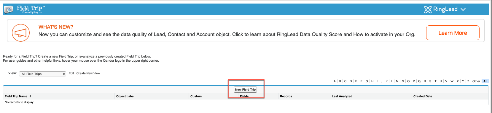
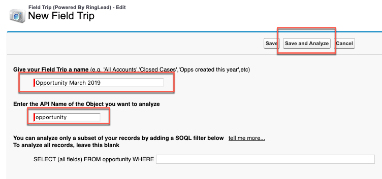
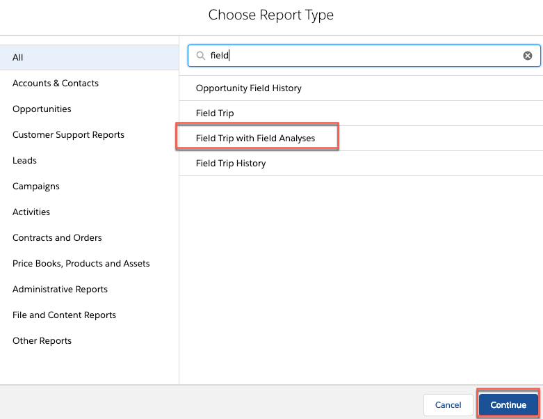
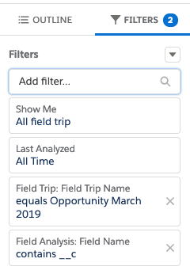
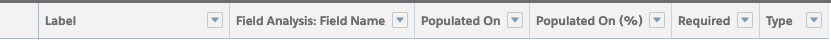
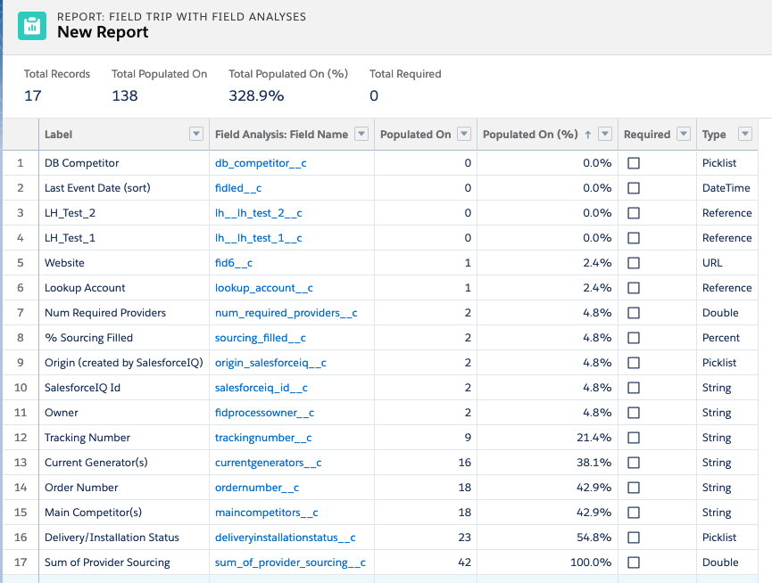

If you have ever found yourself saying that you have too many fields on an object or maybe that you have duplicates on that object, then this is the How-To for you. Field Trip is a free App from the [AppExchange](https://appexchange.salesforce.com/appxListingDetail?listingId=a0N30000003HSXEEA4) designed to allow you to see which fields are used and how often by Object.

Field Trip allows you to filter the usage through SOQL queries if you want to see something more specific.

The example I am going to walk through today is checking out how to see how many fields are in use on the Opportunity object, with the goal in mind of being able to reduce the number post analysis.

First things first, you will need to install Field Trip from the App Exchange. Once that process is complete, continue on with the steps below.

1. Go to App Launcher and click Field Trip
2. Click New Field Trip 
3. For the Name, I always recommend using the Object name and then some sort of time stamp, as you will most likely rerun this in the future. For the Object, merely type the object that you are looking 
4. Click Save and Analyze
5. You will receive an email when the analysis is done. The amount of time will vary based on how many records and how many fields you have

Analysis Part 1:

1. Click on the name of the completed Field Trip analysis to take you to the record page
2. Here you can see the number of fields that were analyzed and the number of records (since I am using a demo org my numbers are very low) 

Analysis Part 2:

1. Now for the exciting stuff. Go to reports, click New Report, and select Field Trip with Field Analyses and hit Continue. 
2. To build this report most beneficially, here are my recommended filters and columns
    1. FILTERS: 
        1. I also recommend filtering out packages you know you are keeping as those are fields you cannot remove
    2. COLUMNS: 
3. After you have built your report, sort the Populated on % column to Ascending, so you see the 0% at the top. 
4. Once you have the report can you clearly see which fields are actively being used.
5. If you combine this with running the Field Layout Analysis from [XLConnector](http://sf9to5.wordpress.com/2017/04/06/review-enabler4excel/), you will be able to see which of those fields hardly in use are also not on any layouts.
    1. This will make your decision-making process about what to get rid of much easier

A couple notes. When you are looking at the custom fields, anything that is a formula that is set to pretty much always fill will have a Populated on % of 100%, so do not be fooled by this if you want to examine your formula fields. If you noticed from my Filters above, I only left custom fields, this is because Salesforce does not allow you to delete Standard fields; therefore you do not need to show the stakeholder who will be making the decision these extraneously.
