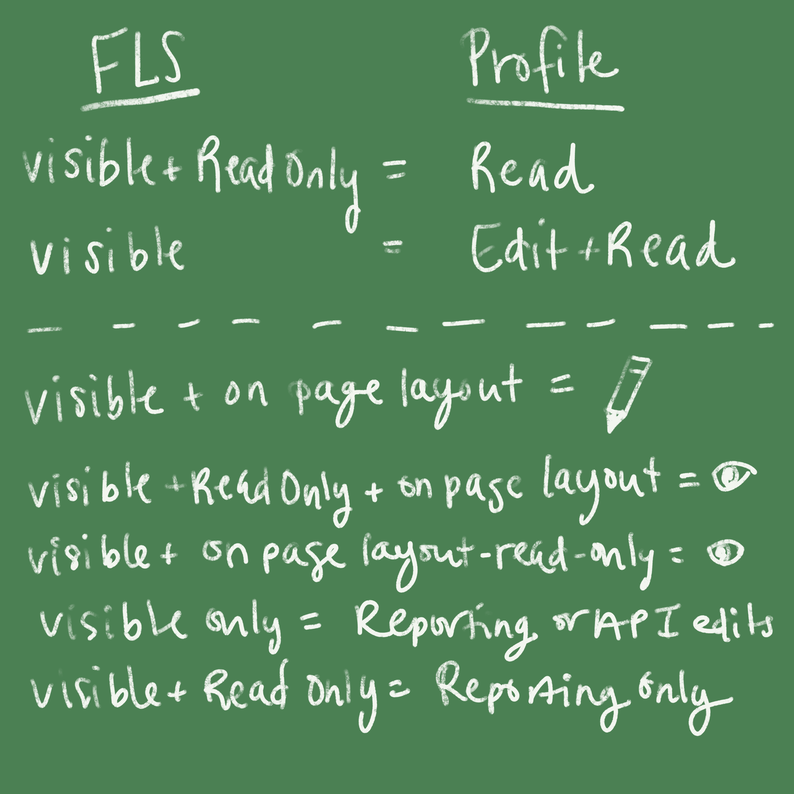

As a precursor to getting into running reports on the data in your system to determine your security level, I am going to review some simple steps for setting up security.

First up is setting Field Level Security for fields on Objects. Setting Field Level Security(FLS) is an essential step in ensuring the security of your data. As noted in the introduction, FLS grants the read and write access to a field.

There are two ways to set FLS. The first method is typically the easiest if you need to update across many Profiles. Go to the Field itself and click the set Field Level Security button. On this page, you have Visible and Read-Only. Visible means that the user has access to the field; it does not necessarily mean that they see it on the layout. Combining Visible with Read-Only is how to ensure the user can see the field, but can only read the data in the field. If Visible is checked by itself, then the user can both edit and read the field. Of course, the user still needs a place to edit it, but not putting something on the layout should not be considered secure.

Similarly, if you want to update on a Profile by Profile bases, you can set the fields by Object in the Profile setup. Here you have the option to set Read and Edit. You need Read to Edit, but you do not need Edit to Read.

For a more visual representation of the information:

Just as crucial to FLS, is Object level permissions. These permissions are addressed on the Profile level. There are six options for Object level permissions, otherwise known as CRUD. There is Create, Read, Update, Delete, Modify All, View All. Modify All and Delete should be kept to particular profiles as this gives many permissions to those who have it. View All is good if you have a Read Only profile that needs to see all of the records for the object, regardless of the Sharing Settings. Setting the Object level only determines the functionality that the user has on the record, it does not determine which fields they have access to (this is FLS), and it does not determine which records the user have access to (this is Sharing Settings).

Since the System Permissions and App Permissions are all True/False based, and there are a high number of them, I will not be digging into these are part of this series. If you are interested in learning more about this, please see the [Salesforce documentation](https://help.salesforce.com/articleView?id=000198725&language=en_US&type=1).

In addition, since this is focused on what can be seen from reporting on Profiles, this series will not be covering Sharing Settings in details. For more information, please check out the [Salesforce Documentation](https://help.salesforce.com/articleView?id=managing_the_sharing_model.htm&type=5).

In this series:

- _[The Ultimate Profile Auditing Guide - Intro](http://sf9to5.wordpress.com/2019/03/19/salesforce-profile-auditing-guide-1/)_
- **The Ultimate Profile Auditing Guide - Setting up Security**
