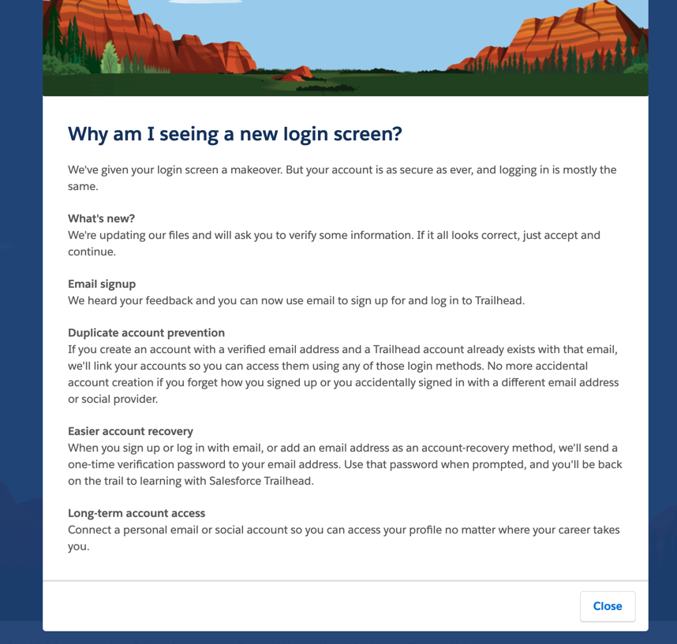
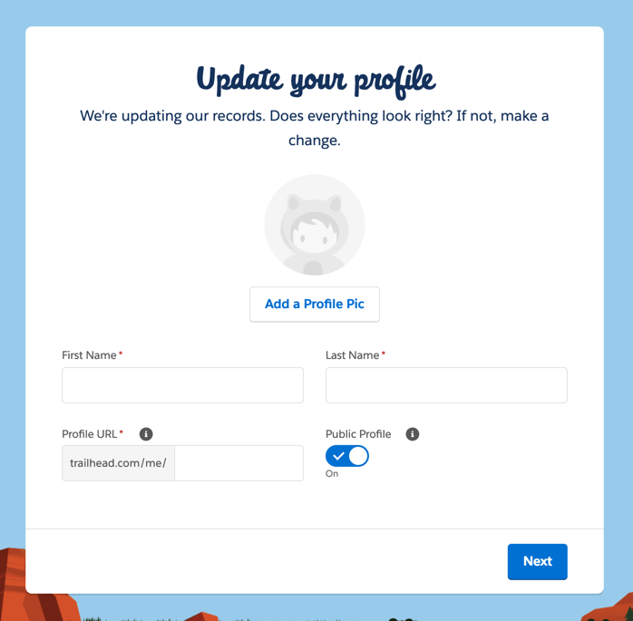
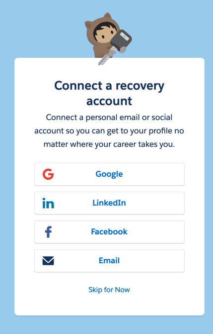

As many of you may have noticed recently when logging into Trailhead the login process has been updated. You may be wondering why this is. A lot of this, while not really explained in the Why image below, is because of the pending updates related to the certification setup connecting with Trailhead. On April 19th, in order to receive or maintain certifications, your Trailhead account needs to be attached to your Webassesor account. As a result, Salesforce wanted to put into place some safeguards to ensure you don't lose the connection or your certs.

As part of the new login process, you verify some of your profile information, including name, Profile URL, and public access.

You are then asked to set up a Recovery Account. This is a really important step, especially if the email address you have associated to either your Trailhead and/or your Webassesor account is a corporate email, you will want to attach a personal email address to the account so you can always be reassured you can gain access. You don't want to lose access to your certs or hard-earned badges.

A couple other benefits noted by Salesforce of this change is that you can now finally create a Trailhead login with an email address rather than having to have a Salesforce developer account. This is a great feature as it helps in preventing account duplication (I have more Salesforce developer orgs than I can count because this didn't exist). Which is, in fact, the second item noted by Salesforce, is that if they find there is more than one Trailhead account associated to your verified email address, they will link it up for you. An added benefit to this! - if you have badges all over the place connected to the same email but were connected to different Trailhead logins, this should help condense them.

Overall, it is a simple experience change, but I think long term it will help greatly. Please keep in mind that [April 19th is THE day that you need to have your Webassesor account and Trailhead account linked](https://trailhead.salesforce.com/help?article=Link-Your-Trailhead-and-Webassessor-Accounts). DONT FORGET!!!
