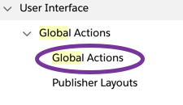
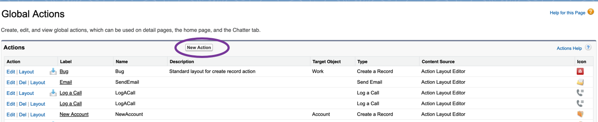
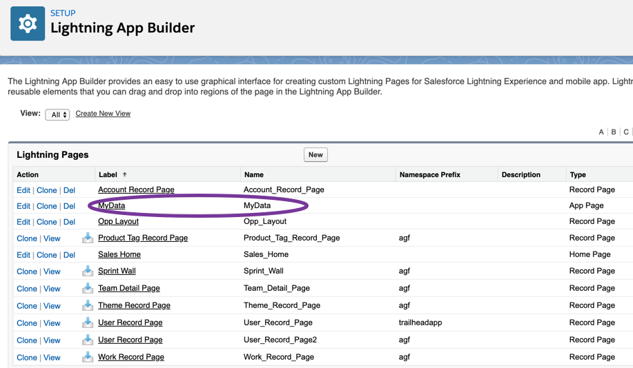
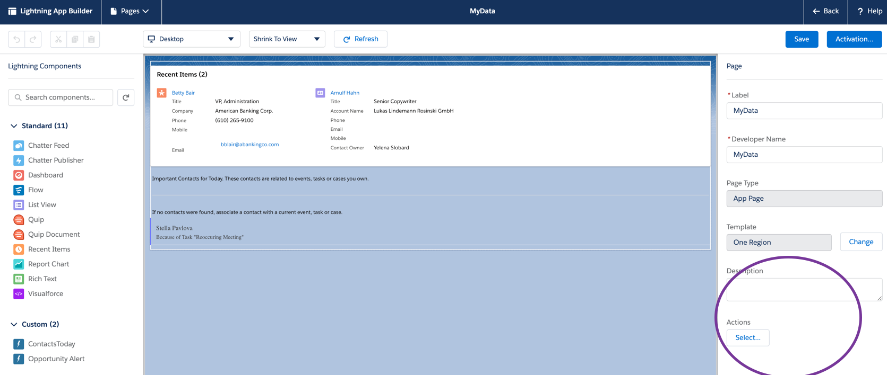
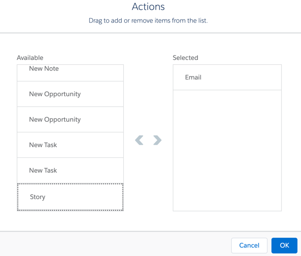
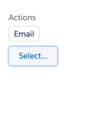
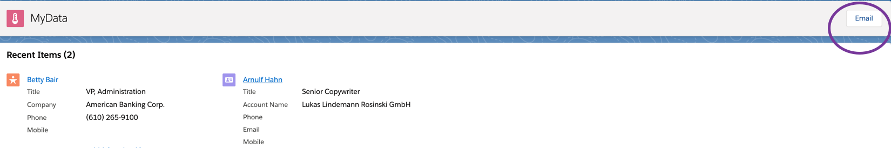

Recently I was playing around in a dev org and decided to create myself a custom app page in Lightning. One of the things that I was interested in doing though was adding a Global Action to that page.

If you don't know what a Global Action is, it is an Action that is not specific to an object in Salesforce. A great example of this is the Send Email action. This allows users to send an Email and use an email template from any record/page that they are on. To see what Global Actions you have available or to create a new one follow these steps:

1. Go to setup --> In the Quick Find look for Global --> Global Actions 
2. From here you can click New Action or Edit or View any existing action 
3. The Send Email is the one I mentioned above and is the one I will use for this example.

So now that we know what Global Actions are, how to access them and how to create them, we can work on adding them to our custom page.

From the Lightning App Builder page, I am going to click Edit next to my custom app:

Once I am taken into the App Builder, I want to make sure that I am on the page itself for the purpose of this edit, and not in one of the components.

You will see when you are on the page, that there is an Actions section in the bottom right-hand corner with a Select button. Click the button to see which actions you can add to the page.

Since I wanted to add the Send Email, I looked for Email which is the label of the action. I used the arrows in the middle to move it over, and then you just need to click Ok here and then click Save again on the page.

You will see in the bottom of the editor that the action was added.

And then when I visit the custom app page, I see the email in the top corner, and I can use that now to send Emails from this page.

