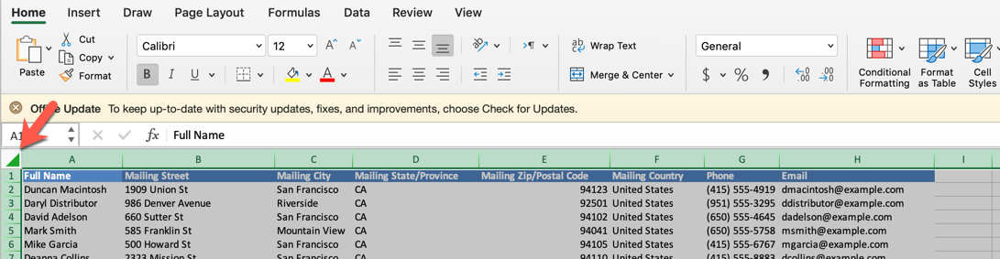
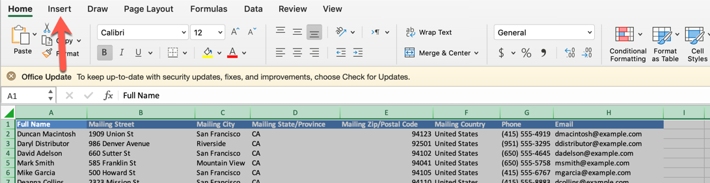
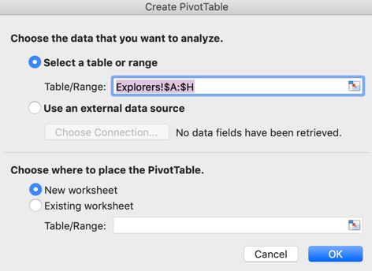
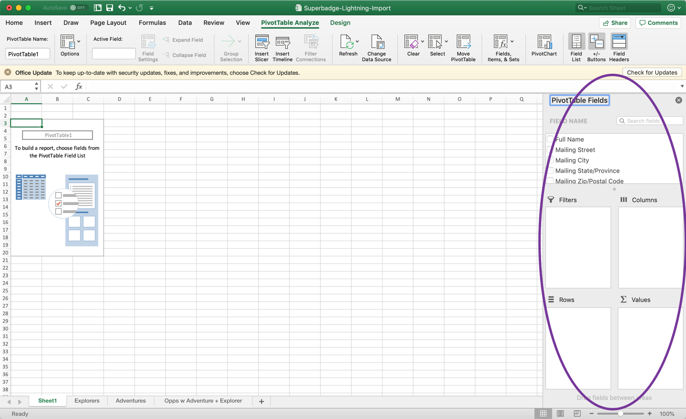
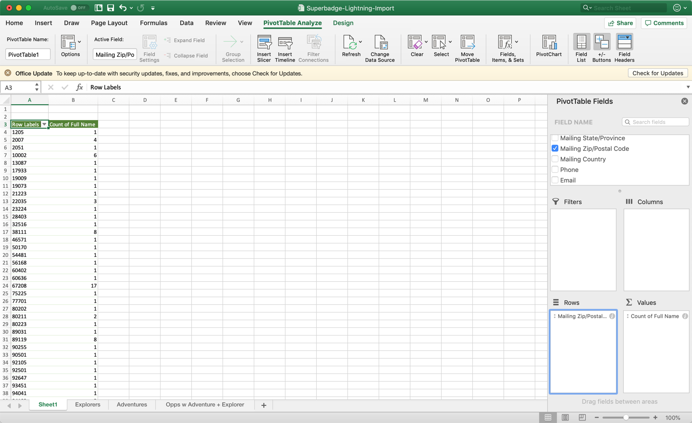

As part of this series, I thought it might be essential to do a quick run-through of how to create a pivot table in Excel. Creating pivot-tables are going to be critical to the next several articles, so this can be used as a tutorial before them. Please note that I am working on Microsoft Excel for Mac 2016. Depending on your OS you may have slightly different configurations, but the end result should be the same.

How to Generate a Pivot Table in Excel

1. Open the file in Excel
2. Highlight from the top left corner to capture all of the data  
3. Go to Insert and select Pivot Table.    
    1. It will ask if you want it on a new sheet - you do  
4. Now you have the empty skeleton of a table.  
5. On the right-hand side pull in the relevant columns and rows. For my dummy example here, I am going to list the Zip Codes and then Count the number of people (records) for each Zip Code.  
6. By dragging the Zip Code to the Rows, it listed out each unique value in that column of data. I then pulled the Full Name into the Values section to Count the number of people who have that Zip Code
7. As a result of the above table, you can now see the data in a more flexible way.
8. One thing to keep in mind is that you can also filter on the columns from here if you want to reduce the amount of data further. You would do this by clicking on the drop-down arrow you see above the Row Label.

Stay tuned for more posts from this Ultimate Profile Auditing Guide and be sure to check out the previous posts:
