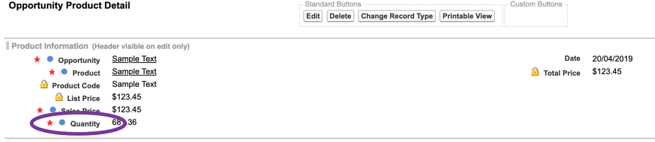
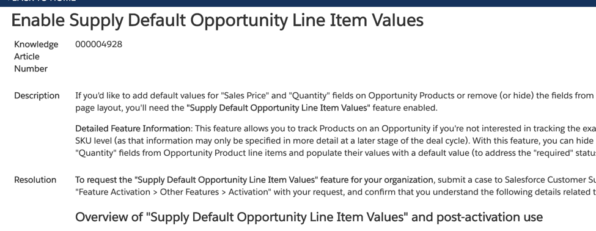
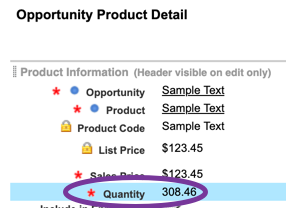

Oh, the world of the little blue dots... If you don't know what I am talking about, I am referring to the small blue dots that show up on page layouts next to fields that Salesforce does not let you take off the page layout. Many times these also have little red stars that mean Salesforce also requires you to fill them out to save the record.

Well, recently these little blue dots and red stars really became an issue, when I had a scenario where standard Products and Opportunity Products were being used (not CPQ), and the desire was to not have to fill out Quantity. But of course, there was a little blue dot and a red star next to this field.

After searching high and low for something to help solve this, an [article](https://help.salesforce.com/articleView?id=000004928&language=en_US&type=1) buried on the internet was found! The article talks about the ability to have a feature switched on by Salesforce that enables you to have Quantity and Sales Price both either removable from the layout or to be able to set a default value for them.

Now, as I already mentioned to get this to work, you do need to reach out to Salesforce to have it turned on for every instance that you are working in (so at least your sandbox that you are building in and then your production environment).

Once this is done though it works great!

While you still see the red star in the image above, if I remove the Quantity from the layout, it no longer requires the user to fill it out.

That's it, the workaround in place and problem solved!
