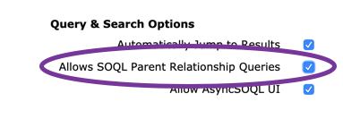

It is time to walk through how to actually perform the audit on the system. As part of this series, several scripts are provided in order for you to gain easy access to the data, as well as, instructions for how to manipulate the data in Excel. Auditing Profiles is not something that can be easily completed within the confines of Salesforce, hence we have provided a means to do it outside.

The first step in this process is to ensure you understand your company’s decision-making process and what data will need to be examined for the audit.

_\*\*This guide does not provide any suggestions, recommendations, or advice on what your company’s setup should be, nor does it adhere to any audit schemas.\*\*_

Once you understand what you are looking for, you can start pulling the data.

To pull the data the easiest recommended tool would be to use [Workbench](https://workbench.developerforce.com/). You will enter the SOQL script (noted below) into Workbench and download the data as a .csv.

Two quick things about Workbench in order for these scripts to work:

1. Make sure you have turned on the Allows SOQL Parent Relationship Queries in the settings tab 
2. Make sure that you have selected the Bulk .csv option to ensure you get a download link

First up of the scripts is the SOQL necessary to pull all of the Object Level Permissions in your system. A good example of this can be determining which Profiles have Delete, Modify All, and/or View All permissions on a specific Object.

Depending on how many objects and how many profiles you have, this script can create quite a large file. So if you are looking for a specific subset of data, I highly recommend filtering down the SOQL statement.

**Pulling the Object Level Permissions**

```
SELECT id,Parent.Profile.Name,ParentId,PermissionsCreate,PermissionsDelete,PermissionsEdit:,PermissionsModifyAllRecords,PermissionsRead,PermissionsViewAllRecords,SobjectType FROM ObjectPermissions WHERE parentid in (select id from permissionset where profileid <> null)
```

 

Next up is the script for pulling field-level permissions. I cannot stress highly enough that you should filter down the Object you want for this. Unless you have a lot of computing power, pulling all fields, by all objects, by all profiles will produce a very large file.

_To do this just add sObjectType = 'ObjectName'_

A good use case for pulling field-level permissions is to check to see who can edit particular fields on particular objects, especially if you have audit-sensitive fields (think credit card numbers) that only certain people should be privy to editing.

**Pulling Field Level Permissions**

```
SELECT id, Parent.Profile.Name, ParentId, PermissionsEdit, PermissionsRead, SobjectType, Field FROM FieldPermissions WHERE parentid in (select id from permissionset where profileid <> null)
```

 

While I am not reviewing the steps for utilizing Workbench, please feel free to contact me or comment on the post with any questions on how to use the tool.

In my next post of this series, I will go through a more live example, including the Excel steps needed to see who has what permissions.
