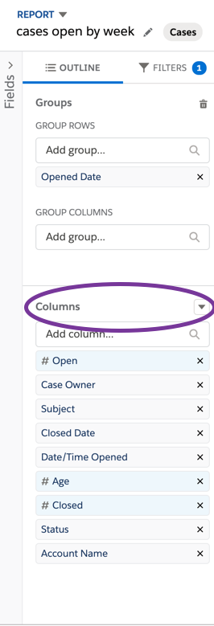
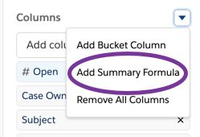
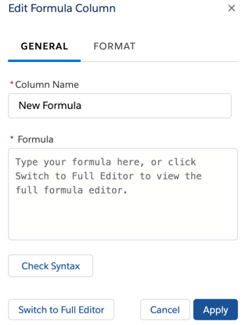
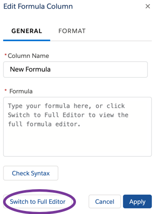
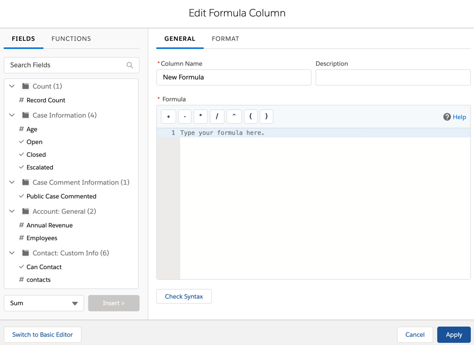
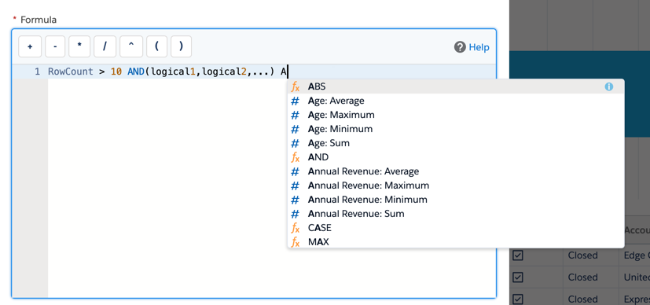
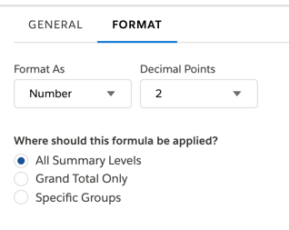

For a while now I have been using the dropdown on the Report Builder to switch the builder into Classic mode anytime I wanted to be able to add a formula to a report. Well, lo and behold, Salesforce did add a formula function to the Lightning Report Builder, and it is quite fancy to boot.

So if you are on a report, click into the Edit section. From here you go to the Columns section and look for the little drop down. 

You see here that there are three options, we are looking for the Summary Formula one. (Although, Bucket Column is also pretty new!) 

When you click the Add Summary Formula, you get a small box that gives you the ability to just go forth and write your formula and give the column a name.

Now I don't know about you, but I don't trust my syntax as far as I can throw it, so you may be wondering where the builder is... You need to click the Switch to Full Editor.

Here is where the fancy lives:

On the left-hand side, you can see all of the fields that you have available to use. The next tab over gives you all of the different formulas. When you find what you are looking for you just click insert and it adds it to the formula section.

If you are interested in typing it out, it will actually start to auto-fill for you:

The tab labeled Format is where you can decide the type of field it will be, as well as, the summary line setup.

There you have it folks, a wonderfully updated formula builder for the newish Lightning Report Builder.
