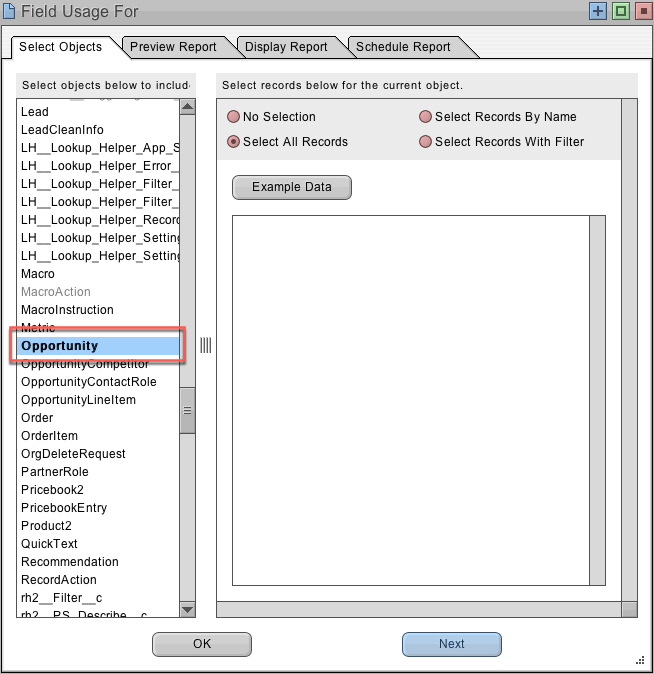
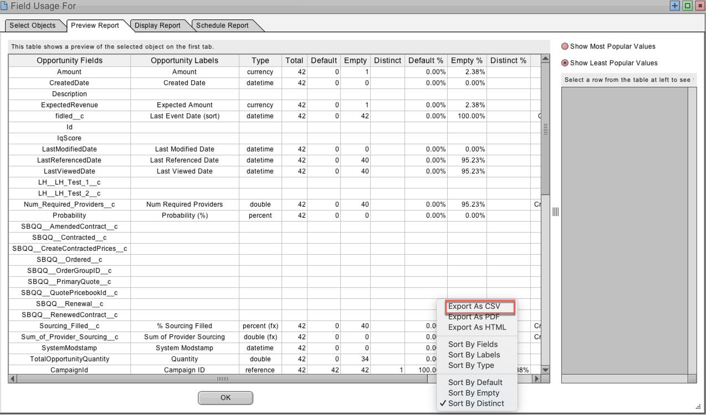
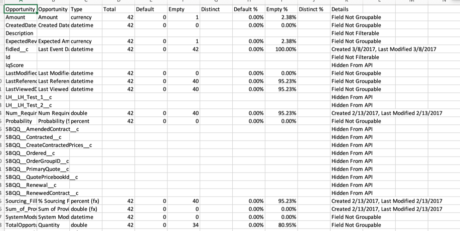
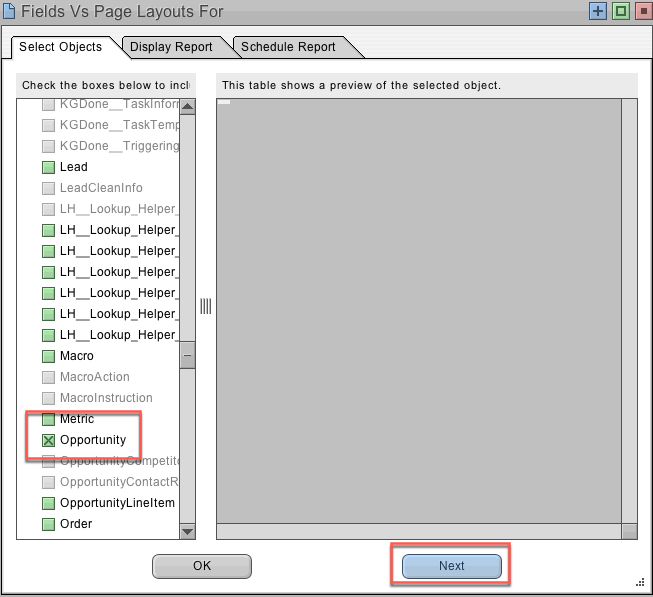
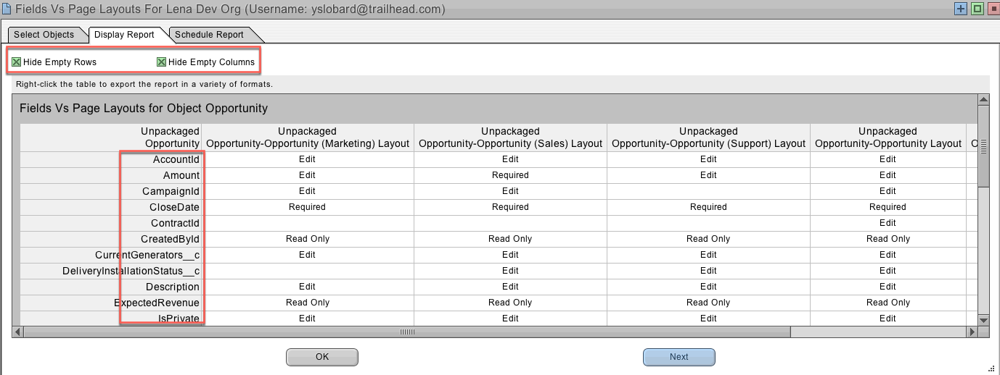
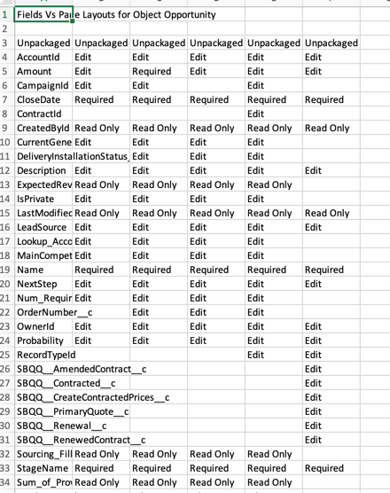
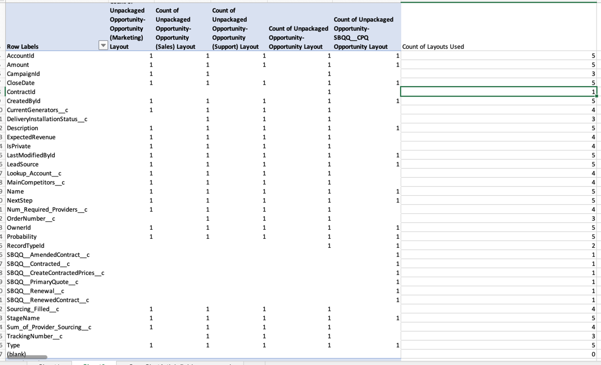
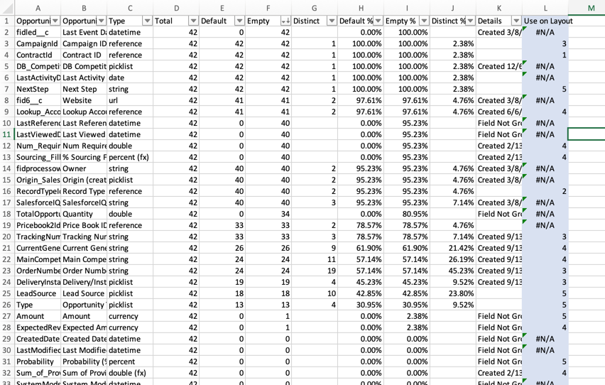
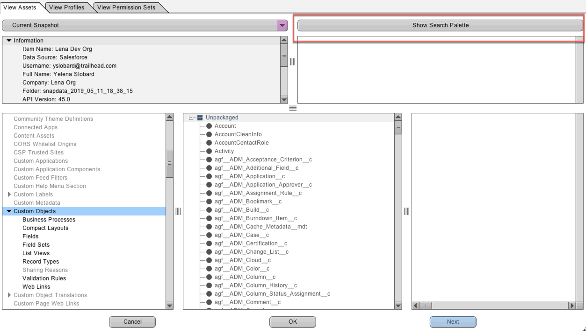

_This is a sponsored post in collaboration with_ [_Metazoa_](https://www.metazoa.com/)_, the developer of the Snapshot Product._

With the push from Salesforce heavily upon all of us to switch from Classic to Lightning, one of the critical things that need to be done to make the transition for your users easier and smoother is to reduce the number of fields both on the page and behind the scenes. Too many fields on a page layout in Lightning has a higher risk of causing the page to take longer to load since everything is on the Browser to make sure things go quickly. Since users are wary of the number of clicks and the time it takes to load, keeping this number down is critical.

With that thought in mind, you might be asking, how do I go about determining which fields should be kept on the layout, but also which fields can be deleted altogether. You may have fields that are on layouts that are never used. You may also have fields that aren’t even on any layouts essentially collecting technical dust.

This post is split up into three parts to demonstrate the different reports you can use from Snapshot to help declutter your Org. Part 1 walks you through the process of sorting through a single object’s fields and the number of times they are filled in. Part 2 examines if a field is on a page layout and combine it with the frequency of population of those fields. Part 3 demonstrates how to determine if a field is used somewhere else in the system so that you can feel safe with your decision to delete it.

**Part 1 - Analysing the number of times a field is used**

After you have taken a snapshot of the instance you are examining (I do recommend examining on Production, but doing the initial cleanup in the sandbox), we can begin by right-clicking on the Snapshot itself.

First, we are going to use the [Field Usage report](https://metazoa.zendesk.com/hc/en-us/articles/360001562172-Field-usage-report). This reports breaks down how often a field is used, if it is using the default value, and also provide you the type of field it is. The type can be relevant because if it is a formula and it is filled out 100% of the time, this can be valuable to dig into more to see if you are using it.

Once in the report, select the Object or Objects that you want to evaluate. I am going to be using Opportunity for this example. _Please bear in mind I am in a demo org with very little going on so you may not see as much as you have in your Org._

 

Then you need to click Next.

Here you see a table of the report. Since we want to combine this with another report later in order to do some manipulation to it, we will need to export it. To do so, right click on the table anywhere and then select **Export As CSV**.

\[caption id="attachment\_2674" align="aligncenter" width="540"\] exported CSV\[/caption\]

For the purpose of this article, we’ll define low-volume usage for a field in which the Empty % column is 100% or some high percentage (the threshold is for you to define). If you want to stop here, you can use the above definition to choose which fields to delete from your system. In part 2 we will look at the way to combine this with layout usage.

**Part 2 - Analysing if a field is on a layout**

In this part, we are going to pull another report and use it in conjunction with the report from Part 1 to get a more defined view of how fields are being used.

To do this, we are going to right click on the SnapShot and then select [**Fields vs. Page Layout**](https://metazoa.zendesk.com/hc/en-us/articles/360001556252-Fields-vs-page-layout-report). This report gives us the fields per layout and tells us what type of permissions each field has on that particular layout.

 

Similar to the previous report, we select the Object that we want to review and then click Next.

In this view, you can right click on the report and click Export As CSV. One note to make is that I have marked the **Hide Empty Rows** and **Hide Empty Columns** at the top of the report. Doing so removes those fields that are not on any layout.

Once in Excel, we can do some manipulations to determine how many layouts a field is on. These changes are an essential first step to combining this with our previously downloaded report (from Part 1).

To do the summation, I used a Pivot Table to get a count of page layouts per field. To get more information on how to do a Pivot Table, please check out my Excel post.

The last column in the above image shows the **Count of Layouts** per field.

We can now do a VLOOKUP from the original report to this Layouts per field report, to display side by side the number of layouts a field is on, next to the frequency of the field usage.

Column L (blue) represents the VLOOKUP formula I did to pull in the Count of Layouts per field. Those rows with a number in Column L, but with a low volume of usage (e.g. row 3) could potentially be eating up valuable real estate on the layout. Consider removing these fields from the user’s view, if you are not able to delete them.

In the same Column, there are several custom fields that are not on any layout (represented by #N/A), consider looking into these for deletion. Continue to Part 3 to learn how to know if the fields are used anywhere else in Salesforce.

**Part 3 - Checking to see if a field is used somewhere**

To begin, right-click on the SnapShot and select View Assets. Before going further, if you care that a field is used in a report and you did not include reports or dashboards in your SnapShot, I recommend that at this time you go back and pull a new SnapShot to include those elements.

In the View Assets screen, there is a Search Palette button in the top right. This button gives you the ability to put in any element and search throughout the SnapShot for anywhere that the element is used. To give you a more in-depth example I pulled a field from a Custom Object rather than the Opportunity object.

Type in the value you are looking for in the text field and then hit Search. The Search tool will find all of the places where that field is used. In this example, if this was a field I was looking to delete, I would probably need to do more research to find out the use cases behind the Workflows and Triggers where that field is used. This is a critical step in the deletion process as it will help you provide clear reasoning as to why a field could or could not be deleted.

Taking on the task of cleaning up fields on an object can appear to be daunting, but with SnapShot available to you, it can make the process a breeze. Again, decluttering fields both on the backend and the frontend is critical for maintaining a clean and efficient system. Users do not want slow pages and do not want to have to scroll through hundreds of fields to find what they need. Moreover, Admins should not be spending extra time trying to figure out what fields are for or if one already exists, you can quickly end up with duplicated fields this way. SnapShot provides you the reports you need to help maintain the system in a scalable way.
