There were some highly anticipated releases in the Summer '19 release for Related Lists, although maybe not entirely as expected. 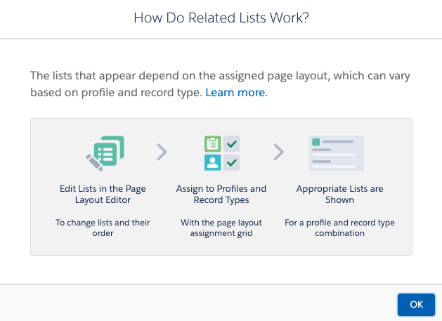

First up are the changes to Lightning Record page selections for the Related List. One of the many requested items was to be able to have more than four columns in a Related List in Lightning, as we did in Classic. To account for this, but also the fact that Related Lists can now sit in different parts of the page, with varying sizes of width, Salesforce now offers three different options for the Related List section. 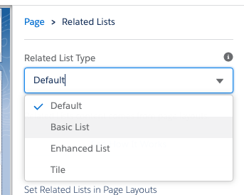

1. Basic List 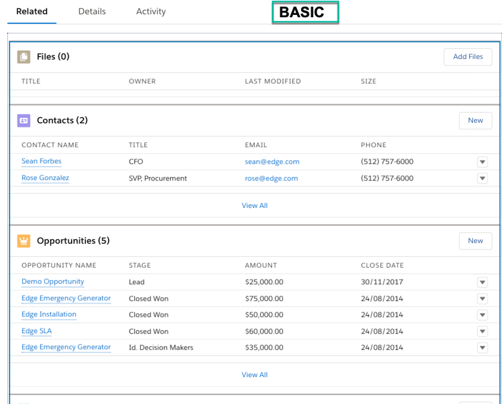
2. Enhanced List 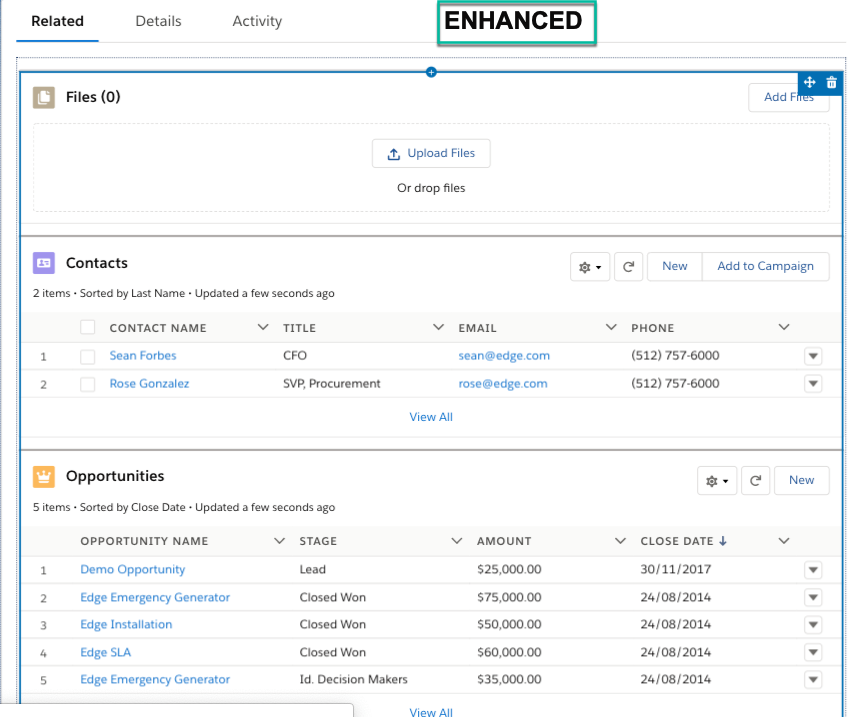
3. Tile 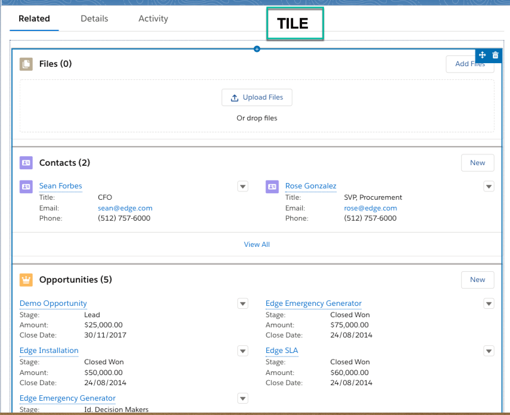

There is also the Default option which chooses the most logical list based on where the Related Lists are situated. As noted in the little information icon, if the Related Lists is a narrow part of the page, you only get the option of Tile View, which means you still cannot have more than three columns displayed. 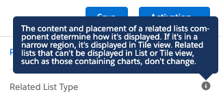

Enhanced List is "newly" available one. From here you can set up to 10 columns (done through the Page Layout), and you can set how many rows to display as well. An added benefit to the Enhanced view is the ability to decided whether or not to show List View actions in the related list. This is bringing us back from some essential functionality from Classic, so I am happy to see this. 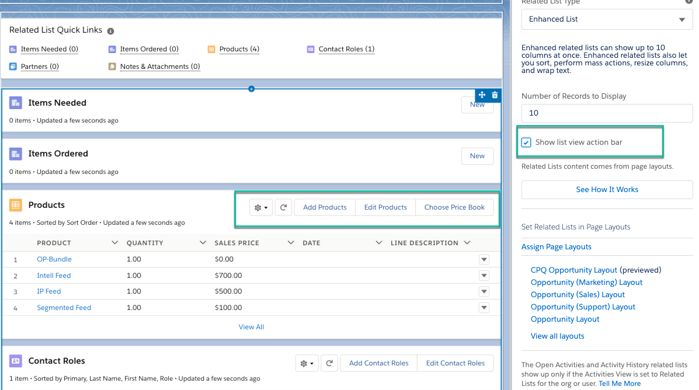

An important note here is that this does not bring back Activities to this section by default. There was another update in Summer '19 to address making the viewing of Activities feel more like Classic. [https://releasenotes.docs.salesforce.com/en-us/summer19/release-notes/rn\_record\_page\_activity\_view.htm](https://releasenotes.docs.salesforce.com/en-us/summer19/release-notes/rn_record_page_activity_view.htm)

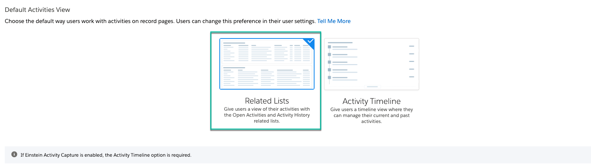

If you update these settings then you can see Open Activities and Activity History and the standard buttons (with Enhanced on) as you did in Classic. 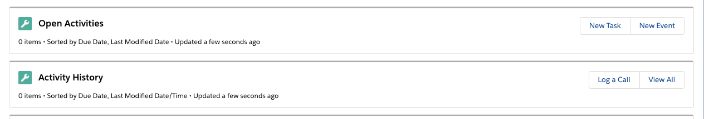

Another small but helpful change that came to Related Lists is you can now change the width of the columns. The width will retain even on refresh; however, Salesforce provides the user to be able to adjust them back to their original width with a click of a button. 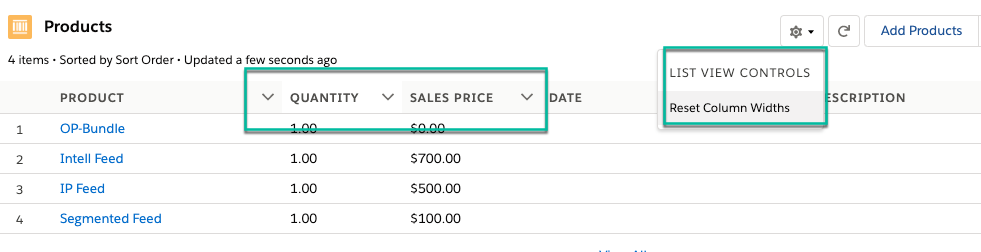

Lastly, and this may not have been what everyone was hoping for, it certainly isn't for me, is the ability to filters Related Lists. On the onset, this seems awesome; however, the filtering part does not persist past your current browser session. So while you can do it for finding something in a very long Related List, you will have to redo it again the next time you want to filter the same list on a different day. Here's to hoping they will still come out with persisting filter functionality.

To filter the Related List, first click on the View All, then click on the filter icon, and then finally you will be able to set the filters for that record. 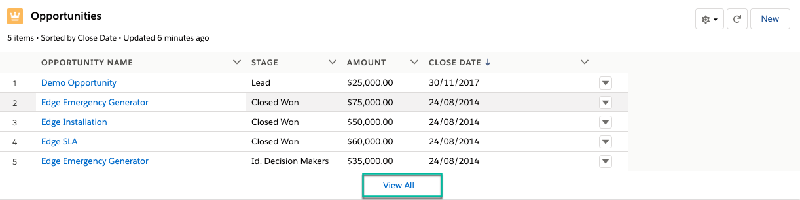

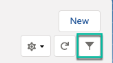

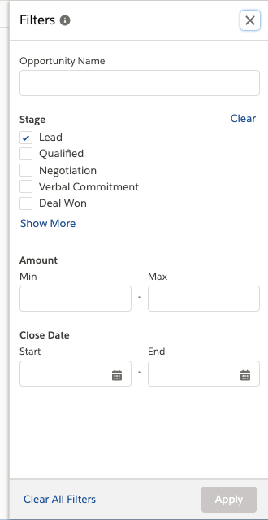
