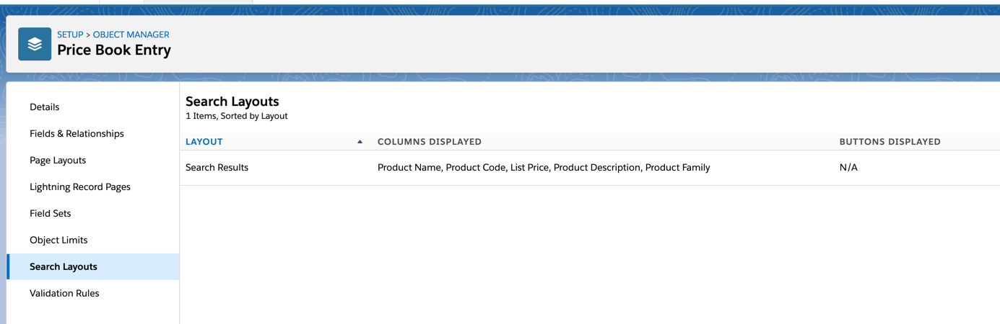

Recently I was asked how to change the Add Products page columns for Standard products - this is the page you get to by clicking "Add Products" in the Opportunity Products related list on the Opportunity record. Despite my best efforts of trying different ways to change it, including Opportunity Product multi-line layout I could not figure out how to make the update.

Digging through the Internet and the many community pages on similar topics, I finally stumbled on the answer. It is so simple to do, but so buried and in a very weird place that no one would ever think to go there.

The answer: go to the Price Book Entry object, click Search Layouts and change the Search Results to display the desired columns. As simple as that!

Short and sweet and I hope it helps you!!
