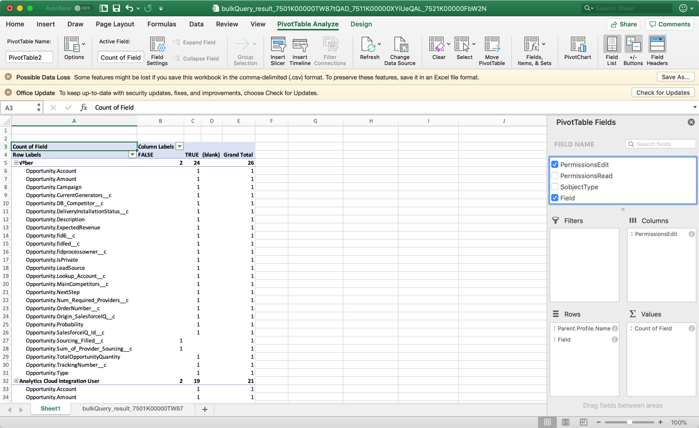
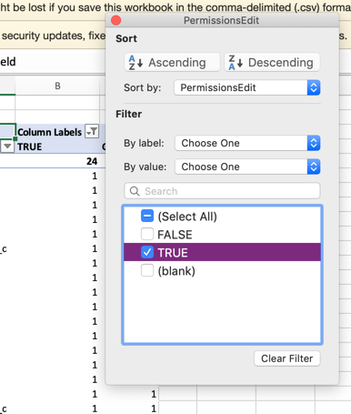
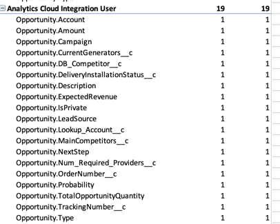
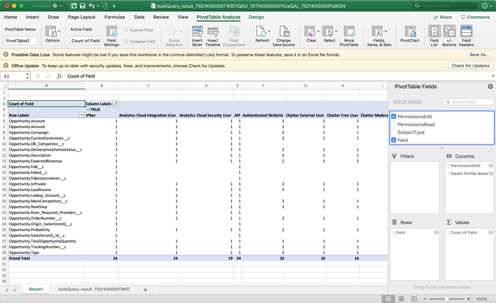

In this last article in the Ultimate Profile Auditing Guide, I will be taking all of the steps we have gone through and be putting it all together.

For this example, the use case goes as follow. I am a newly hired Salesforce Admin, and I have been tasked with finding out all of the fields that users have Edit rights to on the Opportunity object. The goal is to break this down by Profile, rather than as granular as the user level.

To get started the first thing I need to do is my run my SOQL query in Workbench.

```
SELECT id, Parent.Profile.Name, ParentId, PermissionsEdit, PermissionsRead, SobjectType, Field FROM FieldPermissions WHERE parentid in (select id from permissionset where profileid <> null) AND sObjectType = 'Opportunity'
```

Once I have run this I will get a .csv file with the results.

Next is to open the file in Excel and create a pivot table from it.

My setup is going to look as follows: 

I have the Parent.Profile Name as the first row (this shows me the actual name of the profile rather than just an ID). Next, I have the Field in the Rows, this is the information we're interested in. I have the PermissionEdit in the columns because we are interested in where the user has Edit rights. And then lastly I have Count of Field - this is not totally necessary, but I find it makes it easier for filtering and viewing the information.

I now need to add a filter to this to only show me where the Edit permission is EQUAL to TRUE. We do this because we don't care in this case if they don't have Edit rights.

To add the filter, click the dropdown arrow next to the Column Labels and only mark True:



Great, now for the last piece of the puzzle; review each profile section and see if anything is out of place. Or if this is going to some else for a security check, you can save the pivot table and just send them this file.



In case you want an alternative view to one above, you can also use the following setup:



This demonstrates all of the Fields that have a TRUE value for Edit on the left-hand side and then lists the Profiles along the top. Where there is a number, that means that the profile has Edit for that specific field. (Please ignore the 2 in some places, I have duplicate Profiles for some reason in my demo org).

I hope you have found this to be helpful. Please feel free to reach out with any questions on the series.
