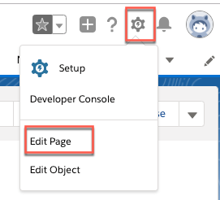
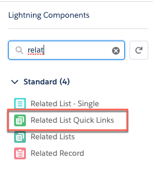
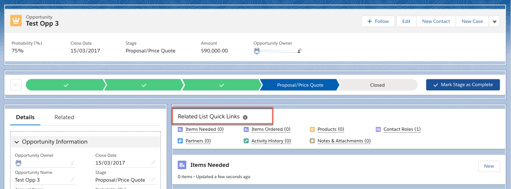
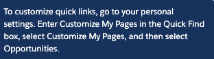
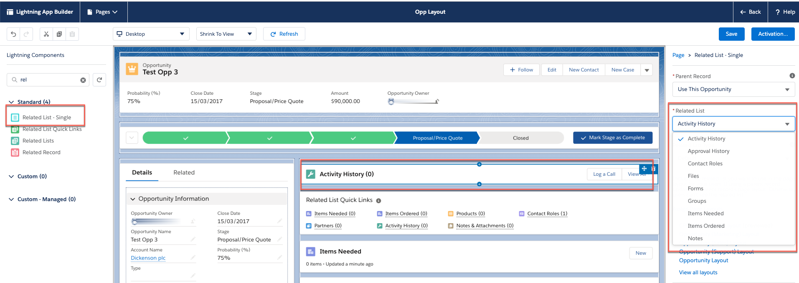

One of the features somewhat buried in the Lightning platform for the Lightning record pages is the Related Quick Links feature. This is a really awesome feature because it helps all of those who are in Classic and looking to move to Lightning but are struggling with the number of Related Lists that they have on the page.

Related Quick Links enables you to set up links in one section of the page for your Related Lists. The links show the number of records per list and are hoverable. The benefit of them over Related Lists is that you are not loading all of the content onto the main record page, which means you are reducing the load time and increasing the speed that users can get to what they need. When the user clicks on the link they are taken to the full list of records, where they even have access to filtering ([see here for more information on that](http://sf9to5.wordpress.com/2019/06/18/related-lists-summer-19-updates/)).

**Related: [How to make Lightning Run Faster](http://sf9to5.wordpress.com/2019/06/25/make-lightning-run-faster/)**

Well, with that wonderful information you are probably asking how you set them up, and perhaps if it is possible to use both Quick Links and Related Lists - indeed it is.

**Setup**:

1. From a record of the Object, you wish to update the page, click on the settings icon and then click on the Edit Page 
2. In the left-hand Search panel, look for Related Quick Links 
3. Drag the Related Quick Links to the section of the page that you want it to display
4. Click Save for the page - at this point it will display the same list that you have the detail page layout 
5. Adjusting Quick Links is possible but it is up to the user, or up to the admin to log in as the user and is limited to what is on the page layout 
6. \[gallery ids="2703,2702" type="rectangular"\]

At this point, you are all set. To make this the most beneficial to you and your team it would be advisable to have only the Related Lists as Quick Links. Then, where you need to have the actually Related List displayed on the Page, use the Single Related List component as a means of enhancing the experience.

