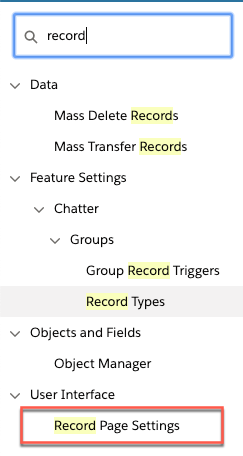
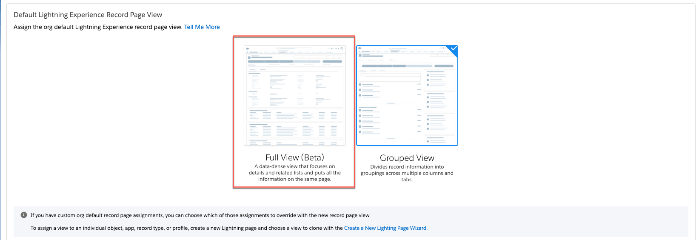
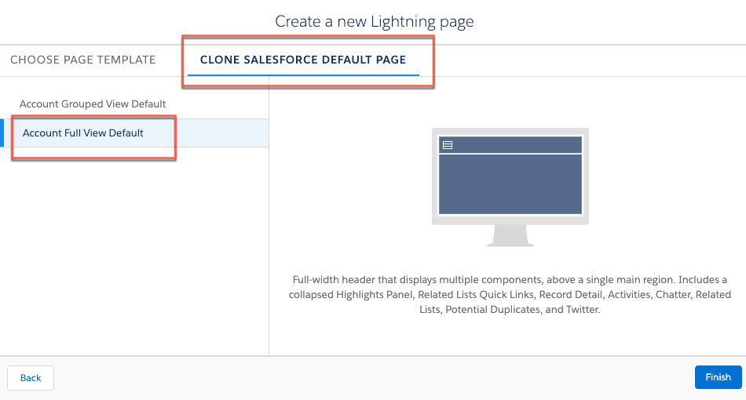

Coming soon to Salesforce (or so is noted by the Beta sign) will be the ability to set up your page views in Lightning like you have them in Classic [using Full View](https://releasenotes.docs.salesforce.com/en-us/summer19/release-notes/rn_record_page_default_view.htm). Full View is designed to remove some of the UX changes that Salesforce made when they launched Lightning. Up until this point, the Lightning Record Pages have all been made up of multiple components and tabs, with no real way to emulate the single pane, scrolling setup that people are used to with Classic.

Although I am not necessarily a proponent of this addition and in fact like the updates to the UX that came with Lightning, those who are struggling to make the transition because there are too many changes occurring at once, can use this new view as a win in keeping users happy, and as means to help convince stakeholders to move to Lightning sooner rather than later.

Again, this feature right now is still in Beta but can be accessed by going through these steps:

1. Setup --> Record Page Settings 
2. Select Full View (Beta) 
3. Save.
4. At this point, this will override the setup that you have in place, so if there are instances where you want to keep the Group View you will need to make the adjustments

Alternatively, you can create new Lightning Record Pages using the Default template that Salesforce now offers. Once created you can then assign the Record Page accordingly. 

Please keep in mind that Salesforce notes that this type of Page Layout will not work with those that still have a large number of fields and related lists.

**Related: [How to declutter your fields using SNAPSHOT](http://sf9to5.wordpress.com/2019/06/10/declutter-fields-snapshot-metazoa/)**
