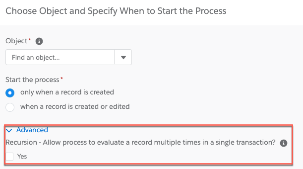
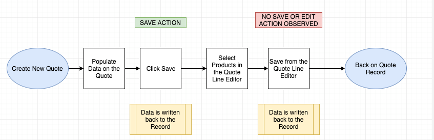

So for a long time, I have known about the Recursion Checkbox in the Process Builder; however, I have never found a reason to use it. I believe part of my shyness towards this checkbox has been that in the development world, there are very few instances where you want recursion to happen. Typically, we are trying to prevent recursion from happening, as it can cause governor limits to be hit and is generally not a best practice.

However, I have recently stumbled upon a perfect scenario that it is useful for, especially when dealing with CPQ. The use case I found for it has everything to do with the order of operations of how Salesforce CPQ handles create vs. edit actions.

In CPQ, when you create a new Quote record, you are presented an initial screen to fill some data out. You then press Save before being taken into the Quote Line Editor (QLE). This writes back any data to the record at the point and is treated as a Create/Edit action.

You then go into the QLE, select your Products, adjust pricing, etc. and then click Save. At this point, the information is written back to the Quote, if there is new data to add, but this is NOT treated as a Create/Edit action.

So where am I going with this? Well, let's say you have a calculation that needs to occur between a value that happens on the original create screen and an amount that is entered during the QLE process. If you set the Process Builder to fire on Create, then it will fire only at the point you initially click Save, and the desired behavior will not occur. If you set your Process Builder to fire on Create and Edit, then the only way to trigger it would be to edit something on the Quote record after coming out of the QLE; this is not a friendly way to do things. So, the solution? Use the Recursion checkbox to force the Process Builder to fire again after exiting the QLE without a user intervention step.

Bottom line, if the Process Builder is not acting in the order you need it to, and it is not because of some other [Order of Operations](https://focusonforce.com/configuration/save-order-of-execution-pitfalls/) related item, then you should try checking the recursion checkbox to see if it triggers your process at the correct point in time.
