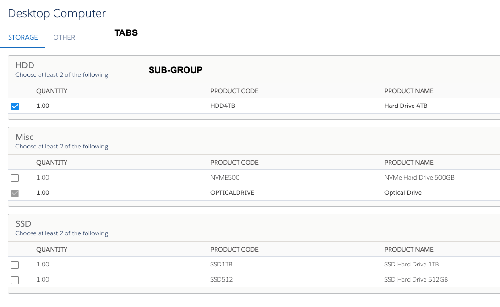
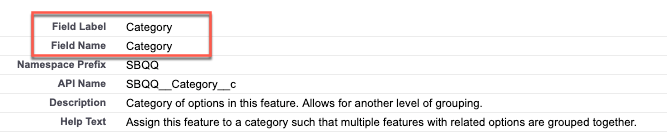
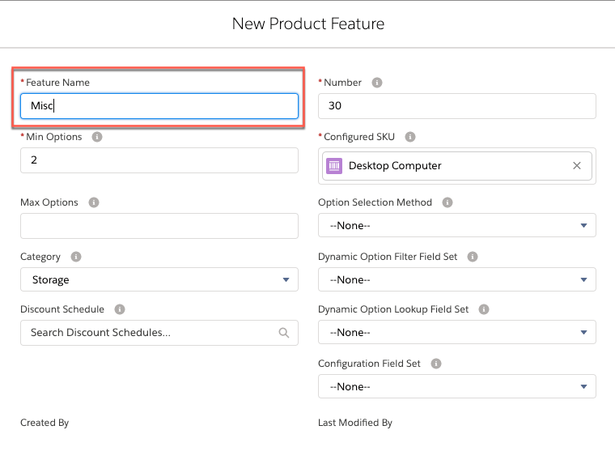
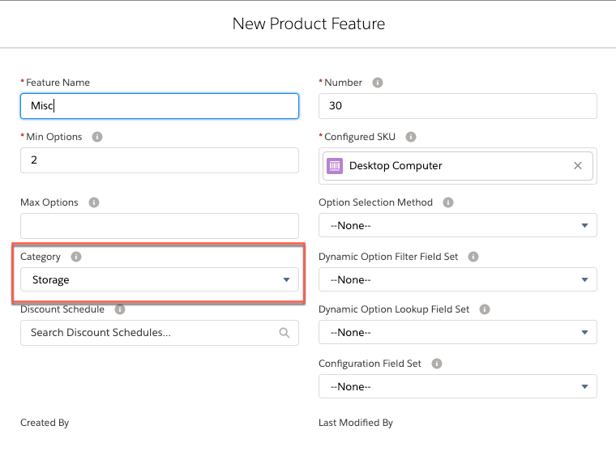
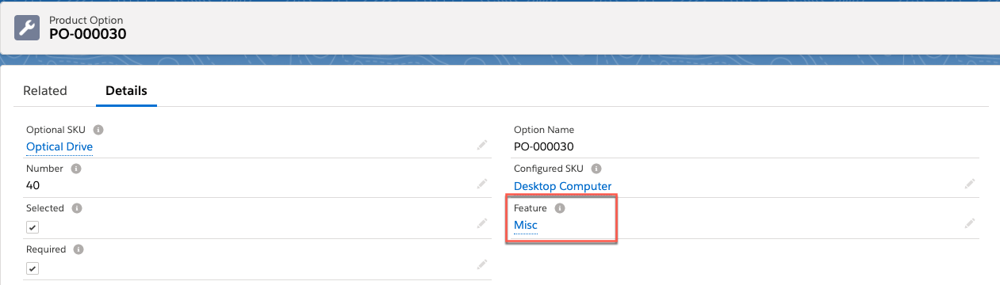

In CPQ there are many different ways to display Products to your users. In this post, I am going to review how you can show a bundle product that has its features broken out by tabs and then sub-groupings on that tab. Our end goal is going to look something like this:

The use case for achieving the above is simple. You have a Product that has many different top-level categories, like a Desktop computer, that you need to select Storage for. Under the topic of Storage, you have different groupings underneath that, that you want to break up, like SSD vs HHD.

Here are the steps:

1. In Setup, go to the Feature object and then go to the Category field 
2. Add new picklist values that are going to represent your **Tabs**
3. Next, create the Feature records for the bundle Product
4. Name the Feature what you want the Sub-Group level title to be 
5. Next, set the Category field of the Feature to be the picklist value that you added for your **Tab** (if you added more than one, pick the correct corresponding value) 
6. Lastly, ensure that the Product Options have the correct Feature associated with them 

 

That's it. Once you have completed these steps for all of your Features and Product Options you will have the result that we started with.
