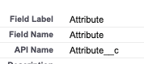
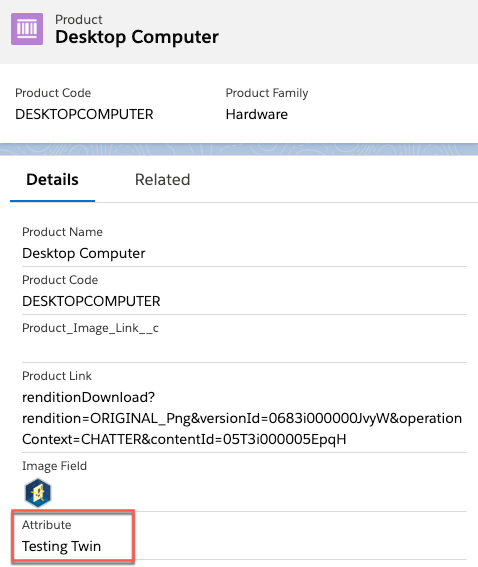
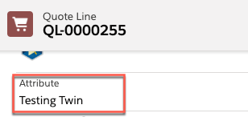

You are probably wondering what is a Twin field and when do you use it. A Twin field is a CPQ feature that lets you create, for certain objects, two fields that are of the same name and type, and the data from one object is automatically populated onto the other object. Of course, there are several caveats to the sentence I just said, but I will get into that later.

So when do you use a Twin field? You can use a Twin field anytime you want to populate the same data from one object to another. Think about when you would use a workflow rule to move data from one object to another. Twinning in its essence is a form of data mapping.

A great example of using a Twin field is when you have an attribute of your product that is defined in a field on the Product record, and anytime you generate a Quote, you want the Quote Line for that Product to also have that attribute noted.

So let's jump into creating a Twin field using the example above.

On the Product record create a Text Area field called Attribute. Next, take note of the Field Name as that is going to be critical for creating the Twin field on the Quote Line. 

On the Quote Line object create another Text Area field also called Attribute (the same exact Field Name from your original field).

Now you are ready to test it out! Put some data in the Attribute and then create a Quote with that Product. Then go to the Quote Line and check it out!

\[caption id="attachment\_2881" align="aligncenter" width="222"\] Product Record\[/caption\]

\[caption id="attachment\_2880" align="aligncenter" width="265"\] Quote Line Record\[/caption\]

 

That's it! Now for the aforementioned caveats to this nifty trick:

- Always double-check that the two objects you want to use are compatible - you can find here: [https://help.salesforce.com/articleView?id=cpq\_twin\_fields.htm&type=5](https://help.salesforce.com/articleView?id=cpq_twin_fields.htm&type=5)
- When creating the Twin field on the second object, do not copy the \_\_c part of the name into the Field Label - this will break the connection
- Repeating this again, take the exact field name, underscore, capital/lowercase letters for the Twin field - it is very finicky about this
- Make sure your field types are the same on both sides, meaning don't combine a checkbox with a Text Area, it won't work
- Lastly, if you are not seeing the data populate, think about when the record with the Twin field was created in comparison to when you create the actual field/populated the record with data
    - Twin fields are ONLY populated when the record is initially created
