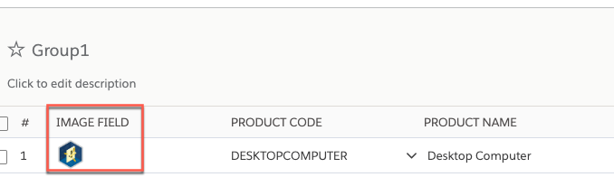

Recently, a customer wanted to display the images of the products they sell within CPQ to make it easier for their sales reps to identify the differences in the products. After much research and digging through the Salesforce documentation, I found it to be lacking in the context needed to do it in Lightning.

Here are the step by step instructions for adding a Product Image in the QLE:

1. Upload all product images as Files 
2. Create two fields on product
    1. Text area field: to be filled in with URL of the image
        1. Go to the actual image in the Files, where you can see the details 
        2. Right-click on the image and select Open Image in new Tab
        3. Copy everything in the URL after "version/" and put into the Text Area field you created on the Product record 
            1. Make sure to associate the correct image with its corresponding product
    2. Formula field for Image: IMAGE("/sfc/servlet.shepherd/version/"+Product\_Link\_\_c+".png","photo",32,32) \*\* swapping name of custom field for the text area name
3. Create two fields on Quote Line
    1. Twin field from product:
        1. Text area with same API name as the product text area
    2. Image field:
        1. Use the same formula as you did for the Formula field on the Product record
4. Add image field form quote line to line editor Field Set.
    1. Field Sets --> line editor

Final Result:

* * *

Related: [How to Set up Twin Fields in CPQ](http://sf9to5.wordpress.com/2019/10/08/how-to-set-up-twin-fields-cpq/)
