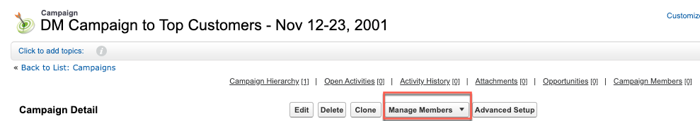
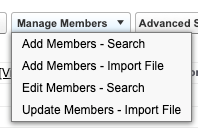
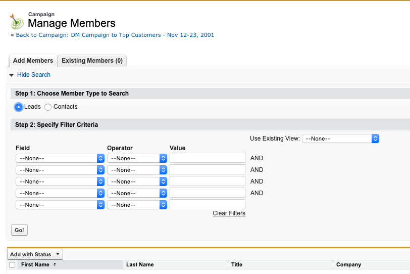
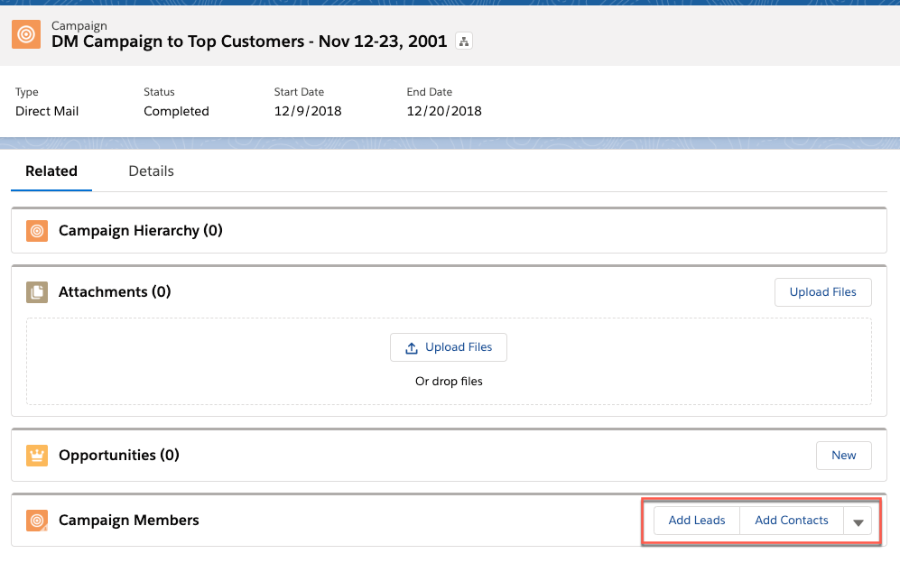
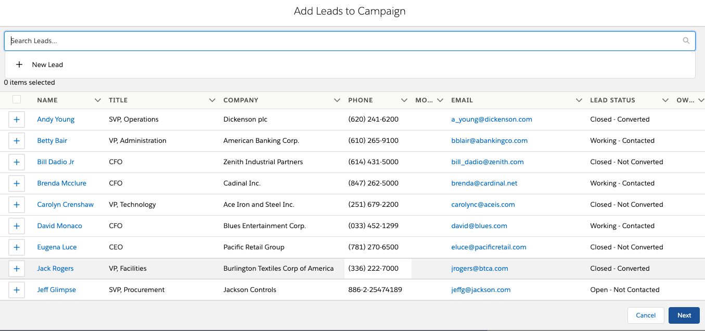
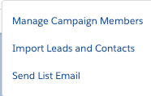
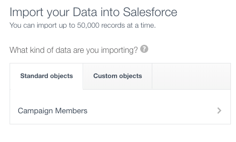
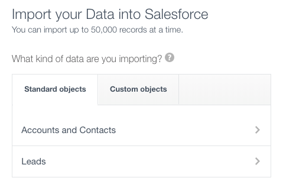

The user experience of many features in Lightning may differ in comparison to Classic. One such feature is adding Campaign Members to a Campaign.

**_Related: [Salesforce Lightning Reference Guide](http://sf9to5.wordpress.com/2019/08/26/salesforce-lightning-guide/)_**

In Classic, the way you added Campaign Members was through the Manage Members button at the top of the Campaign screen.

The button is a drop-down with the option to Edit, Update, or Import Members to the Campaign.

If you clicked the Manage Members - Add Members Search option, you were taken to a screen to search the system for both Contacts and Leads.

In Lightning, the process is a bit different. From a Campaign, you go to the Related List section (this will be different based on your company's record page layout).

In the Campaign Member's related List you will see the option to Add Leads or Add Contacts.

Using one of these buttons allows you to search the system, based on any of the searchable fields that you have, for Leads or Contacts based on the button you selected.

In addition to those two buttons, there are also additional buttons in the dropdown - Manage Campaign Members, Import Leads and Contacts, and Send List Email.

The Manage Campaign Members and Import Leads and Contacts buttons both take you to the Data Import Wizard. The difference is that the Manage Campaign Members button takes you to a screen to only importing/adding Campaign Members meaning the people records exist somewhere in the system already.

The Import Leads and Contacts button takes you to the Import Wizard screen for uploading Accounts, Contacts, and Leads.

Overall, the feeling is different and the items are in different places but all of the functionality remains the same, you just need to adjust where you are looking for it.
