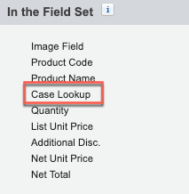
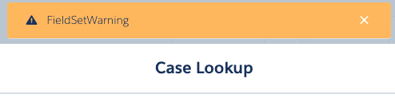
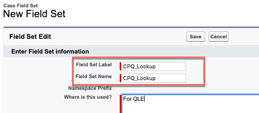
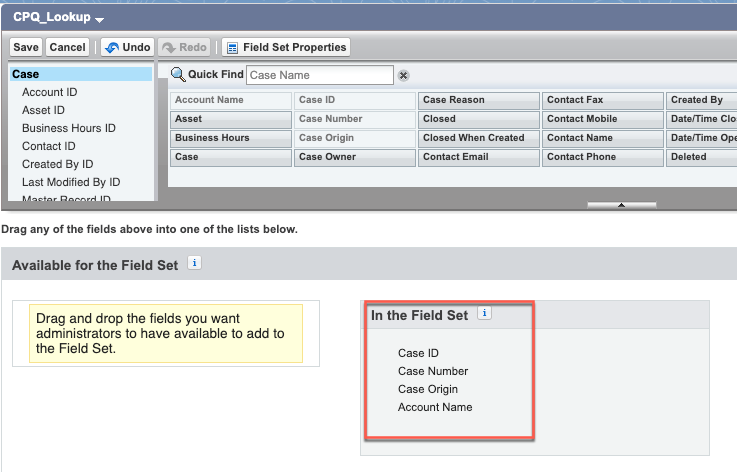
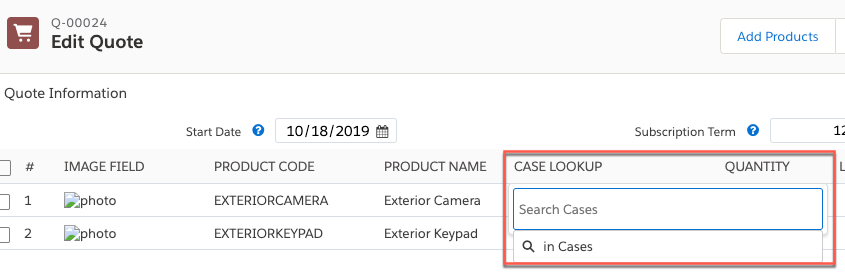
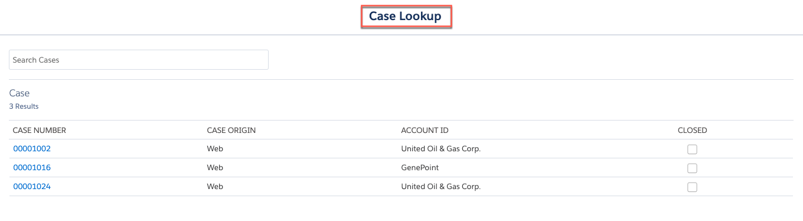

Recently I was asked about adding a Lookup field on a Quote Line to be filled in on the Quote Line Editor. As a result, I learned something new about the backend of CPQ. There is a special way to adjust what fields show up in the Lookup filter view and how to set it up.

So let's dive into an example. Say I have a Case Lookup field that I have added to my Quote Line and the Line Editor fieldset. 

The first time you click on the Lookup field from the Quote Line you are going to get some sort of error. This particular time I got this one: 

Previously I had received an error that had more explanation as to what to do next, but I cannot seem to regenerate that message.

The reason you get the error is that you need to create a separate Field Set specifically for CPQ on the Object that you are looking up to. In my case, its Case. To create the Field Set, go to the Lookup Object, Case, and create a new Field Set called the "CPQ\_Lookup". It must be that exact name in order for this to work.

After you create the Field Set you are ready to give it a try!

