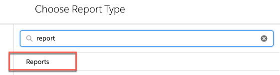
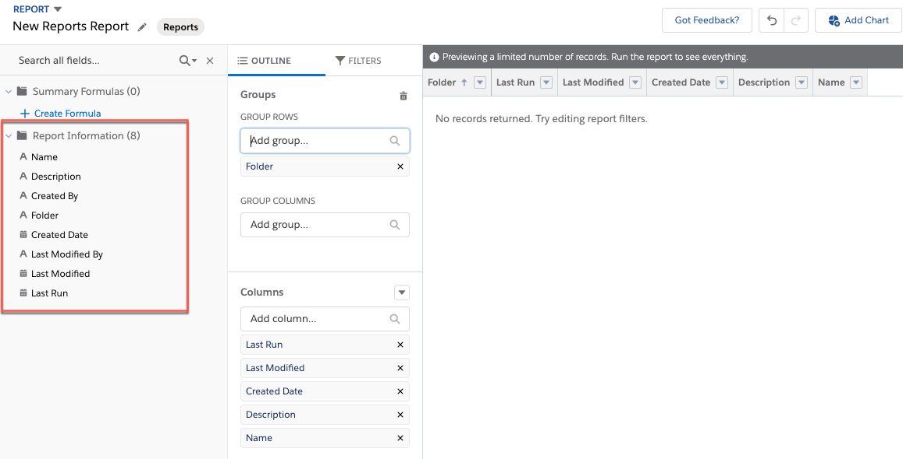
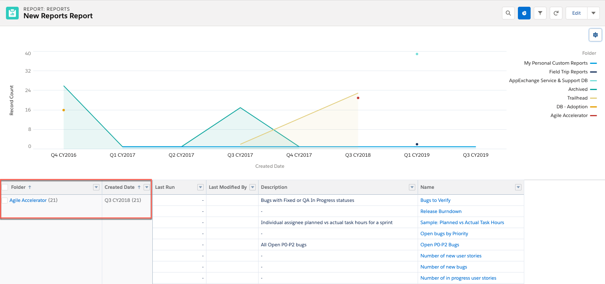
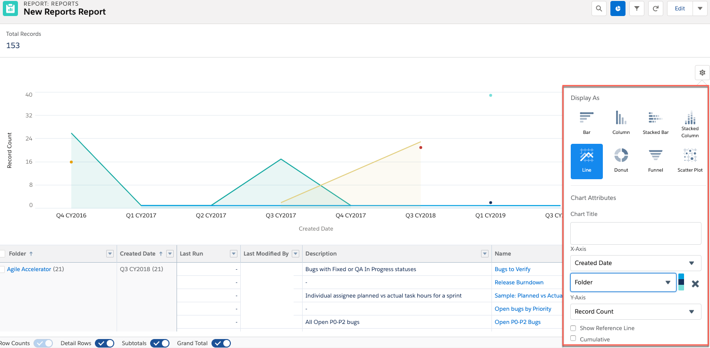
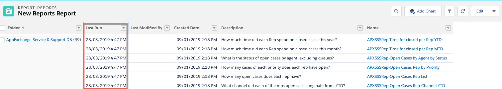

Perhaps you are thinking about doing a Reports cleanup as part of your [Lightning Transition](http://sf9to5.wordpress.com/2019/08/26/salesforce-lightning-guide/). Salesforce has made it easy to report on Reports. Possible good use cases for using this Report type are: seeing how many reports you have in total, how many have been run recently, how many have NEVER been run (trust me you are going to have more than you expect), and lastly, which reports are now out of date.

To do this, simply go to Reports, and then search for Reports.

Once you have your report, I recommend adding all of the columns as they each provide useful bits of information. 

For this example, I am choosing to group mine by both the Folder that the Report lives in and the Date (Quarter) it was created in.

After I have created and run the report, I can also add a chart that shows me the break down of record count by Folder and Quarter created in.

From here I can review the Last Run date and other data points to determine which Reports can be removed from the system.

My recommendation is that before deleting reports, move them to their own Private folder so that if someone yelps about it being missing you can still put it back. I would give it about three months before deleting permanently.

I hope this helps your cleanup effort!

For making a quick move of reports make sure to check out my [Reports Mover tool.](http://sf9to5.wordpress.com/2017/10/11/salesforce-mass-report-mover/)
