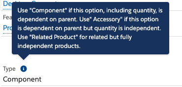
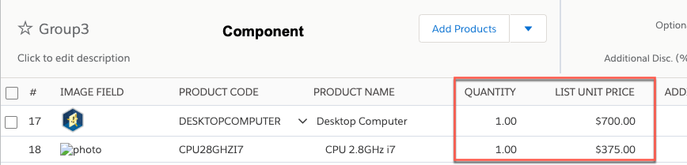
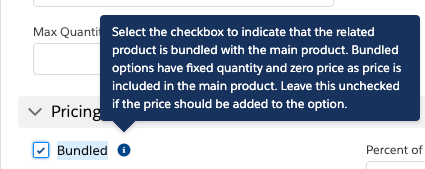
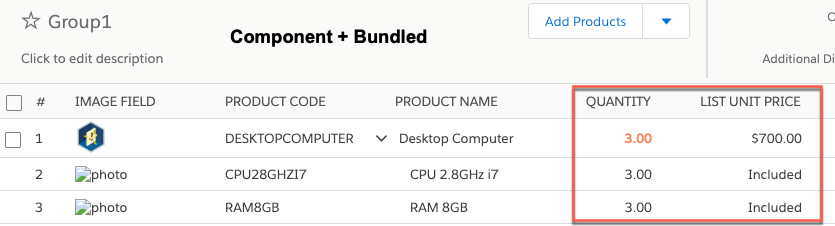
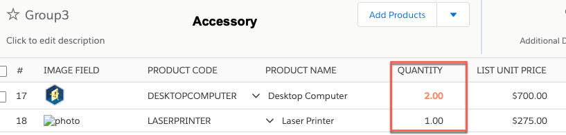
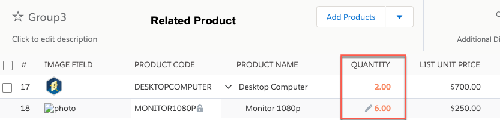

An important field on the Product Option record that you should always consider when creating Product Options is the Type field.

This field controls the behavior of its relationship with its parent Product (Configured SKU). Below I will demonstrate how the different values of the Type field behave.

Component: This sets the Product Option to be completely dependent on the parent Product, including both its inclusion in the Quote and the Quantity of the Option. 

Component + Bundled = TRUE: This sets the price of the Product Option to be Included, and because of the Component aspect, the Quantity matches that of the Parent Product.

Accessory: This only makes the parent Product necessary as included on the Quote, in order to include it on the Quote. There is no impact on Quantity. 

Related Product: There is no behavior controlled by the relationship between the parent Product and the Product Option. When Related Product is selected, Required cannot be set to True - the system will let you check the box, but will grey out the option in the Product Configuration step. 

None (no selection): The behavior here differs between if the Product Option has a Feature or not. (A Feature is a way of categorizing the Product Options into different groups). If it has a Feature, then it will be treated as Component. If it does not have a Feature, it will be treated as a Related Product.
