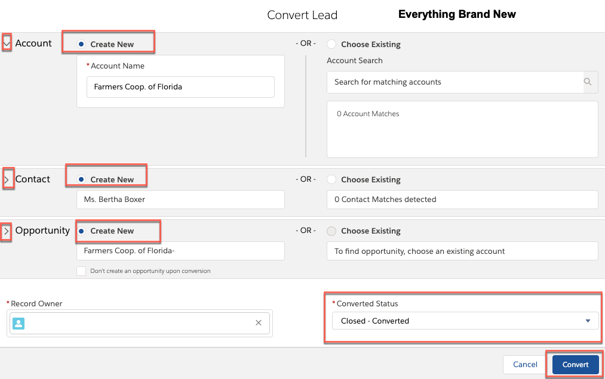
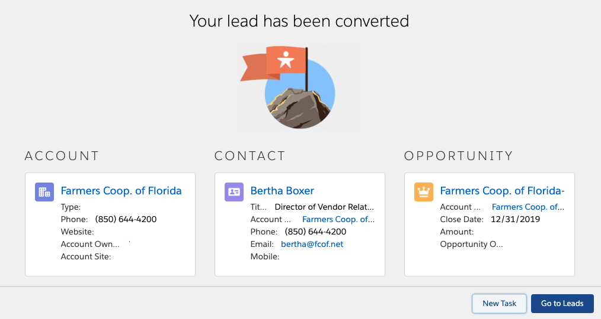
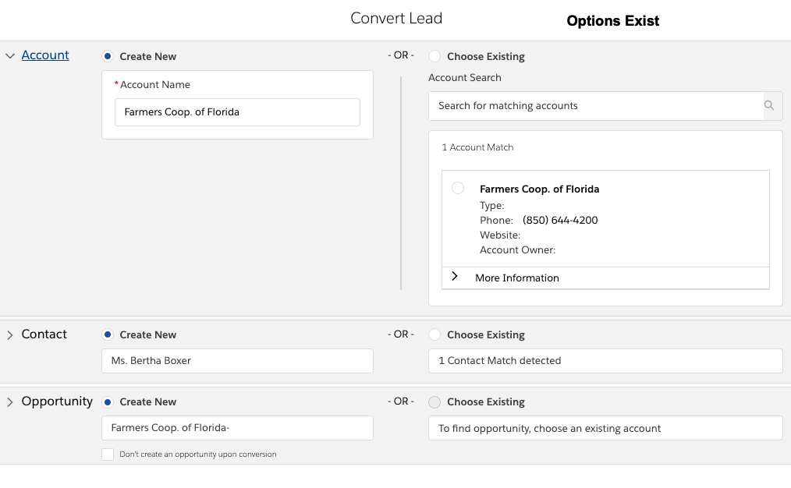
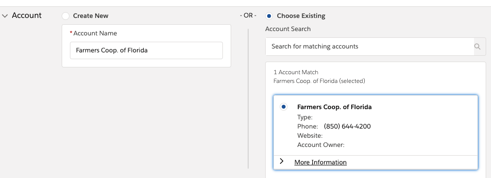
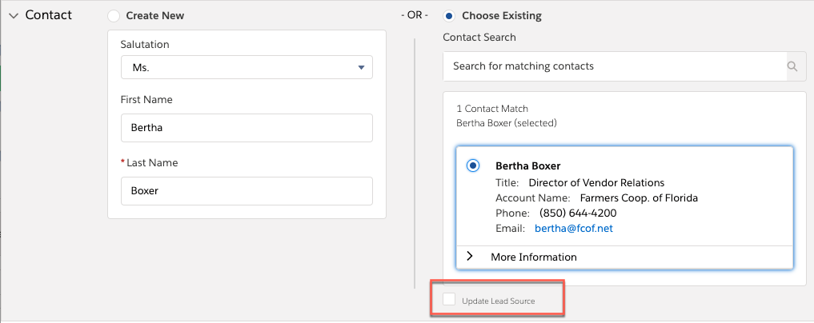
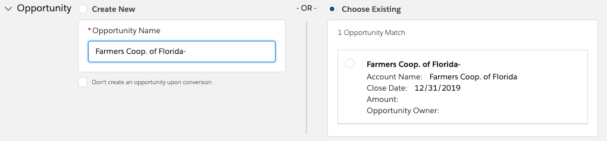
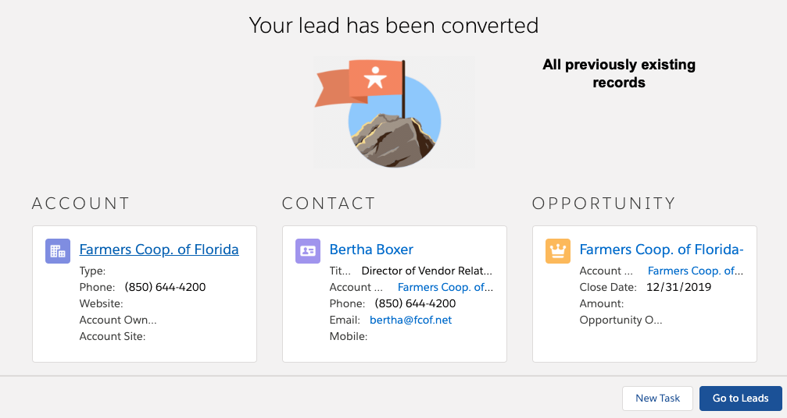

During the [transition process to Lightning](http://sf9to5.wordpress.com/2019/08/26/salesforce-lightning-guide/), one of the big user experience changes you may see is the difference in how the Convert button on a Lead works. The differences are completely beneficial to your users but may take some adjusting to the visual elements of it.

Let's step through the Convert screen in Lightning:

The first time you are converting a Lead that has no matching Account or Contact, this is the screen you will be presented with:

As you can see in the above image you have the ability to create all-new records for all three objects. In each row you also have a drop-down to make small adjustments, i.e. make changes to the Account Name.

You also have the ability to set the Converted Status for the Lead.

After you click Convert you will get a screen with links to all of the newly created records:

If you are converting a Lead that has a matching Account and/or Contact and/or Opportunity than these are options you will be presented with:

In each level where there is a matching record, you will see what Salesforce believes is the closet match.

Account: 

Contact: Here you are also provided the ability to update the Lead Source to be based on this newly converted Lead

Opportunity: 

As you will note for all three options you always have the ability to search, which is a great added functionality.

Finally at the end when you click Convert, you will be given links to the records, whether new or existing:

As an added benefit of the Lightning conversion process, if you have turned on the Multiple Accounts to Single Contact functionality, you will also have the ability to select a Contact that belongs to one Account, but Convert to a different account and this will create the relationship.
