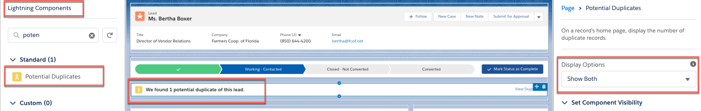
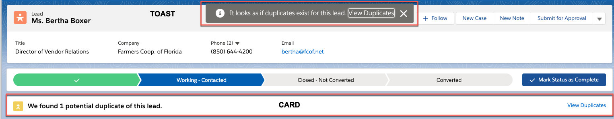
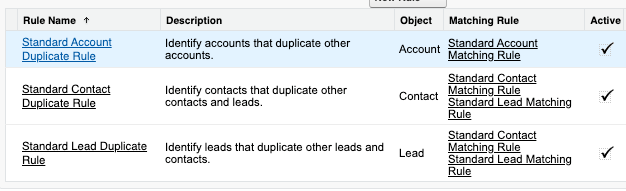
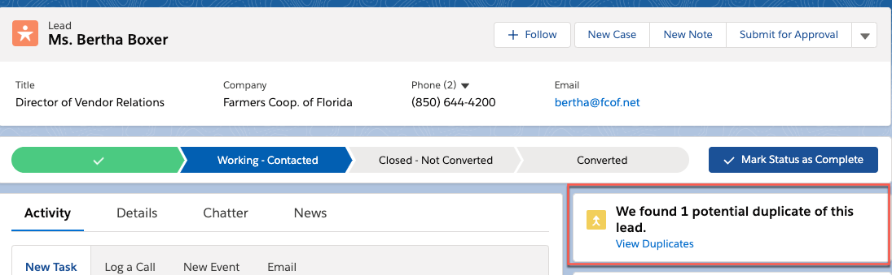
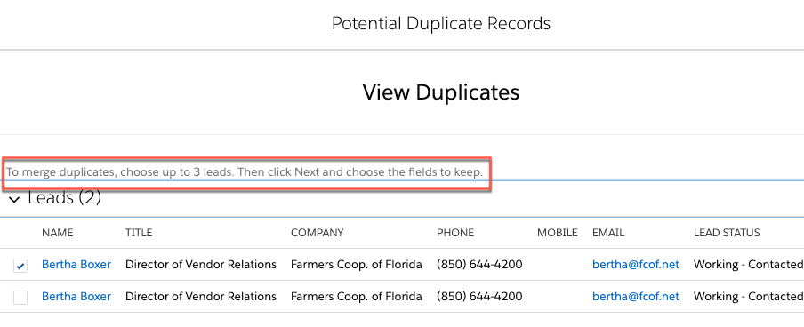

As many of us are working through the transition to Lightning, you may be looking for all of the things you are familiar with from Classic in the Lightning setting. One of those items is likely the Find Duplicates button that exists for Leads in Classic. In Lightning, there is no Find Duplicates button, however, we have a different alternative available to us: the Potential Duplicates Component.

To set the Potential Duplicates Component on Lead there are few steps that you need to take.

1. On the Lightning Record Page for Lead add the Potential Duplicates Component to the page 
    1. Here you have three options for the Component, Show Toast, Show Card, Show Both - the decision of which to show is completely preference-based 
2. To make the component work, you will need to make sure that you have Matching Rules and Duplicate Rules for Leads turned on. Salesforce provides some rules out of the box for Leads, Contacts, and Accounts. 
    1. To learn more about how those rules work, check out the [documentation](https://help.salesforce.com/articleView?id=matching_rules_standard_rules.htm&r=https%3A%2F%2Fwww.google.com%2F&type=5) from Salesforce.
3. Once the rules are on, your users will see the component in action any time they are on a record that triggers the Duplicate Rules 
4. When you click the View Duplicates link you will then get the option to see the Duplicates and Merge 

There you have it, the replacement for the Find Duplicates button. This process can be repeated on Contacts and Accounts. The Potential Duplicates component does not currently work on Custom Objects.
