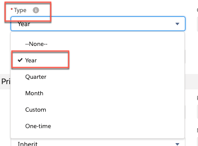
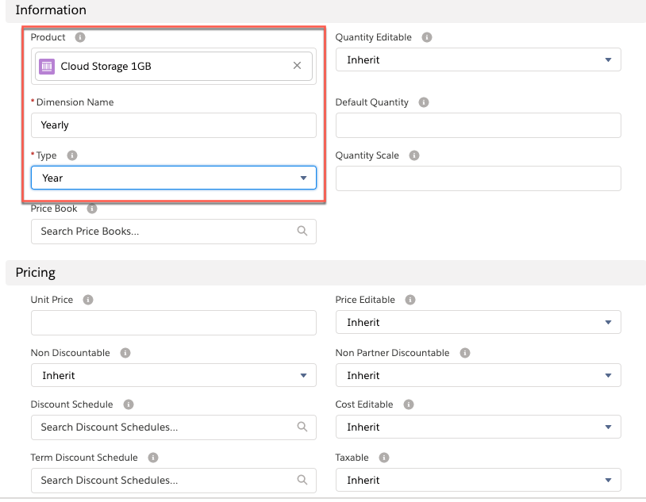
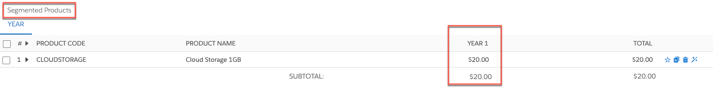
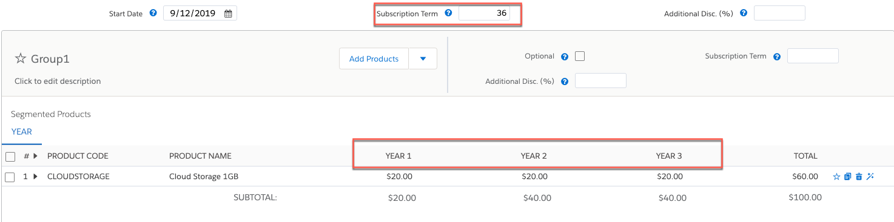
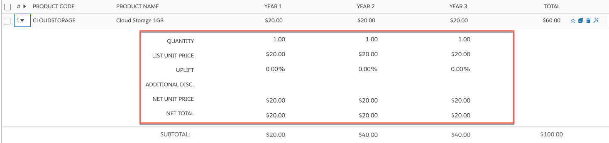
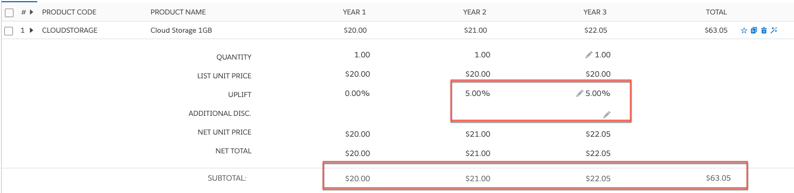

First, let's clarify what MDQ stands for and what it actually means. MDQ stands for Multi-Dimensional-Quoting. It is commonly used for quoting with multiple years/terms/segments where you may have a ramp-up in price over the course of the segments and/or a ramp-up in the quantity of the product being sold.

Setting up a Product in a new CPQ environment is relatively simple:

1. On your product record add a Price Dimension record based on the segment length that you want to use (Monthly, Quarterly, Yearly, or Custom) 
    1. You can only have one Price Dimension per Product Record
    2. There is also the option to create a One-Time Price Dimension. You can have a One-Time Price Dimension in conjunction with a segment based Price Dimension
    3. One-Time Price Dimension are there for you to capture a one time fee that is excluded from the ramping or future segments of the product
2. For the purpose of this demo, I will be continuing to the standard list price rather than opting for one of the other pricing options available 
3. Now that I have added the Price Dimension I can test it out to see how it looks 
4. When you select a Product that has a Price Dimension, also commonly referred to as a Segmented Product, Salesforce CPQ automatically separates it out from the rest of the non-segmented Products
5. To add additional segments, since mine is Year based, I will increase my Subscription term from 12 months to 36 months. This will add two more segments to the view 
6. Clicking on the drop-down next to the Product you can see additional information about the segments, including the ability to change the price, add an uplift, and change the quantity 
7. In this example, I added an uplift of 5% to the second and third year, and you can see that the uplift takes from the previous' year's price. 

Those are the basics for applying MDQ to a Product. There are ways for defaulting uplift, quantities and such, but I wanted to provide a baseline for those looking into it.

MDQ can be a challenging setup if you are not starting from scratch with it. I highly recommend reviewing Salesforce's documentation about the things that can or cannot be done with MDQ when looking to move to this structure.

[https://help.salesforce.com/articleView?id=cpq\_mdq\_guidelines.htm&type=5](https://help.salesforce.com/articleView?id=cpq_mdq_guidelines.htm&type=5)

Also, my example was a very simplistic example, and while it can work in some scenarios you may have other implications or needs to go along with the MDQ setup. Make sure to speak with your Salesforce Partner when embarking on this journey.
