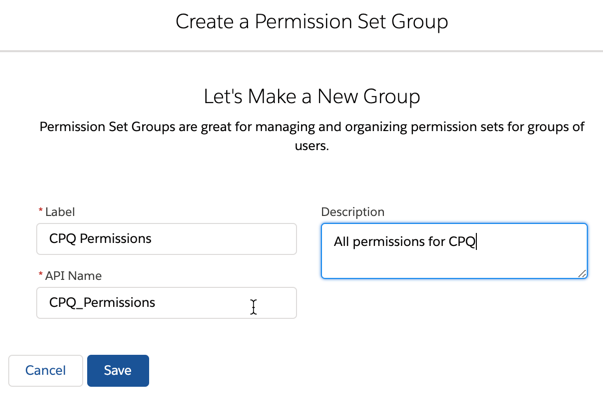
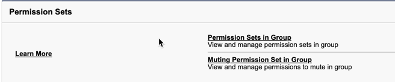

In the Spring '20 release from Salesforce, [Permission Set Groups](https://releasenotes.docs.salesforce.com/en-us/spring20/release-notes/rn_forcecom_psg.htm) will finally be GA (generally available). This is fantastic news because these groups are going to save all of us admins so much time and headache when it comes to assigning permission sets.

You may be wondering what a permission set is or what a permission set group is, so let me explain.

A permission set is a collection of permissions that you can give to specific users. The permissions included in a permission set add to the permissions a user already has from their profile. For example, say you want to give certain people delete access for the contact object, well you could do that by creating a unique permission set that includes that permission and then assign to the specific people. Another typical example is creating permission sets for specific tools or applications within your org, like for CPQ.

A permission set group is a group of those previously mentioned permission sets. This is really handy when you have a series of different permission sets that make up all of the permissions needed to do something or work in a specific tool. For example, using CPQ again, you may have a Permission Set for Admins, and you may have a Permission Set for Users. Instead of having to include all of the user permissions in the admin set, you could give the admin both permission sets. The groups will help with this setup as you could give the admin a permission set group, instead of having to assign two different permission sets.

Let's see this in action in Salesforce (you may need to wait for Spring '20 to be released into your org for this to work):

Go to Setup and search for Permissions. You will see Permission Set Groups available.

Create a new Permission Set Group by clicking on the New button. 

Give the Group a name and description. 

Now you can select which Permission Sets you want to include (you will need to have already created your Permission Sets to do this step). Click on the Permission Sets in Group to do this. 

After you have selected the sets, you can save out and then Assign the Group to appropriate users.

With Permission Set Groups, you also have the option to mute individual permissions that are in the Group. You can do this by using the Muting Permission Set in Groups.

Just like that, you now have a time saver on your hands when you get new employees or new tools to assign out.
