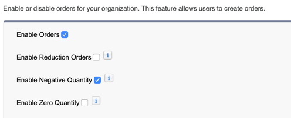

Say you have a product that you sold for $100 last month with a quantity of two, and this month the customer would like to exchange that product for an upgrade (a different product altogether). With Amendments in CPQ, this is not an issue. You can zero out the line and then add the new product. However, if you are using orders, you may be wondering how to make the zero quantity product show up when creating the Order so that you can adequately handle the transaction in whichever billing/invoicing system you are using.

Buried in the Salesforce Setup are Order Settings. These settings allow you to configure things like zero quantity product line or negative quantity product lines. Let's take a look:

First off, in the list, you have Enable Orders; if you are reading this article, that is likely already turned on; however, if it is not, you will not be able to create Orders without it.

Next in the list is enabling [Reduction Orders](https://help.salesforce.com/articleView?id=orderreduction_overview.htm&type=5); a reduction order is when you need to return or cancel out an order or de-provision a service.

Enabling Negative Quantity is one of the items I noted above. This allows order line items to have a Negative Quantity. To be honest, I have never had to use this setting, and if you try to find scenarios that are legitimate business cases, well, there just isn't much to find. I do know that NetSuite can use Negative Quantities for changing things across an order, but beyond that, there are usually other mechanisms in place that would not leave you with a negative quantity.

Enabling Zero Quantity, on the other hand, is precisely the point of this article. There will be many times in amendments where a line is zeroed out in Quantity, for example, exchange or upgrade to a different product. Most billing systems still need to see that information, so you do want to be able to pass over the Order Line Item even with the Zero Quantity, and that is what this is used for.

While it is just a series of checkboxes, these settings don't live in an expected place as they are part of the native Salesforce experience and not part of either CPQ or Billing packages. I hope this provides some clarity on the settings available to you.
