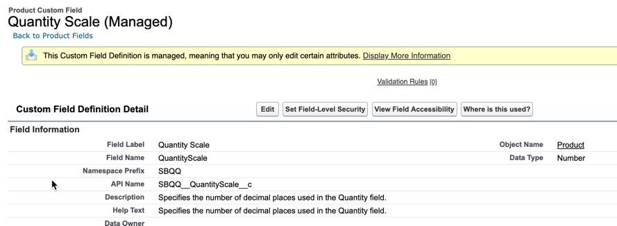
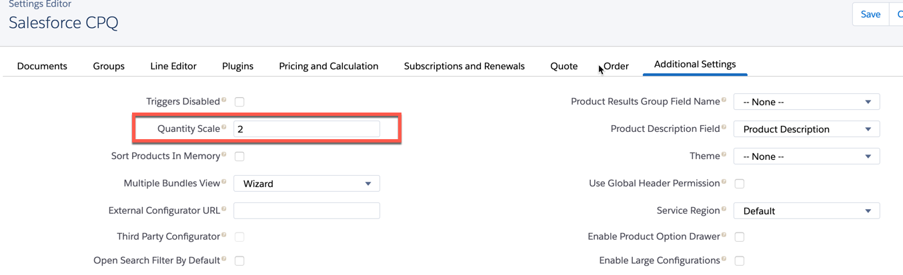
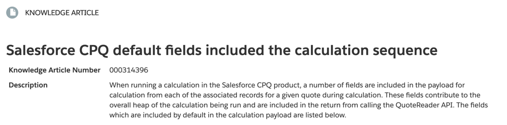

Recently I had a headscratcher of an issue. I was trying to make it so that in the QLE the value in the quantity column would show up with two decimal places. I checked the Quantity field on the Quote Line object and all appeared to be correct. Even when looking at the QLE and double-clicking I would temporarily see the two decimal places, so I asked myself what on earth is going on?!

Apparently, for the Quantity field throughout CPQ, there is a prioritization of which Quantity field's decimal place setting takes first place - seriously, who knew? Anyway, for those out there also scratching their heads, here is the order it goes in:

First is the Quantity Scale field on the Product - this will be what the product derives as the scale for the quantity, assuming it is set. 

Next, is the Scale setting in the Package Settings for CPQ. A caveat here, even if this is set to zero, but the product is set to two decimals, visually, the system will round the value - see the help article for more info: [https://help.salesforce.com/articleView?id=000314164&language=en\_US&type=1&mode=1](https://help.salesforce.com/articleView?id=000314164&language=en_US&type=1&mode=1) 

Lastly, is the Quantity field included in the default fields list for CPQ that are part of the [calculation sequence](https://help.salesforce.com/articleView?id=000314396&type=1&mode=1) - you would only get to this point if you had nothing in the previous two, and you should always have at least a value in the Scale setting in the Package Settings. 
