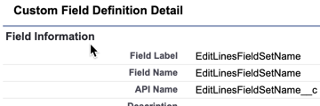
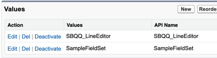
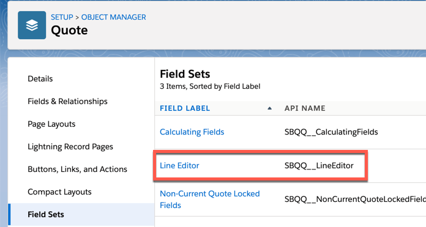
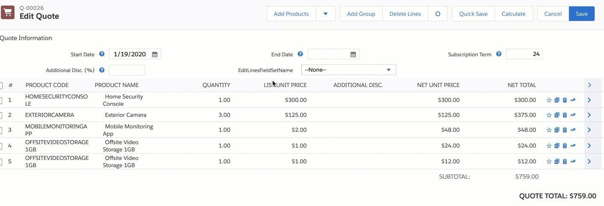

Recently, I had a need to be able to change between two different sets of fields while looking at the columns in the QLE. The reason? There were two distinct sets of fields that the users needed to review, but including them in one Field Set led to an unbelievable amount of fields at once and way too much scrolling.

Here are the steps I took to make that scenario a reality, including the ability to change the fields right from the QLE:

1. Create the Field Sets that you want to have as options for the columns in the QLE (Setup --> Objects --> Quote Line --> Field Sets --> New Field Set)
2. Create a field on the Quote object with the Field Name - _EditLinesFieldSetName_
    1. The Field Label can be whatever you want, but the name needs to be as noted above because this is a special field that Salesforce offers to achieve this setup 
    2. The field should be of type Picklist
    3. The values for the picklist should be the Field Names of the Field Sets you made in step 1 - this means no \_\_c but also no spaces 
3. Now add the new field you created in step 2 to the Quote Line Editor Field Set (Setup -> Objects -> Quote -> Field Sets -> Line Editor) 
4. Now go to a Quote to test it out! Switching the value in picklist and Quick saving will change the column headers that you see. You may set a default value if you want something other than the Line Editor to be the standard set of columns. 

Unfortunately, at this time, this is only available for the columns in the QLE and not the header in the QLE. Here are two ideas that you can upvote if you would like to see that changed.

[https://success.salesforce.com/ideaView?id=0873A0000003aJkQAI](https://success.salesforce.com/ideaView?id=0873A0000003aJkQAI) [https://success.salesforce.com/ideaView?id=0873A000000CUciQAG](https://success.salesforce.com/ideaView?id=0873A000000CUciQAG)
