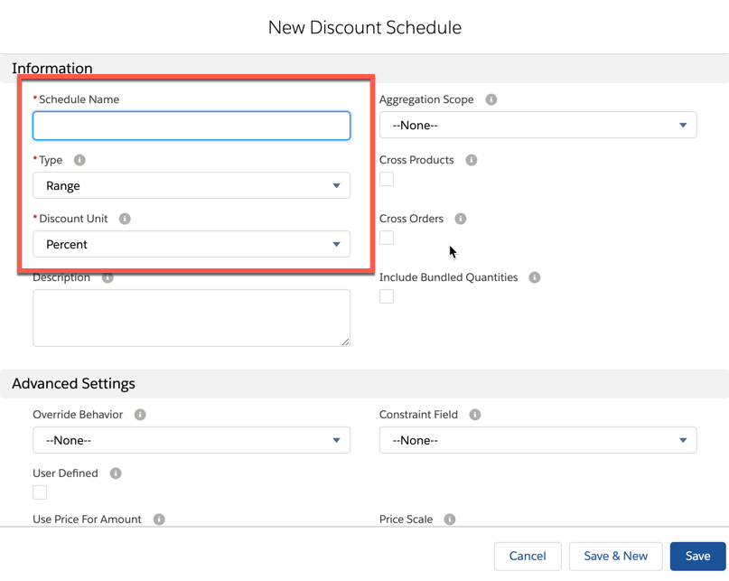
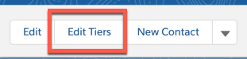
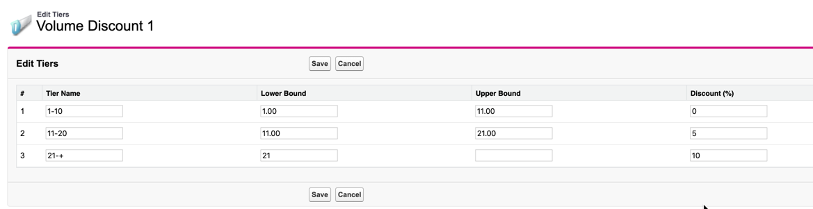
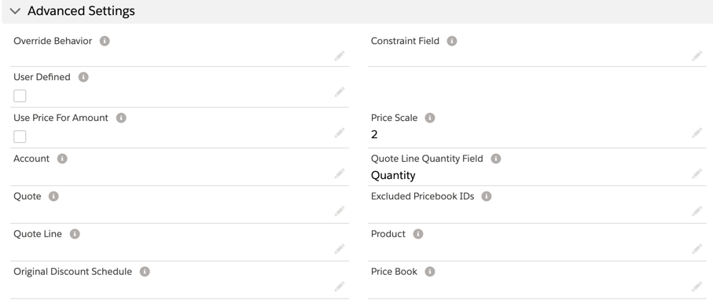
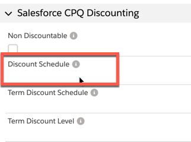
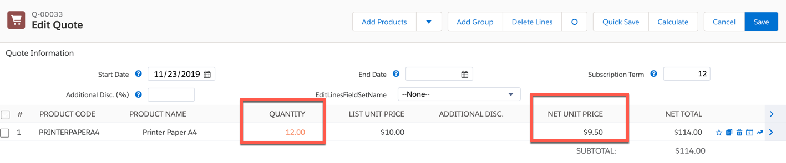
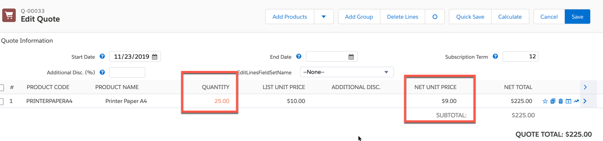

Discount Schedules can be used for lots of different scenarios; two of the most common are based on term length (i.e. if you have a 24-month term you save 10%) or based on volume (if you buy a quantity of 10 you save 5%, but if you buy 20 you save 10%). In this post, I will walk you through the process of setting up a Discount Schedule that is volume-based.

The scenario we are going to play out is that we are selling Printer paper, and the more the customer buys, the higher the discount they get. For quantities of 1-10, they will get no discount, for 11-20 they will get a 5% discount, and for anything greater than 20 they will get a 10% discount.

For the definitions of the fields on the Discount Schedule record, please visit my [CPQ Study Guide](http://sf9to5.wordpress.com/2017/09/12/salesforce-cpq-exam-study-guide/) for details.

For this Discount Schedule, I will give it a name and then leave the Type as Range and the Discount Unit as Percent, as that aligns with what I want to achieve. 

After I create the Discount Schedule record, the next step is to create the tiers I noted in the scenario above. Click the Edit Tiers button and then fill as shown below. 

The key here is to keep in mind that the Upper Bound is exclusive, while the Lower Bound is inclusive, so you will always go one higher on the Upper Bound and then repeat the value for the next tier's lower bound.

After you have the tiers set up, we need to connect the Discount Schedule to a product. As you can see, though, in this screenshot, there are numerous ways you can associate a Discount Schedule - it could be for an Account or for a single quote. In my case, since in the future, I may want to connect it to multiple products, I am going to make the association to the Discount Schedule from the Product record.

\[caption id="attachment\_2982" align="alignnone" width="907"\] Discount Schedule record\[/caption\]

\[caption id="attachment\_2983" align="aligncenter" width="322"\] Product record\[/caption\]

After the association is complete, all that is left is to test it out. Below are examples of setting the Quantity to be in the two tiers with discounts, and you can see that when it is changed, the Net Unit Price and Total price are adjusted accordingly. 

Lastly, if you go to the Quote Line, you can see which tier was selected along with which Discount Schedule was applied. This is great for troubleshooting if you are ever experiencing a Discount Schedule that is not behaving how you would expect.
