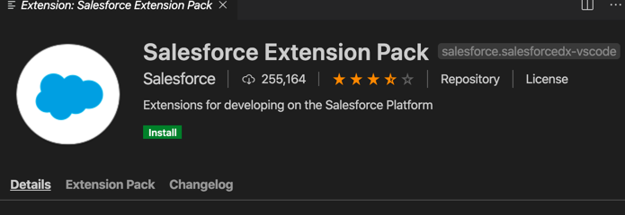
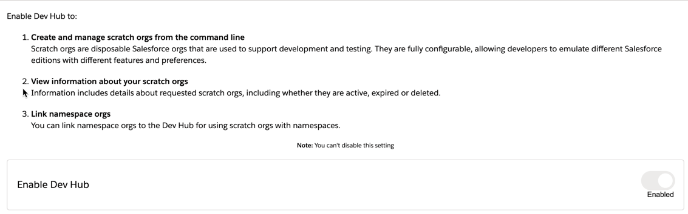
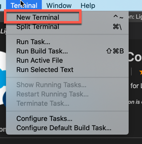
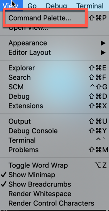
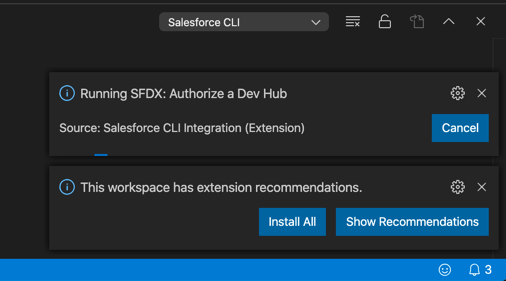

I recently had to re-install VS Code in order to complete the Winter '20 Platform Dev I maintenance exam and I found that the instructions for getting all of the pieces together are a bit jumbled, so here are my steps for getting VS Code set up with Salesforce installed and ready for creating Lightning Web Components.

1. Go to [https://code.visualstudio.com/download](https://code.visualstudio.com/download) and download the correct version for your machine
2. Once installed, launch the program
3. Download both Salesforce CLI and the Salesforce Extension pack (you are working on getting the Salesforce DX set up) 
    1. If you are running Catalina and cannot install the Salesforce CLI package, you are not alone. To get around this right-click on the downloaded file and Click Open (this will add an Open button to the same dialog box)
4. Meanwhile, in your Salesforce dev org, you need to enable The Developer Hub 
5. Next is to update to the latest Salesforce DX - do this by going to Terminal and clicking New Terminal 
    1. Run this command: **sfdx plugins:install salesforcedx@latest**
    2. This will install the latest version
6. Next in the same Terminal window, update the CLI with this command: **sfdx update**
7. Lastly, prior to getting into building, you will need to authorize your org, with the Dev Hub you enabled previously
8. Create a project by going to command palette and type sfdx: create project 
    1. Set up the name of the project and location to whatever works best for you
    2. Then type **sfdx: authorize a Dev Hub ** 
    3. You should see a success message once it is done
9. Now you are ready to use VS Code for scratch orgs and creating Lightning Web Components

Here is a fellow blogger who wrote out their steps and has some of the install links included: [https://www.sfdcpanther.com/how-to-setup-visual-studio-code-and-salesforce-dx/](https://www.sfdcpanther.com/how-to-setup-visual-studio-code-and-salesforce-dx/)
