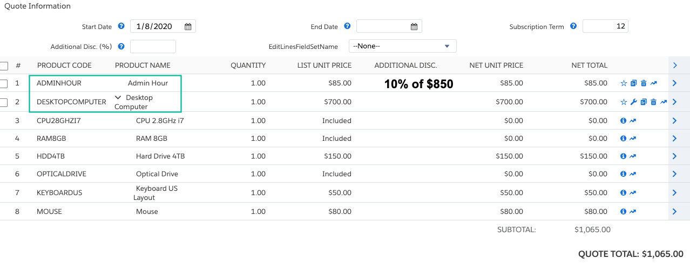
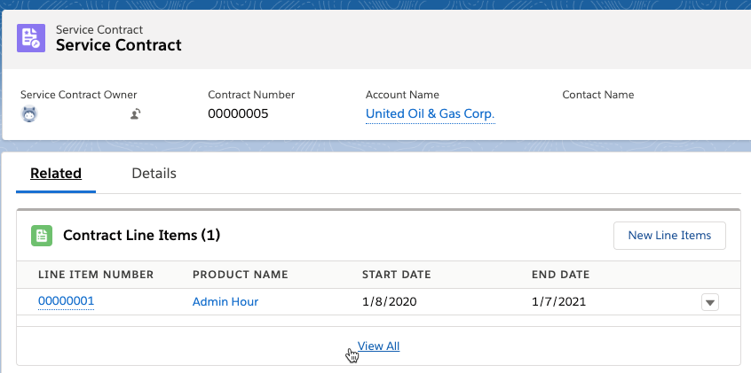
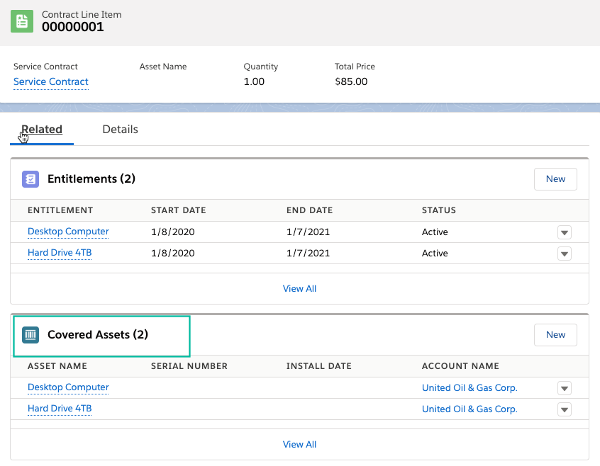

In the world of CPQ, there are different routes you can go for handling contracts; you can use the out of the box Contracts object which is incorporated into CPQ with additional fields and objects. The other option is to use another install packaged from Steelbrick called Service Contracts, which essentially is deemed as the Contracts package for Service Cloud.

The significant difference to call out is regarding the use of Entitlements between the two packages. While Entitlements as an object is built into Service Cloud, to have Entitlement records be auto-generated as part of the CPQ process, you will need the Service Cloud CPQ package.

When working on CPQ, there are a series of fields on the Product record that will dictate the outcomes/behaviors when contracting a quote or order.

Product Fields

- Subscriptions:
    - Subscription Pricing
    - Subscription Term
    - Subscription Type
- Assets
    - Asset Conversion
    - Asset Amendment Behavior
- Entitlements
    - Entitlement Conversion
- Covered Assets
    - Pricing Method
    - Subscription Pricing
    - Percent of Total (%)
    - Percent of Total Category

Let's walk through a real-world example of what these fields mean and the outcomes of using the Service CPQ package.

I have two products that work together, a desktop machine and admin hours (support). The desktop machine is hardware and should be treated as a non-renewable asset. The admin hours is a renewable product that can be continuously renewed as long as the person has the desktop. The admin hours are also priced based on the desktop machine purchased - meaning it is a percent of the total hardware.

Desktop Product Setup:

- Pricing Method: List
- Percent of Total Category: Hardware
- Percent of Total Base: List (which price to take the percent off)
- Asset Conversion: One Per Quote Line
- Asset Amendment Behavior: Default

This setup turns on asset creation, giving us one asset per quote line, instead of by quantity. It also labels this product as Hardware so that the Admin Hours knows where to pull its pricing from.

Admin Hour Product Setup:

- Pricing Method: List
- Subscription Pricing: Percent of Total
- Subscription Term: 12
- Subscription Type: Renewable
- Percent of Total Category: Hardware
- Percent of Total (%): X%
- Entitlement Conversion: One per quote line

This setup makes the product function as a renewable product. It also enables entitlement creation for the Admin Hour, which in combination with the percent of total fields, will allow for the creation of a Cover Asset. Or, on the flip side, as a result of the percent of total fields, it will create a Subscribed Asset. In addition, this setup will generate either a Contract Line or a Subscription Line, depending on the package.

Covered Assets and Subscribed Assets are junction objects that show the user which entitlements cover the assets or which subscription lines cover the assets - depending on if you are using Service CPQ or standard CPQ (respectively). These two objects will only have records when the renewable item is a Percent of Total product related to the Asset

Let's see this in action:

Create an opportunity and the Quote that contains the two products that we created previously.

From the Opportunity or the Order (depending on where you want to contract from), click the Contracted checkbox.

Refresh the page to see the Contract. Click into the Contract to see the related records. You will see that you have one Contract Line Item, for the Admin hour, and two Entitlements for the Assets (don't worry about these right now).

If you click on the Contract Line Item, you will see that you have two Covered Assets and two Entitlements that are all associated with that Contract Line.

Once you go to renew, you will be able to add new products or adjust the support products as needed.
