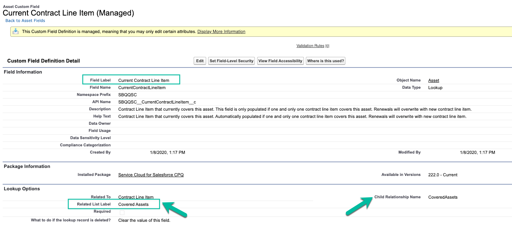
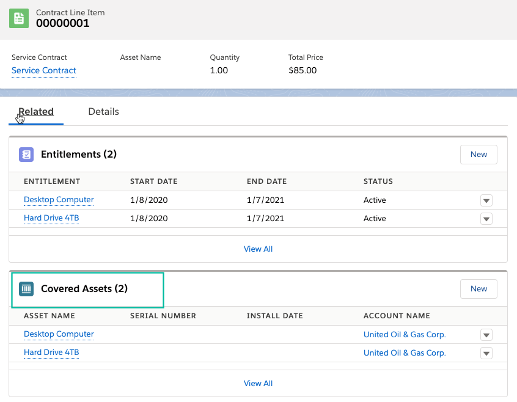

You may have searched the internet high and low as I did to understand the purpose of Covered Assets. Lo' and behold you won't find anything -- save this article on it -- because it is not an object, nor is a "Covered Asset" really anything other than a re-labeled related list on the Contract Service Lines as part of the Service CPQ package.

So what's the point? Well, the point is that this field, which is a lookup field between an Asset and a Contract Line, gives a similar behavior to the Subscribed Asset object, in that it gives the user the ability to see which Contract Lines (subscriptions) cover which Assets. This field, however, is only populated in very specific use cases, in which Salesforce can make the determination of the relationship between the Asset and the Contract Line. The point that it is created is when the subscription product is a Percent of Total of the Asset product and that there is only one Contract Line covering the Asset. Without the noted set up the field, and thereby the related list will forever stay blank.

