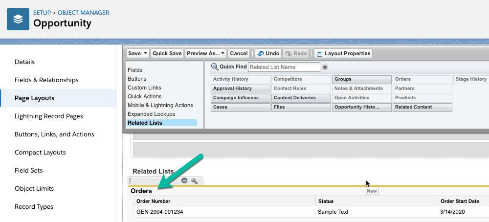
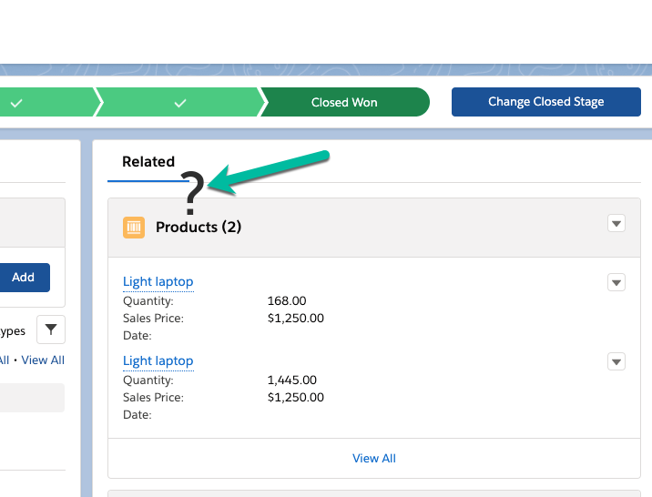
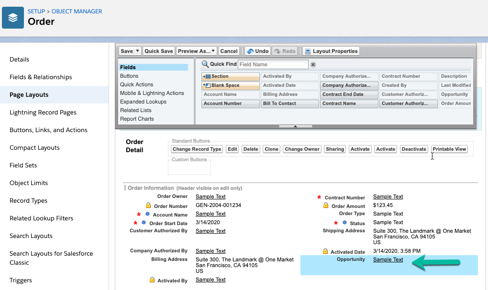
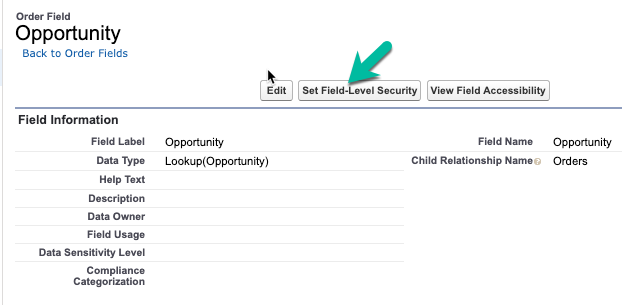
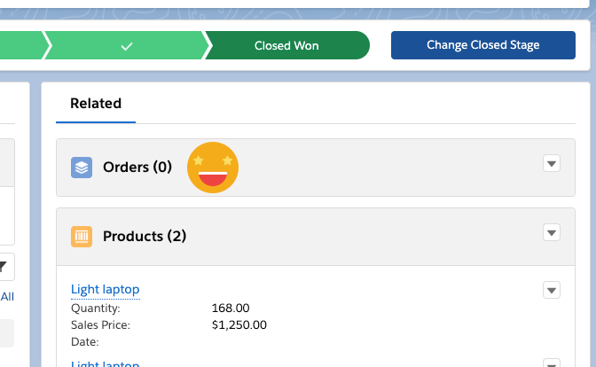

Why is the Order related list not showing up on my Opportunity page layouts? This may seem like a simple thing to fix, you may be saying. Add it to the layout and make sure the user has access to the Orders object.

 

 

Despite going through all of the usual checks, including logging in and out, to make sure the [Lightning cache](http://sf9to5.wordpress.com/2019/02/26/why-quick-action-not-show-lightning/) wasn't getting in the way, I was still unable to resolve such a simple issue. It took some very thorough and deep googling in order to find the solution. Apparently, reasons unbeknownst to us, Salesforce has a random requirement that the Opportunity Lookup field is on the Order layout and that the field not be hidden from the User.

Once you have done that, refresh your page and you should be golden! Shout out to the community members who managed to figure this one out!

