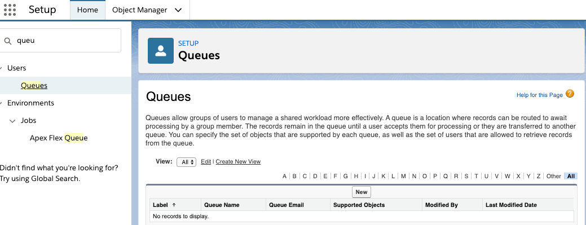
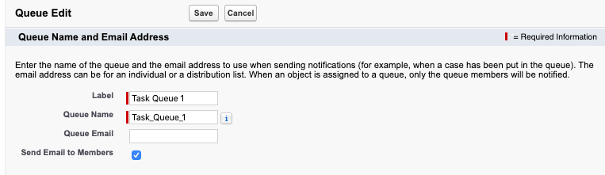
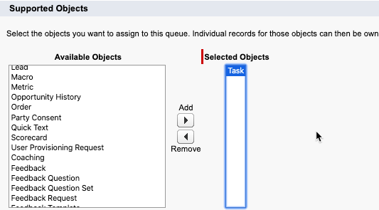
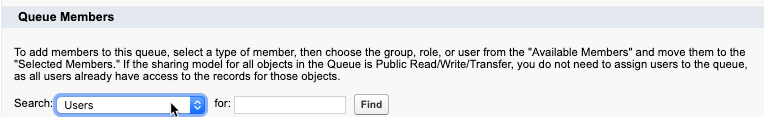
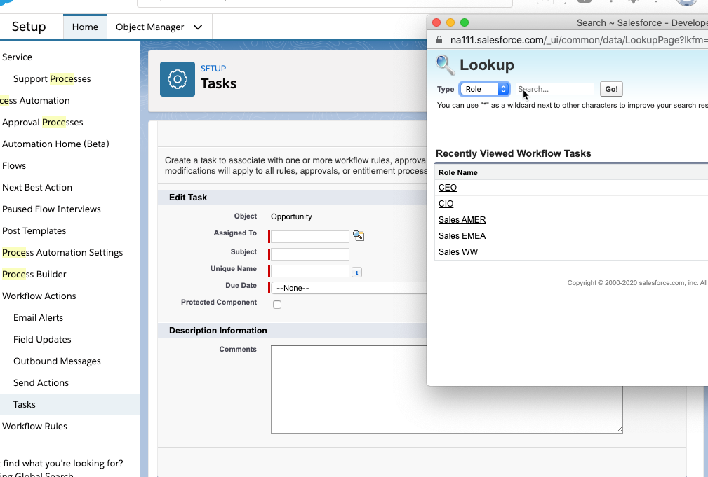
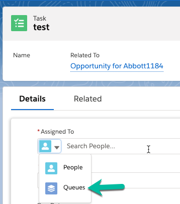
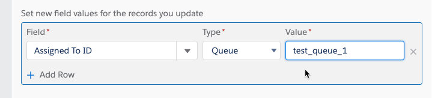

_Updated 7/3/2020 - at the bottom of the post_

As of the [Spring '20 release](https://releasenotes.docs.salesforce.com/en-us/spring20/release-notes/rn_sales_productivity_activities_task_queues.htm), we, admins can finally provide users the ability to assign tasks to queues. For those wondering what a queue is, it is a way of routing records to a specific group of people, roles, or public groups, that enables you to not have to individually list out people. Previously, queues were limited to other objects like Leads and Cases.

The first thing to think about is when do you want to implement task queues. The most common scenario would be a task that could be completed on Opportunity by a certain group of people, but you want to provide the option for any one of those people to complete and also allow them to see it. This is an easier solution than assigning a task to multiple people, as not one person actually owns it and you don't have to do the steps of assigning each person. An alternative common use case is if you have many people who work together but they are on different shifts, this will enable them to all be alerted and let whoever is working at the time take the task.

Setting up the task queues is pretty straightforward, especially if you know how to create a queue already. In the case that you don't, here is how to do that:

1. In Setup go to Queues and click New 
2. Give the Queue a Name 
3. Decide if you want to send it to a distribution list and/or all of the members included. Keep in mind if you chose to do both you may end up with duplicate emails
4. Select Task as the object from the list 
5. Pick your queue members; you have the option of Users, Roles, Roles and Subordinates, and public groups 
6. Click Save

Now that we have our queue we can start using it. Along the lines I mentioned before a common implementation of this would be through a workflow rule or process builder. I am going to set up a task to be created every time an Opportunity is Closed Won. I will assign the task to the queue I created in the previous steps.

Scratch that, as I was working on this article and going based on my understanding of the release notes,  I had assumed that Salesforce would enable the ability to assign to the task queue when generating the Task, however that seems not to be the case. The only logical reason I can come up (and it's a stretch), is that they only wanted to do the modification in the Lightning UI. What I mean by that is, in the Setup section for workflow rules, the UI is still rendered the same as the Classic UI. 

So in actuality, the only place you can make the adjustment is on the Task itself in Lightning. Unfortunately, this still leaves a manual step of changing it to the queue after the task has been created by the system. If someone knows a way around this, leave a note in the comments. 

[https://success.salesforce.com/ideaview?id=087300000007HC0AAM](https://success.salesforce.com/ideaview?id=087300000007HC0AAM)

Update from 7/3/2020 (at least when I found it):

You are able to assign a task to a queue through a process builder, so while not possible through workflows, which would have been great, you can solve this with a process builder.

