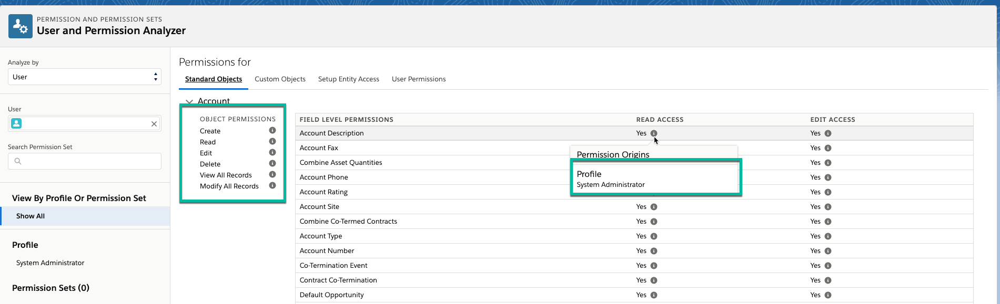
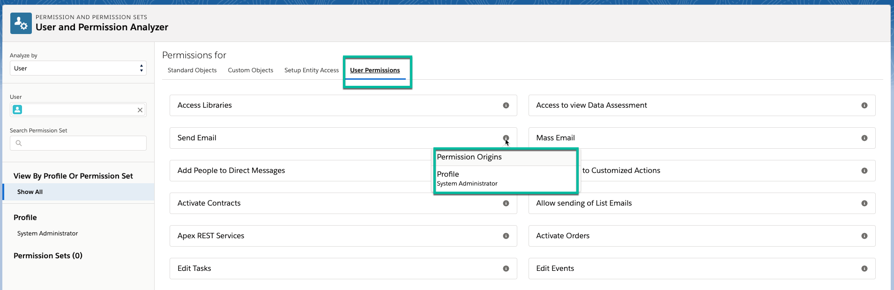
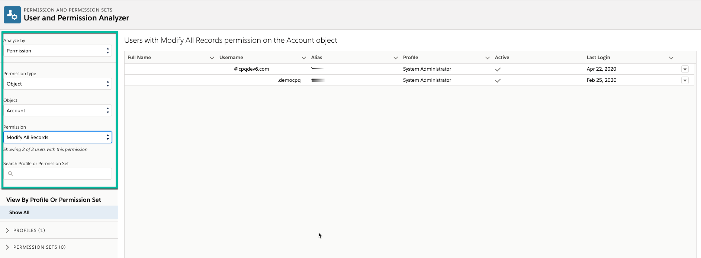
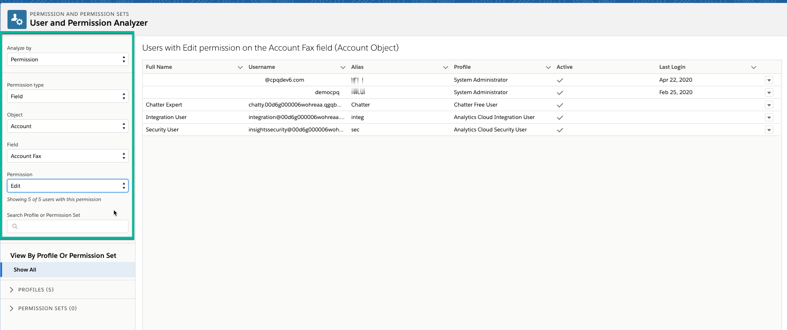
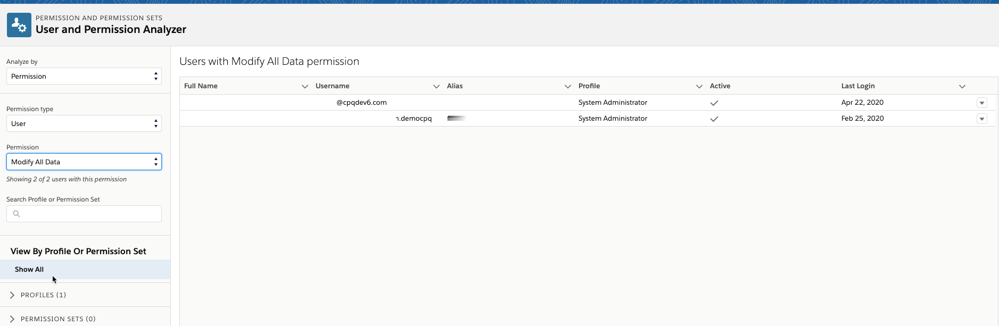

_\*\*\* You will need Lightning enabled and My Domain enabled for this app to work\*\*\*_

In 2018 I wrote a [post about a tool](http://sf9to5.wordpress.com/2018/11/08/review-profile-permission-set-helper/) put out by Salesforce Labs that was designed to help you convert your Profiles to Permissions sets. Well, thanks to a reader who called to my attention some changes to the app, I am here to bring you the updates about the [Profile and Permission Set Helper](https://appexchange.salesforce.com/appxListingDetail?listingId=a0N3A00000FeF99UAF).

It seems that Salesforce has heard our pleas about the Profile setup being very difficult to navigate and run comparisons and understand who has what permission. Well, now the app has an Analyzer feature that lets you do all of that. Let's take a look!

**Analyzing by User:**

The interface is quiet simple. With a series of selections on the left-hand side, you can control what you will see displayed.

Here you can see what permissions the user has by the object.

Here you can see what additional user permissions this person has and even where the permission is coming from (profile vs permission set).

**Analyzing by Permission:**

Have you ever wanted to quickly see who had the Modify All permission or some other permission and know exactly where it came from? Well, this analysis by Permission does just that.

You can filter by Field, Object, or User permissions, you can then choose to display all of the Profiles and Permission sets or filter.

An example of all those with Modify All Object permission on Accounts.

An example of edit on a specific Account field.

An example of Modify All Data User permission.

Overall this is a great tool that makes Profile and Permission set analyzing easy to do. And don't forget it also can [convert Profiles to Permission sets](http://sf9to5.wordpress.com/2018/11/08/review-profile-permission-set-helper/).

_\*\*\* You will need Lightning enabled and My Domain enabled for this app to work\*\*\*_
