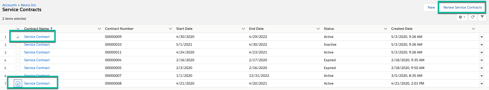
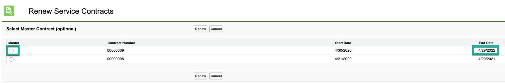
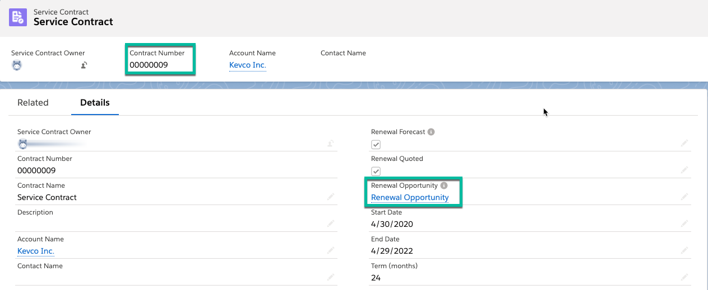
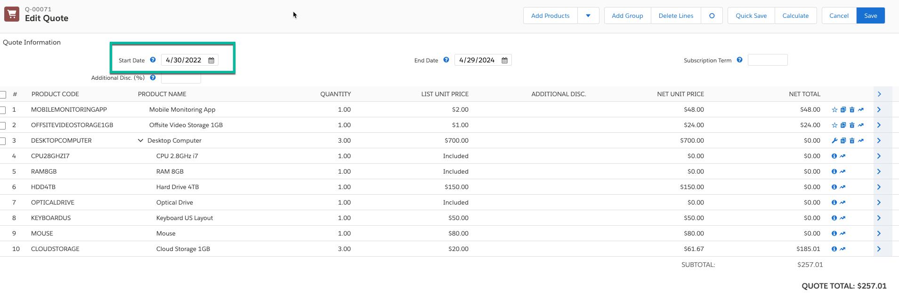
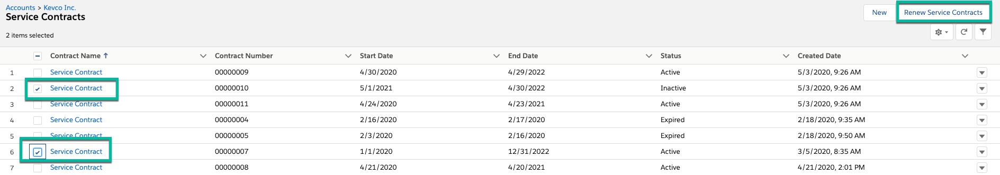
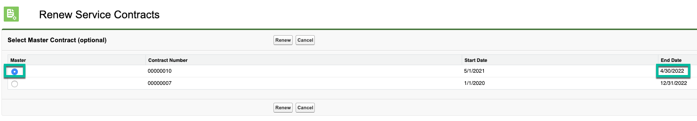
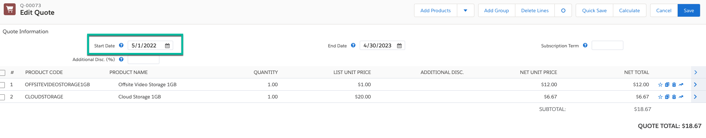
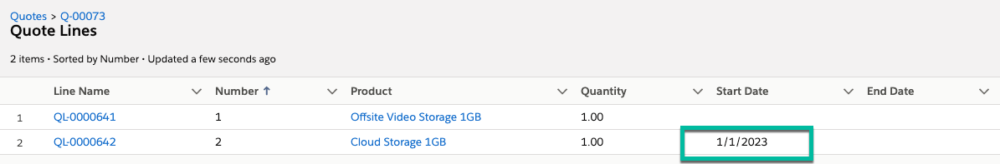

You have several contracts that have occurred on an account that have different subscription products with different end dates. You want to merge them together and renew them all into a single opportunity and quote.

To do the scenario noted above you would use the Renew Contracts or Renew Service Contracts (depending on your [CPQ package](http://sf9to5.wordpress.com/2020/02/25/cpq-service-contracts/)) on the Contracts related List on the Account page.

There are a few caveats to know before jumping into this process:

1. If you have two contracts and one has expired, you need to select the one with the later date.
2. The master contract determines the start and end date of the new renewal quote.
3. If you have two contracts and neither has expired the recommendation by [Salesforce](https://help.salesforce.com/articleView?id=cpq_renew_several_contracts.htm&type=5) is to make the one with the earlier close date to ensure there are no gaps between the dates of the products on those contracts.
4. Whichever Contract is the master will set the length of the new Renewal Quote
5. This is designed for accounts that are doing Contract based Renewals as opposed to Asset-based Renewals.

Ok, so let's do this step-by-step (with the assumption you already have multiple contracts ready):

First let's demonstrate what happens if you select the later end date contract as the master contract.

1. Go the account and select the Contracts you want to Renew
    1. Here I am selecting contract 008 and 009 
2. Select the contract that is ending later 
3. Click Renew
4. You will then be taken back to the Account page
5. Go to the Opportunity related list to find the new Renewal Opportunity (or go to the Contract and refresh to see the Renewal Opportunity link) 
6. From the Renewal Opportunity go to the Quote and click Edit Lines to see the newly created Quote 
7. The issue to call out here is the Start Date. Since we chose the later end date, which controls the start date of the Contract, I have lost time between when Contract 008 ended (4/20/2021) and the start of this new Quote (4/30/2022). This is why Salesforce recommends against this.

 

Alright, now let's try it with setting the earlier end date

1. Go the account and select the Contracts you want to Renew
    1. Here I am selecting contract 0010 and 007 
2. Select the contract that is ending ealier 
3. Click Renew
4. You will then be taken back to the Account page
5. Go to the Opportunity related list to find the new Renewal Opportunity (or go to the Contract and refresh to see the Renewal Opportunity link)
6. From the Renewal Opportunity go to the Quote and click Edit Lines to see the newly created Quote 
7. Here you can see that Contract 0010 had ended on 4/30/2022 and the new quote starts 5/1/2022 - one day after the end of the contract, so no time is lost
8. You can also see though that Salesforce is smart in how it handles the back-dating. The Cloud Storage product, which was had a contract end date of 12/31/2022, does not start until the contract is over. The correct Start Date is stamped on the line. 

 

If you ever need to redo the Renewal process, simply go back to all contracts that were involved in the process and remove the Renewal Opportunity from the field, as well as uncheck Renewal Forecast and Renewal Quoted.
