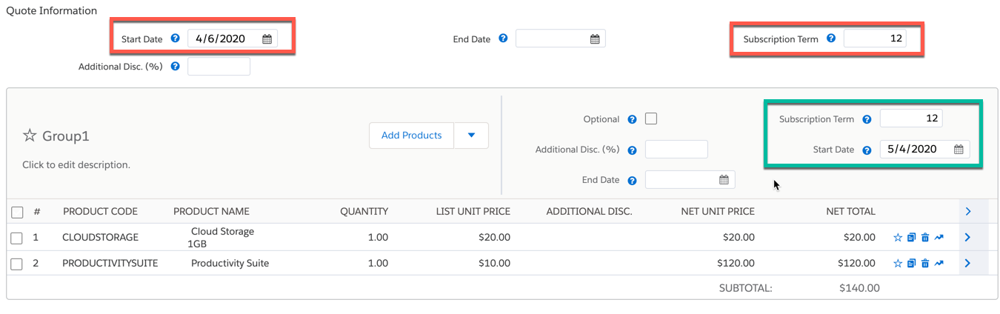
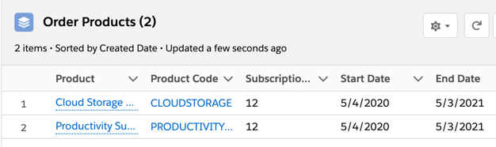
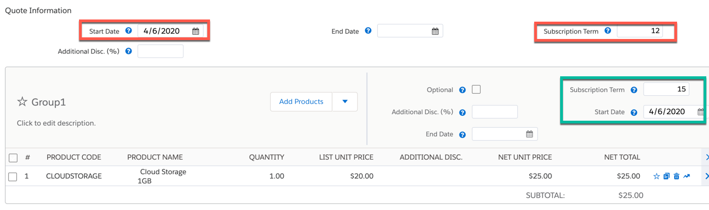
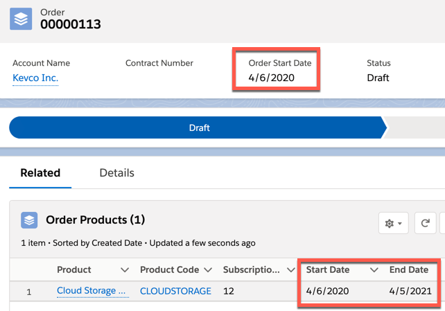
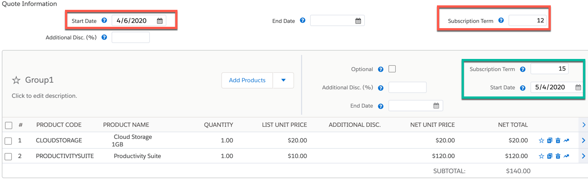
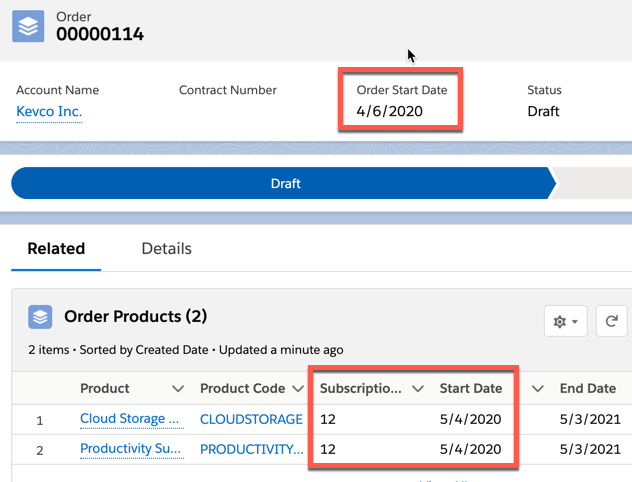
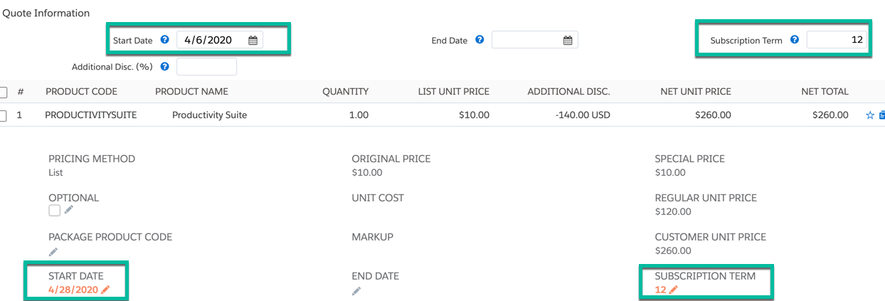
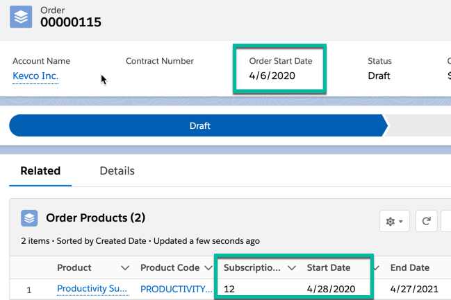
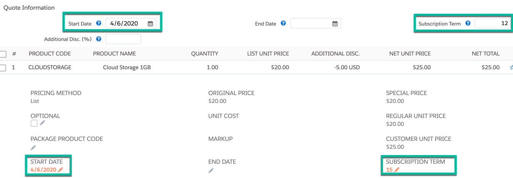
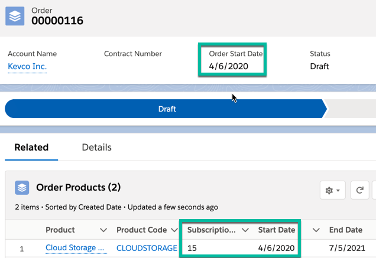

While there is documentation about how dates are set in Salesforce, the documentation can become confusing, if not contradictory when you start looking into the details of which object controls the final dates.

Salesforce says that the specificity for the Quote term and dates goes that the most granular level is the ruling level, meaning it goes Quote Line, then Quote Line Group and then Quote. So if you have all three filled out and they are different the Quote Line will win. However, this premise only actually stays in play if you are contracting directly from the Opportunity. If you are planning on Ordering first a new set of rules kicks in.

In this [documentation](https://help.salesforce.com/articleView?id=cpq_order_date_logic.htm&type=5), Salesforce calls out that in order to make sure the Order Product start and end dates are all aligned for the correct length of time, it will shift the start and end dates of the Order Products to be based on the Order start date. The Order start date can be set either to Today, the Quote Start Date, or a manually entered date until the Order is activated. So, of course, this begs the questions about what dates and terms hold on the Order if something other than the Quote dates/term is filled in.

The question is not one easily answered as different combinations yield different results. I will demonstrate below the various combinations and the results.

\*\*All of these examples are using the Order Start date setting as Current Date\*\*

Scenario 1: Quote Start Date and Term populated and Quote Line Group Start Date and Term populated, with the Start Date being different.

Result: Order Start Date: 4/6/2020; Order Product Start Dates match the Quote Line Group Start Date

Scenario 2: Quote Start Date and Term populated and Quote Line Group Start Date and Term populated, with the Term being different.

Result: Order and Order Product Start Dates match, but Order Product takes the term of Quote (12 months) not Quote Line Group (15months)

Scenario 3: Quote Start Date and Term populated and Quote Line Group Start Date and Term populated, with the Term and Start Date being different.

Result: The Start Date of the Order Products match the Quote Line Group, but it takes the Quote term of 12 months.

Scenario 4: Only populate the Quote Line Group Start Date and Term.

Result: As expected, you keep the Start Date and Term from the Quote Line Group.

Scenario 5: Quote Start Date and Term populated and Quote Line Start Date and Term populated, with the Start Date being different.

Result: Keeps the Quote Line Start Date.

Scenario 5: Quote Start Date and Term populated and Quote Line Start Date and Term populated, with the Term being different.

Result: Keeps the Term of the Quote Line.

 

I could keep going, as the scenario combinations are endless between quote, quote line, and quote line group. The bottom line though that I have found as the oddest and therefore the most important to note is that when using groups and setting start date and/or term at the group level, always clear out the group header information to ensure that the order behavior works as expected.

If anyone knows if this is a Salesforce bug please share in the comments.
