In the Winter '20 release for Salesforce, In-App Guidance was launched. This is a tool that enables you to add prompts throughout Salesforce to help provide useful guiding information to your users where and when they need it most.

[The Summer '20 release](http://sf9to5.wordpress.com/2020/05/19/my-summer-20-favorites/) extends the functionality in two ways. One for those who do not have [MyTrailhead](https://salesforceben.com/mytrailhead-what-is-it-and-why-do-you-need-it/), the In-App Guidance prompts now have more locations on the screen they can live and the user has the ability to move them around. For those who do have myTrailhead or are considering it, Salesforce added a Walkthrough functionality that sounds a lot like WalkMe but specific to Salesforce.

I am going to walk through setting up In-App Guidance in the Summer '20 preview org. I did not set up the Walkthrough functionality.

1. Go to Setup --> In-App Guidance 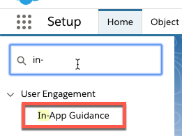
2. You will be taken to the newly updated In-App Guidance Builder
3. Go to the screen you want to add a prompt to and then click the Add button on the far right. I am using the Homepage for this example 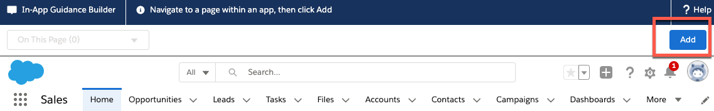
4. I am using the Single Prompt option 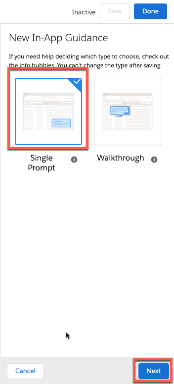
5. You will then be presented with the option of docked or floating. Docked means it is attached to the footer/bottom of the screen, floating means you can place it somewhere on the screen, perhaps close to the item you wish you to provide information about. 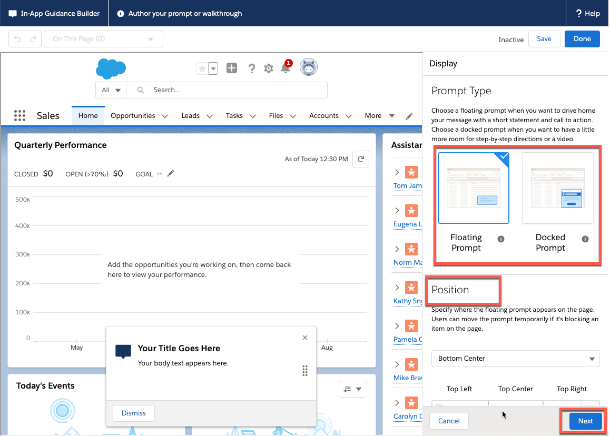
6. If you choose floating you then get the ability to set where you want it to live. 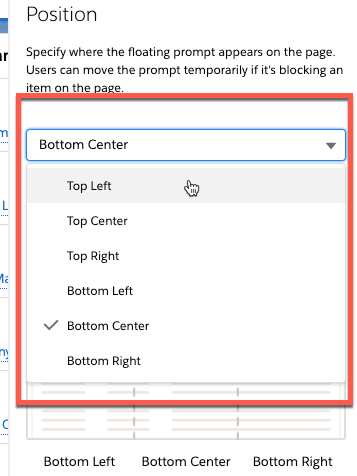
7. On the next screen, you will be asked for the details of the prompt. 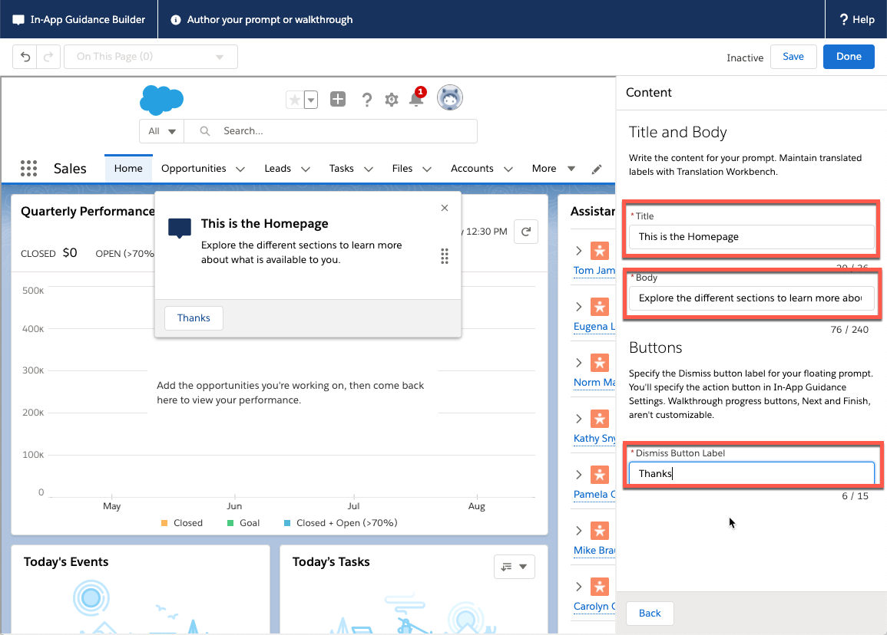
8. You then need to Save - this will bring up an activation walkthrough.
    1. Name your buttons and provide the link to where the prompt lives. 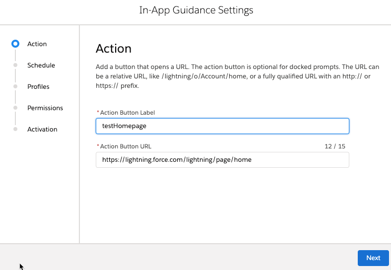
    2. Schedule for how long and for how many times the user should see the prompt. 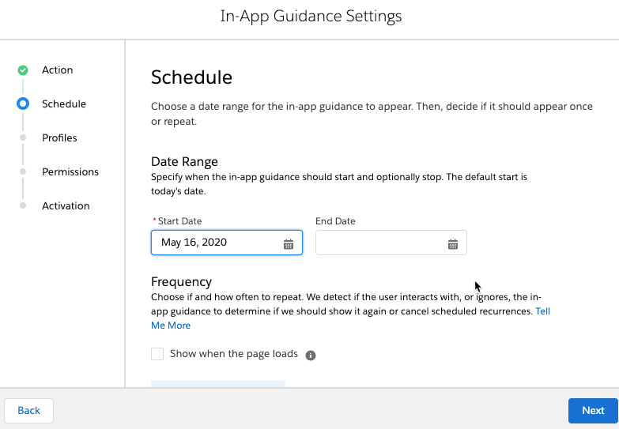
    3. Select the profiles/ permission sets that this should be applied. You also can have it apply to everyone. I would like to call out the very odd limitation though, that if you select profiles/permission sets you are limited to 10. 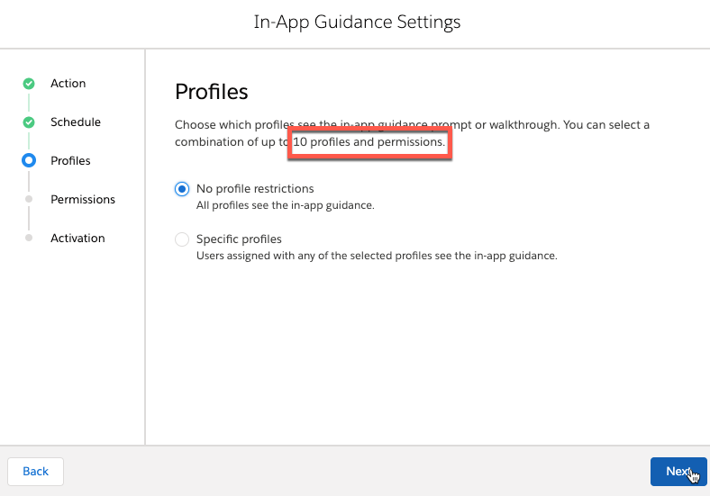
    4. Finally, you are giving the prompt itself a name and a description. 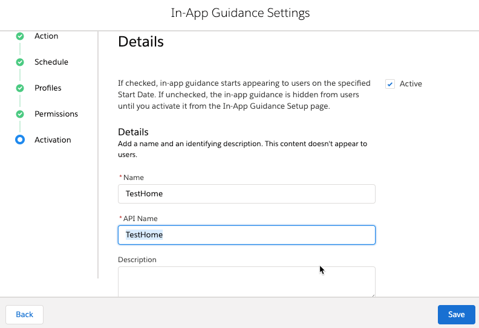
9. Last but not least try it out in the builder - you can select it from the dropdown list and then you will see it the same way a user will. The set of dots on the right allows the user to move the prompt around. 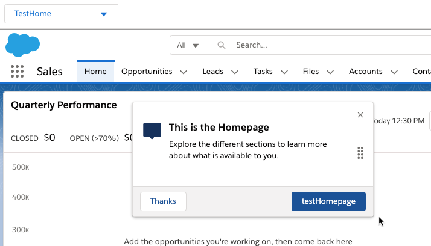
