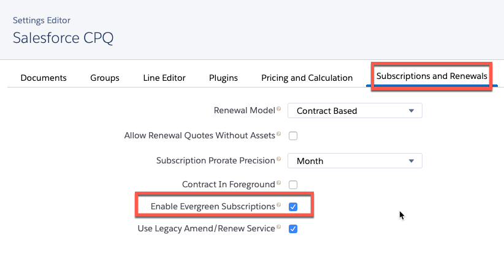
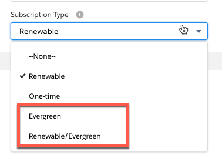

A question I have heard since the Winter '19 release, where the Subscription Type options for CPQ products were expanded, is what is Evergreen and what is Renewal + Evergreen.

In short form, an Evergreen subscription product is a product that never ends, think your Netflix subscription, its monthly and just keeps going until you cancel. Setting up a product in Salesforce as Subscription Type Evergreen results in the same idea, you get a product that doesn't have an end date and isn't renewable.

This may lead you to think that the Subscription Type, Renewal + Evergreen is a renewable evergreen product, however, this is just a result of a bad naming convention on Salesforce's part. Renewal + Evergreen is actually a Subscription Type where the product as a regular subscription for the initial purchase time, and then on the renewal becomes an Evergreen product. So in a more real-world example, you get a deal on your phone bill for the first year by signing a contract that has an end date once the year is complete. On renewal of your phone bill you move into monthly payments with the ability to cancel at any time.

In order to access these two Subscription Types, you do need to have Evergreen products enabled and then you need to add the options to the Subscription Type picklist.

To learn more about managing and quote Evergreen products checkout the [Salesforce documentation.](https://help.salesforce.com/articleView?id=cpq_evergreen_use.htm&type=5)
