Multi-currency is a feature that comes with Salesforce that is very useful if your company either is multiple countries with different currencies or simply sells in more than one currency. Below I am going to walk you through the basic steps of setting up a secondary currency using GBP (Great British Pound).

1. Go to Setup --> Company Information 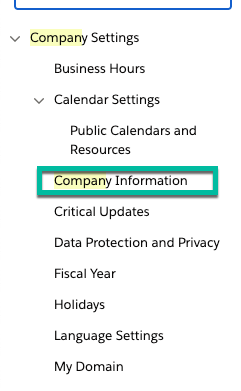
2. Click on the Edit button 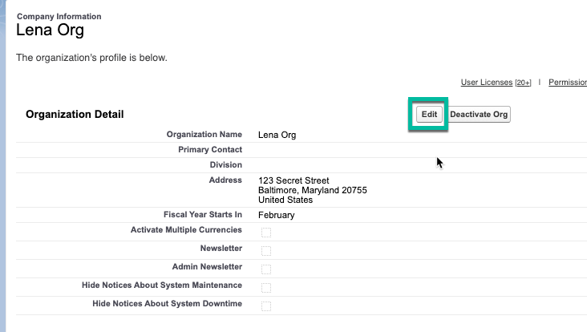
3. Check the Activate Multiple Currencies box and click Save 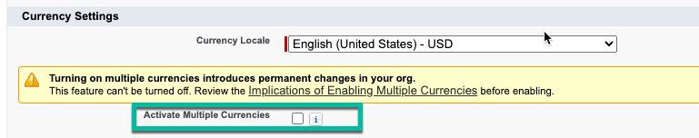
4. You will now see an extra button called Currency Setup, click it 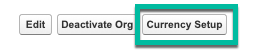
5. By default, Advanced Currency management will be off 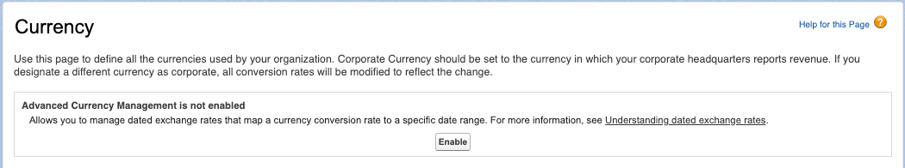
6. By default Parethentical Currency Conversion will be on - this is what you will see on any currency field when your default currency and the currency of the record you are on do not match. 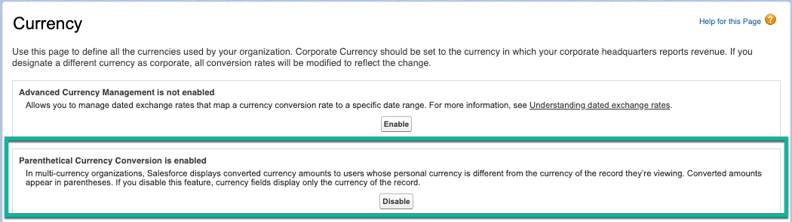
7. In the Active Currency section, click New 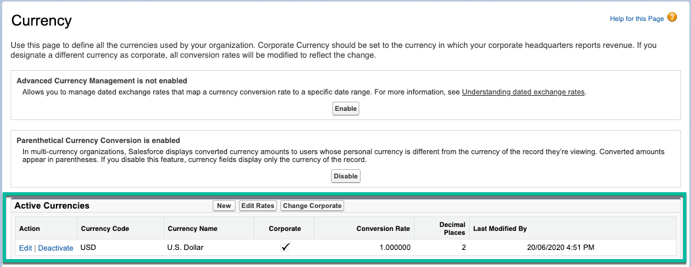
8. Select your Currency Type, add your conversion rate, and set your decimal places (used for rounding the Parenthetical value) 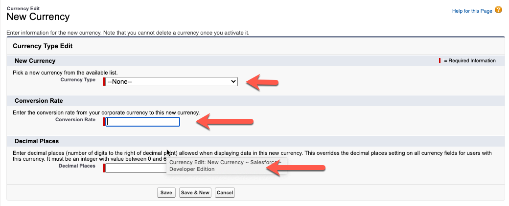
    1. Conversion rates in Salesforce are controlled by you; it is possible to purchase third-party products on the AppExchange if you need something more sophisticated for obtaining the values if Google does not work for you.

Other buttons/features

Change Corporate Currency - this allows you to change the default currency for the company as a whole. 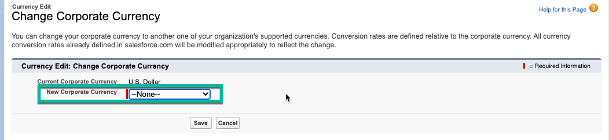

Edit Rates button - this allows you to change the rates associated with your currencies 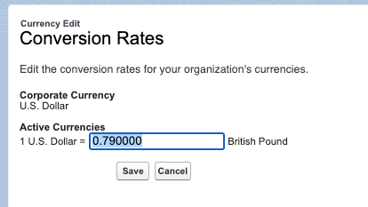

Edit on the Active Currency line - this allows you to change the decimal places associated with the currency 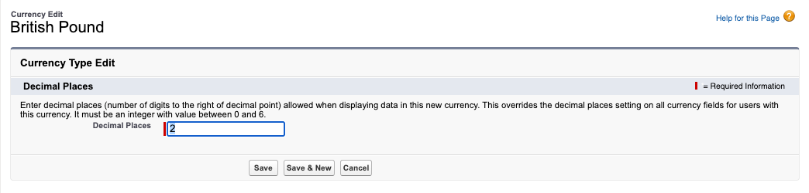

That's it for you basic multi-currency setup. Stay tuned for more.
