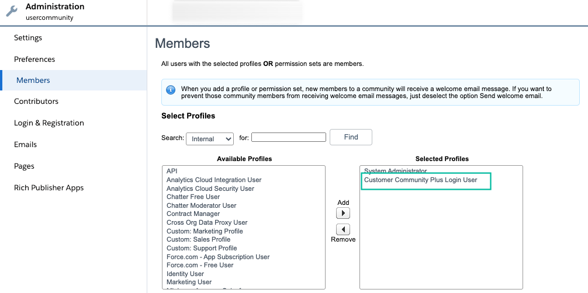
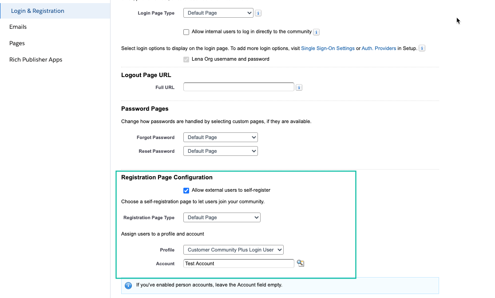
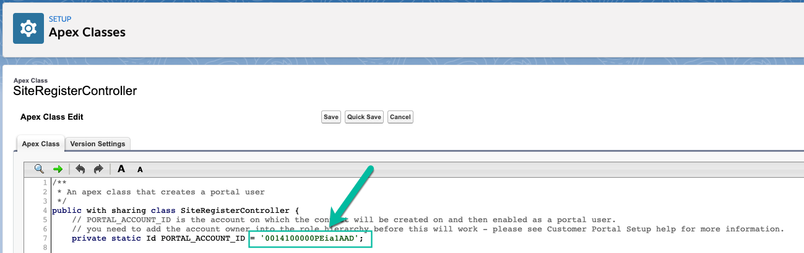
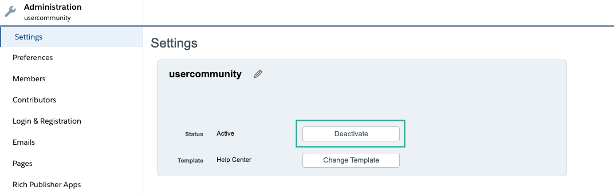

Some new projects have come my way and I am starting to dive deep into the Community Cloud that Salesforce has to offer. The first thing on the list was to get a Customer Community up and running with a Self-Registration login. There are Trailheads and Salesforce documentation on how to do this, however, despite my best efforts to follow the steps, they did not result in success.

After spending too many hours trying to wrangle the Salesforce documentation, StackExchange, the Community, etc. into something that led to an actual result, I managed to compile a list of things you need to make sure you have done in order to successfully use self-registration in a customer community.

1. I am going to start with the obvious one based on the title of this article, which is to make sure you have a Customer Community set up.
2. Make sure you have an Account ready that will serve as the account to be associated with your self-registering users.
3. Ensure that the owner of the Account has a role - very important, otherwise, you will keep getting the error "Portal Account Owner must have a role". This role will be the role that those users have.
    1. In the most basic scenario, I had one account and one role.
4. Next is to ensure you have a profile prepared for these new users and you have added in on the Members page.
    1. All Communities --> Workspace --> Administration --> Members 
5. Complete the Login & Registration section of the Administration workspace to match the settings below. 
6. Next is a very important step, left out of all of the documentation, you need to update the Portal Account id in the SiteRegisterController apex class.
    1. Setup --> Apex Classes --> SiteRegisterController
    2. The ID needs to be the ID of the Account noted in item 3 
7. Second, to last, make sure you have published your site to get all of the changes live.
8. Lastly, make sure your site is Activated! 

 

There you have it, my list of eight things you should make sure you have done to successfully launch self-registration for a customer community. Hopefully this saves you from searching, "Self-Registration for Communities not working".
