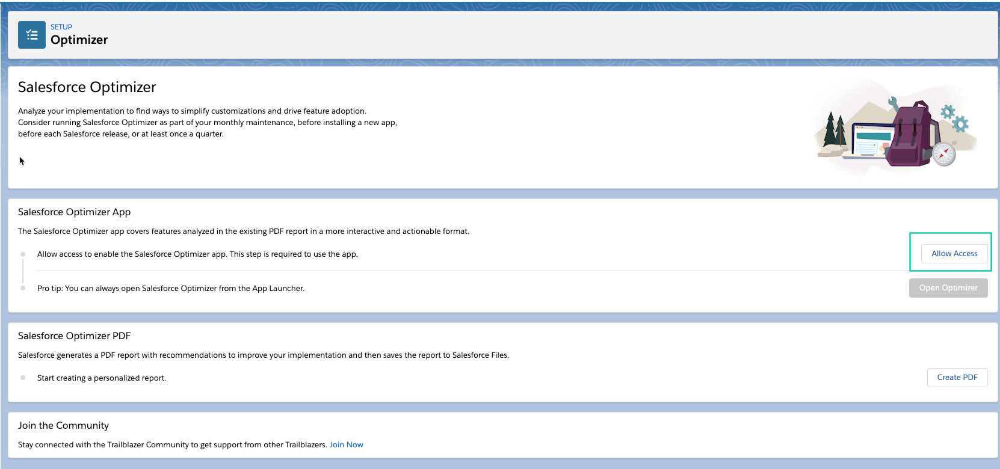
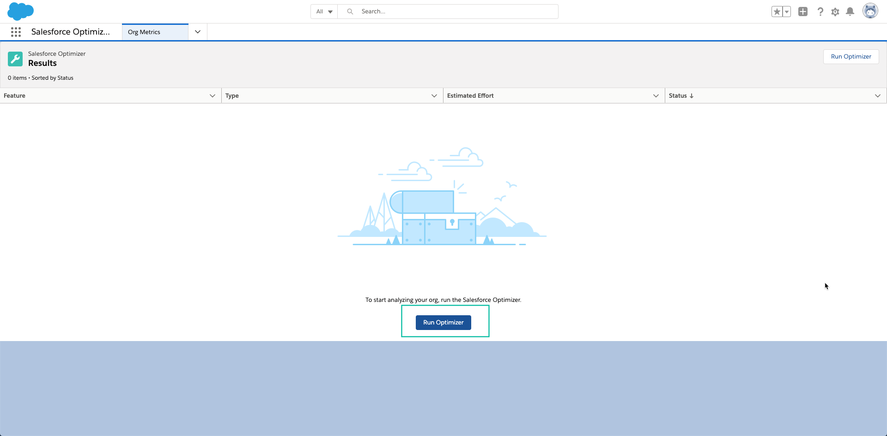
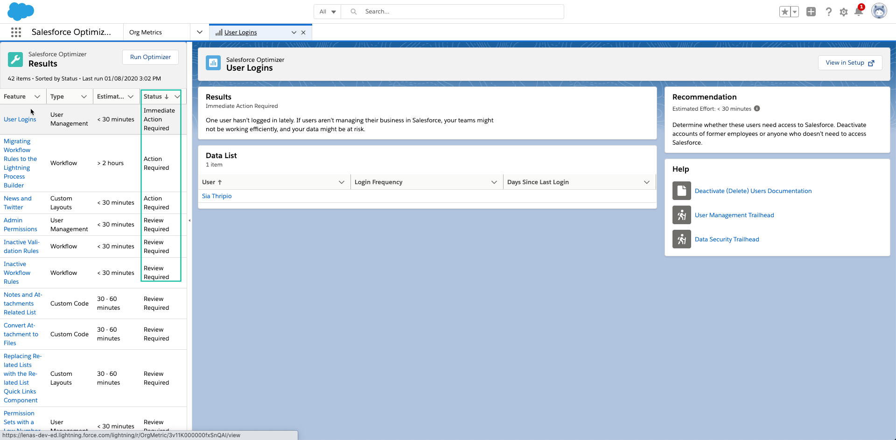

The Optimizer app is an app provided for free by Salesforce. It is accessible through Setup when in the Lightning interface. The Optimizer app gives you a rundown on how your system is configured and where improvements can be made.

Before the [Summer '20 release](http://sf9to5.wordpress.com/2020/05/19/my-summer-20-favorites/), Salesforce only offered the Optimizer functionality as a report that had some limitations to it, including only showing N amount of records for specific queries, expecting the user to rerun the report after making some changes. Luckily, with the new release, those days are behind us.

In the Summer '20 upgrade, the report is now a functional app, that you can interact with. After turning it on in the settings, you can run the Optimizer, and then sit back and wait while it generates the information.

 

\[caption id="attachment\_3319" align="alignnone" width="1662"\] Allow Access for Optimizer to Run\[/caption\]

\[caption id="attachment\_3320" align="alignnone" width="1920"\] Click Run Optimizer to start the app - it can up to 24 hours.\[/caption\]

 

Once the Optimizer has finished running, you will get a list of records that can be clicked into. Salesforce was also smart and made the app run with a split-screen, so you can always see the list of features on the left-hand side the need adjusting.

One of the really cool things about this update, beyond being something you can tangibly work with, is the fact that in each item that you click, you get a specific dashboard-style page that includes what needs to be adjusted with a description. A list that you can actually click on the relevant records. There is also a Setup button that will take you to the correct place in the Setup menu to make adjustments. Additionally, they provide links to material that may help make the necessary changes.

Below are some general examples of different records you might see.

\[gallery ids="3322,3323,3324" type="slideshow"\]

One thing I would like to call out is that you can easily see as part of the record, Salesforce tells you the immediacy of needing to fix the item using  - Needs Immediate Action, Action Require, Review Required, No Action. This can be very helpful if you have limited time to put towards this.

Running the Optimizer app on a quarterly or semi-annual basis is an excellent practice to get in the habit of, as it can help you ensure that you are keeping your Salesforce in tip-top shape. And if you ever in need of the physical report to show to anyone else, why this important, that is still accessible from the settings page.
