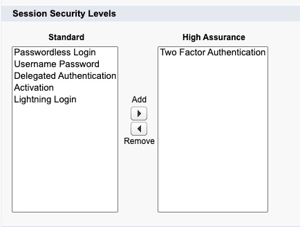
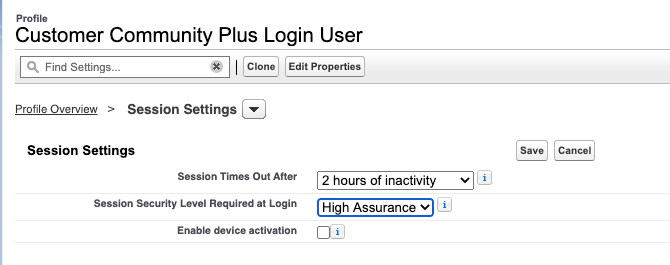
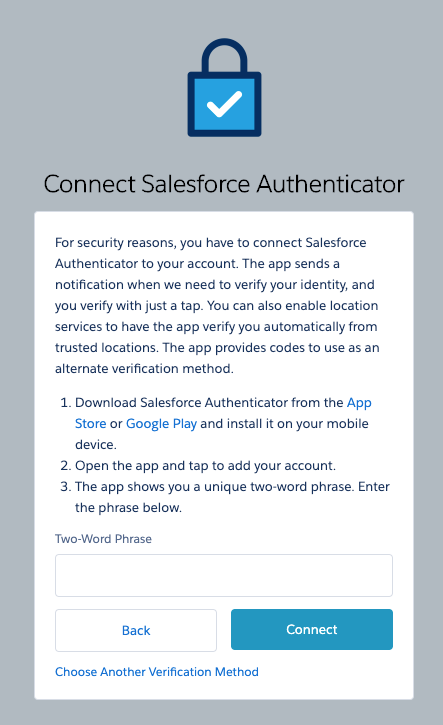
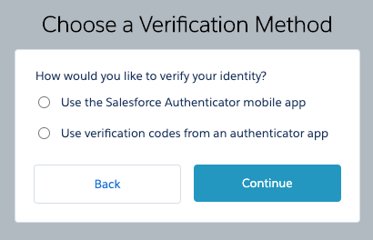
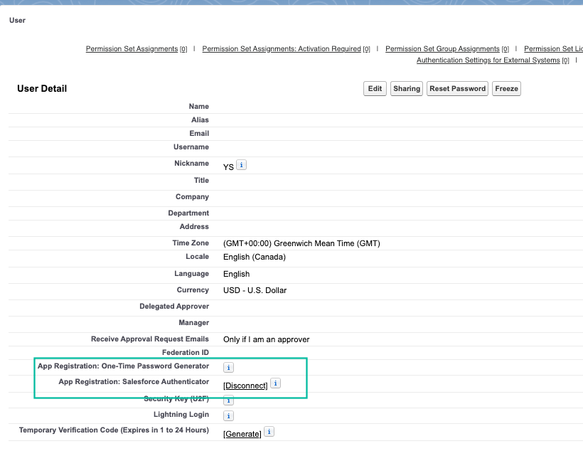

You have recently created a Salesforce Customer Community and have enabled Self-Registration for users, meaning that they can sign themselves up for an account with your site. Well, perhaps you are security-minded and want to ensure that those who are logging in are really who they say they are and the account/ email hasn't been compromised.

One of the really good ways to address this is to enforce two-factor authentication (2FA) on login. What this means is that any user logging into your site will be required, to not only identify themselves with a username and password but that they will also need to receive a code through an authenticator app.

It is important to call out the Salesforce does not consider email and SMS verification codes to be 2FA codes, rather they are used in scenarios when you have logged in from an unfamiliar browser, IP address, location, etc. During those points, if 2FA is not turned on, you will be sent a verification code to either email or SMS to [confirm your identity](https://help.salesforce.com/articleView?id=activating_computer.htm&type=5).

Setting up 2FA for the community is a rather simple process. You simply need to make sure that Two Factor Authentication is listed in the High Assurance column in the Session Settings (Setup --> [Session Settings](https://help.salesforce.com/articleView?id=admin_sessions.htm&type=5))

and that the profile you wish to use for the community has its Session Security level set to High Assurance as well.

This ensures that the next time the user logs into the Community (regardless if it is their first time or not) they will be forced into utilizing an authenticator app.

Below is what the user will see on the next login after 2FA is enforced. They are first presented with the ability to use Salesforce Authenticator, but they do have the option to select an alternative verification method.

Salesforce and Google authentication are the most popular. To learn more about them please check out their individual sites.

Salesforce Authenticator App: [https://play.google.com/store/apps/details?id=com.salesforce.authenticator&hl=en\_US](https://play.google.com/store/apps/details?id=com.salesforce.authenticator&hl=en_US) Google Authenticator App: [https://play.google.com/store/apps/details?id=com.google.android.apps.authenticator2&hl=en\_US](https://play.google.com/store/apps/details?id=com.google.android.apps.authenticator2&hl=en_US)

In the case that Salesforce authenticator is used, there is a specific setting for the app is that that enables the ability to decide whether to support geo-location, meaning you can let the user share their location and if the location remains the same the next time they log in they will not be prompted again. This setting is also found in the Session Settings.

To disconnect the app, simply go to the user and click Disconnect next to the correct app. Doing this will enforce that they again set up the app the next time they log in.

