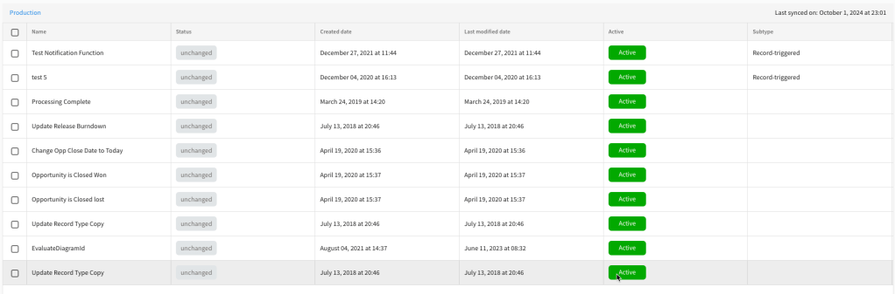
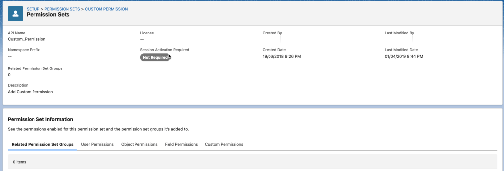
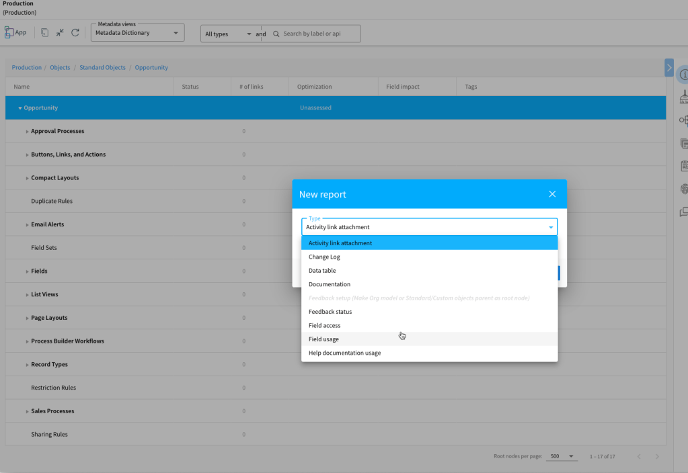
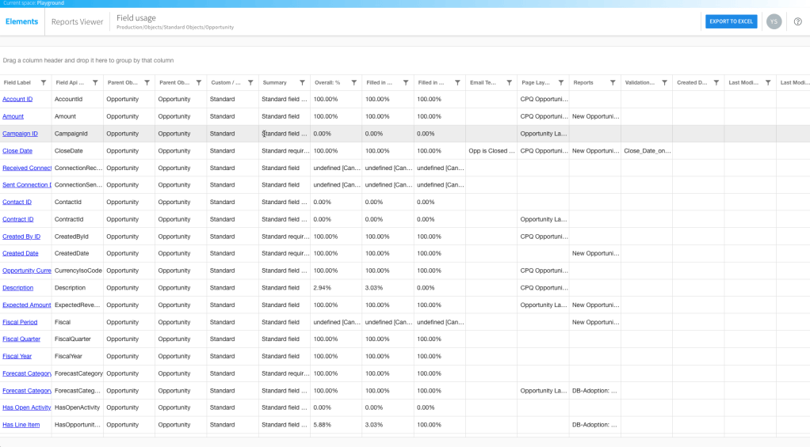
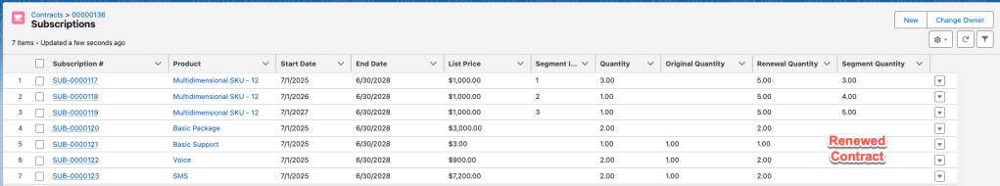
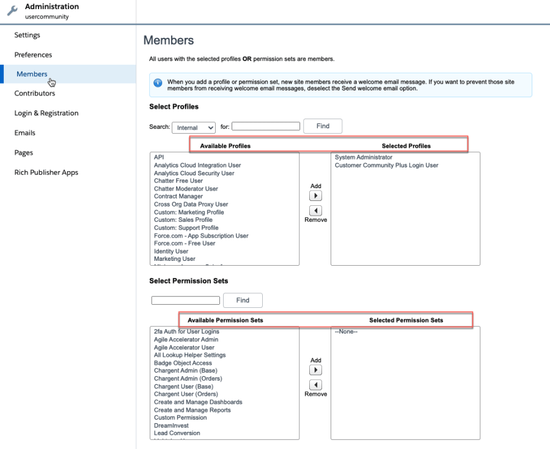
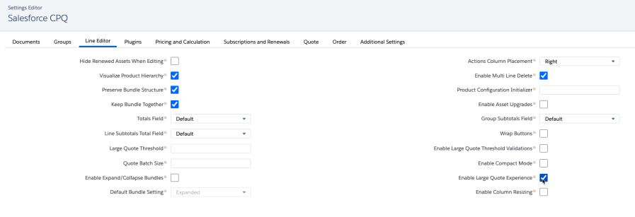
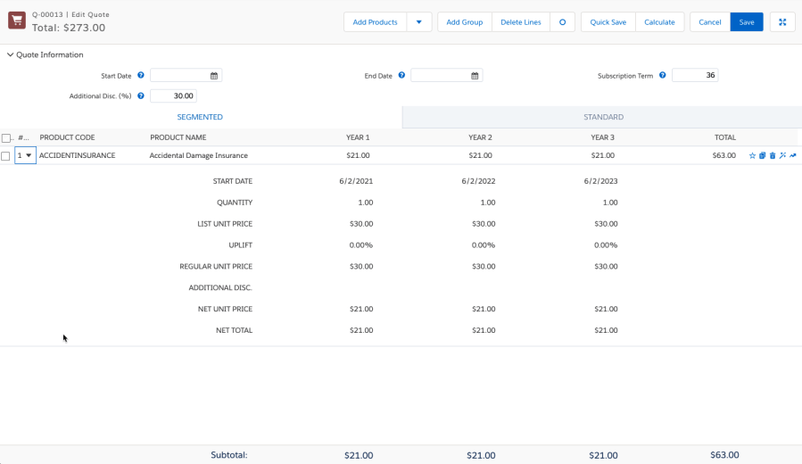

I can't believe I finally get to write this article - I also cannot count how many times over the years I have been asked can we make a button on a layout dynamic without changing page layouts. Dynamic Actions is finally here! In the Winter '21 release it is Beta for Standard Objects and in GA for Custom Objects. Below I will walk through the steps of setting up a dynamic button on an Account page.

1. Make sure you are in Lightning!
2. Go to either an existing Lighting Record Page or create a new one
    1. For more details on Lightning Record Pages and Lightning in general check out my reference guide:
3. Click into the Highlights panel at the top of the page

4\. Click on the check box to turn on the Dynamic Actions feature in the right side bar

5\. Click the Add Action button

6\. Search for an Action - there are three types: Standard, Quick, and Productivity

7\. For this scenario I am going to create a filter for the New Opportunity button to only display when the Type= Channel/Partner Reseller

You can either use the Record Field option to find the field or you can use the Advanced option which provides even further granularity, including lookups.

Once you have selected the option and the field and set the filter it will look like this:

8\. Now time to test!

<figure>

<figcaption>

Without the button, because the Type is not the filter value

</figcaption>

</figure>

<figure>

<figcaption>

With the button, because the Type is the correct filter value

</figcaption>

</figure>

The change happens automatically on save. And there you have it! There are so many different use cases for this, and really gives us admins the ability to be more selective and granular about when and to whom we show the different buttons.
