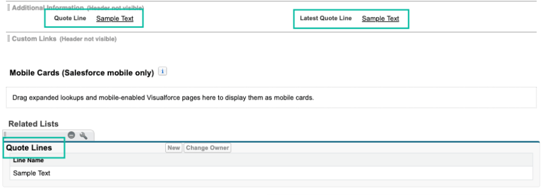

I recently discovered some useful fields for CPQ in connection with the [Asset record](https://sf9to5.wordpress.com/2020/03/10/what-is-covered-asset/). They are there to assist in connecting back to the original Quote Line. They also provide extra details in the scenario that your Asset is connected to a percent of total Subscription Product.

Quote Line: This reflects the Quote Line that created the Asset Record it is connected to.

Latest Quote Line: If this Quote Line is impacted by an Amendment, this will show the most recent Quote Line related to this Asset.

Subscription Quote Line: This field gives the Quote Line of the Subscription Quote Line, if there is a related percent of total product.

There is also a related list on Asset called Quote Lines, which shows the related Quote Lines when the Asset is connected to a renewal Quote Line through a Subscription product.
