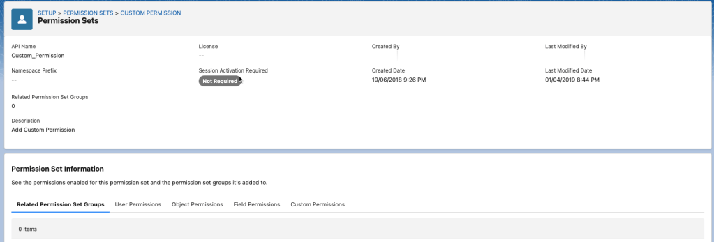

With the Winter '21 release, Dynamic Forms became GA for Custom objects in Salesforce. Dynamic Forms provide the ability to customize the Lightning Record Page by field, giving more control to admins than the Page Detail Layouts.

Below, I will walk through some of the setup steps for the Dynamic Forms, but before doing so, I want to make a quick call out - my experience with this has been limited and a bit buggy. I highly recommend reviewing several sets of documentation from Salesforce before jumping into making any changes from the standard Page Detail Layout to the Dynamic Forms.

- Dynamic Form Limitations: [https://help.salesforce.com/articleView?id=dynamic\_forms\_limitations.htm&type=5](https://help.salesforce.com/articleView?id=dynamic_forms_limitations.htm&type=5)
- Dynamic Form Known Issues: [https://help.salesforce.com/articleView?id=dynamic\_forms\_known\_issues.htm&type=5](https://help.salesforce.com/articleView?id=dynamic_forms_known_issues.htm&type=5)
- Dynamic Form Tips and Considerations: [https://help.salesforce.com/articleView?id=dynamic\_forms\_considerations.htm&type=5](https://help.salesforce.com/articleView?id=dynamic_forms_considerations.htm&type=5)

To get started with setting up Dynamic Forms, you will need to decide which Custom Object you would like to do this on and determine if you will use an existing Lightning Record Page or create a new one. For the purpose of this walk-through, I am using the CPQ Quote Object and an existing Lightning Record Page.

1. On the Lightning Record Page, click the Upgrade button to be taken through the wizard  
    

2\. Walk through the steps of the wizard. The last step will ask you which of the existing Page Detail Layouts you are looking to use as the basis for the setup.  

3\. After completing the wizard you will see some adjustments in the Details tab

4\. You now have the ability to do several different things.  
\-- Create filters on fields  
\-- Create filters on sections  
\-- Create/Remove sections  
\-- Add/Remove fields  
\-- Set Read-Only/Required UI settings \*

To set a field level filter, you click the field you want to set the filter on and proceed through the steps as indicated in the panel on the screen's righthand side.

The process for this is very similar to Dynamic Actions - so if you would like more details, please check out my [How To for Dynamic Actions](https://sf9to5.wordpress.com/2020/11/03/setup-dynamic-actions/). Setting up the filters on the Sections is the same as the setting them up for the fields.  

After you have completed the process of setting the filter you will see this icon set on the right side of the section - 

Lastly, I did attempt to set the UI settings for Read-Only on two fields. While it was indicated in the back-end that it was turned on, it did not respect the choices I made in the UI. As mentioned previously, I am still learning this tool. Please refer to this [help article](https://help.salesforce.com/articleView?id=dynamic_forms_req_fields.htm&type=5) for more information.

Once back in the UI, you see the updates you have made.

<figure>

<figcaption>

Updated Layout - Discount Section not shown

</figcaption>

</figure>

<figure>

<figcaption>

Status field updated, Discount Information Section showing

</figcaption>

</figure>

I foresee this tool being extremely useful in the future and an excellent way to move away from Page Detail Layouts. I do believe there is a learning curve to this and the fact that Salesforce still has a bit to go on the development side. However, long term, I believe we will be able to say goodbye to a million fields on a layout and change how we need to use validation rules and required fields.
