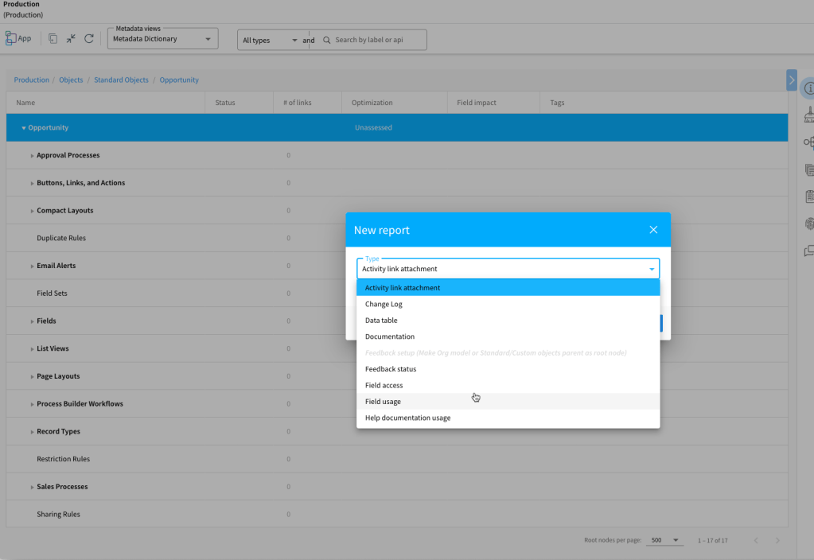
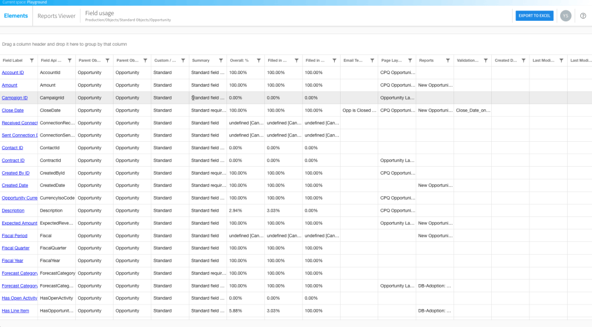

So you have decided to go the route of using Advanced Approvals, congrats! Advanced Approvals has many features that Standard Approvals do not have, one of them being Approval Chains. Approval Chains allow you to have multiple routes for a particular record to go and have those routes run in parallel.

To get more specific, take an Opportunity, for example, that you want to have approved by several different departments prior to closing the Opportunity. You may want Finance to look at the record to ensure all relevant invoicing information is provided. You may want a certain set of Sales leadership to review it to confirm what was sold is valid and accurate. You may even want a deployment team or installation team to review it to ensure that they have all of the information they need to get what was purchased by the customer set up.

The scenario I described above is the perfect use case for using Approval Chains. In the case above, you would likely have different criteria for each department to check the Opportunity. You wouldn’t want one team holding up another team from approving the Opportunity.

Setting up Approval Chains in Advanced Approvals is very easy. You simply go to the object and click New, provide the name and the relevant object for the chain.

Once this is done, you will be able to create Approval Rules. These rules behave similarly to standard approvals. You set the criteria for each rule and decide who gets the approval and when in that specific chain they will need to approve (think if you have three steps in Sales leadership who will need to approve consecutively).

Based on the scenario I described above the diagram would look like this (each "column" is a chain):  

That's pretty much it for the chains. They give the ability to construct multiple pathways that run in parallel for the approval process. And for clarity's sake, I will also add that this ability to run in parallel does not mean that all chains must approve. They will only need to approve if the rules within the chain are met. Additionally, if a person who is required to do approval is in more than one chain, they do not necessarily need to approve more than once (there is a setting in the rule to determine this).
