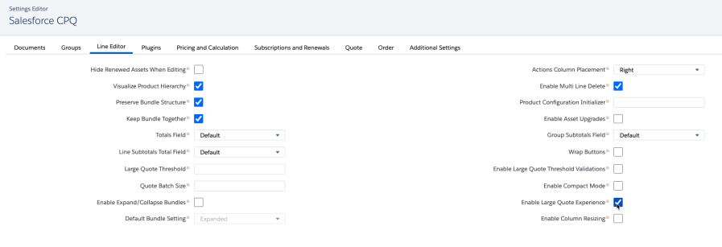
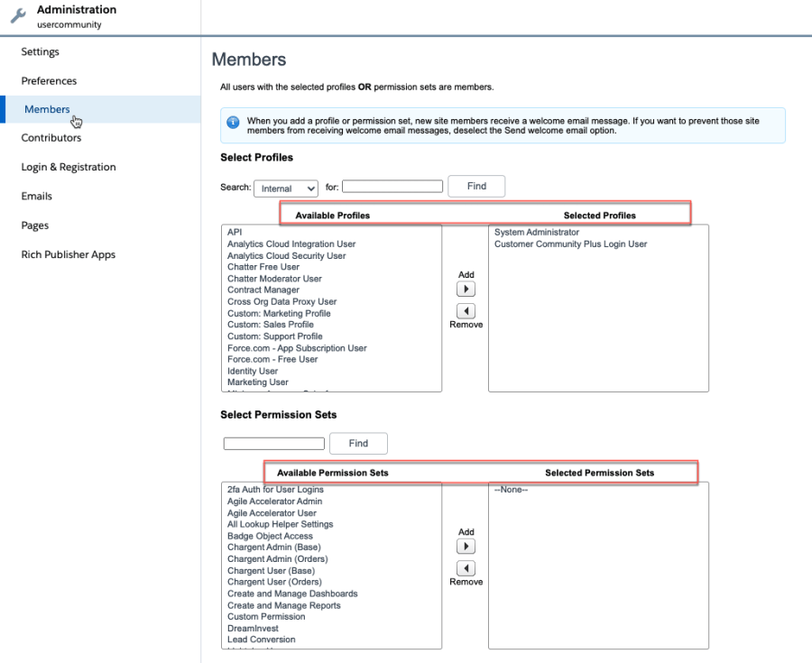
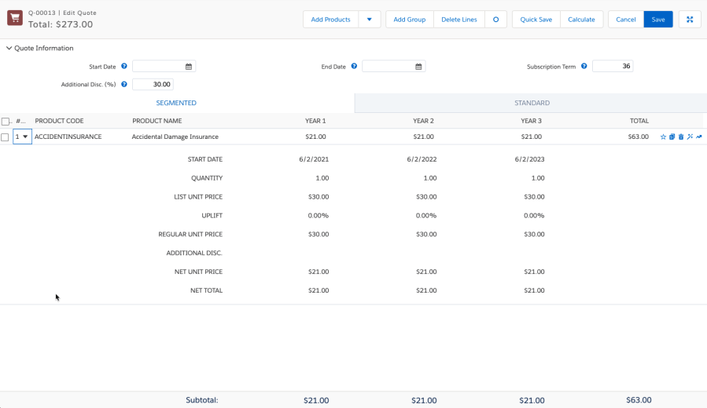

Perhaps you read my last article on [Advanced Approvals](https://sf9to5.wordpress.com/2021/04/06/advanced-approvals-chains-use/) about how and when to setup Approval Chains, and you are now working on the Approval Rules and Approval Conditions in those Chains. In this guide, I will walk through setting up an Approval Condition and what the different fields on the page mean.

1. Find your relevant Approval Rule  
    

2\. On the related tab, click New next to the Approval Condition  

3\. Fill out the fields on the Approval Conditions  

<figure>

<figcaption>

This rule is checking that the Amount field is greater than 100000

</figcaption>

</figure>

1. The Condition Name is an auto generated number.
2. Approval Rule - as long as you clicked New from the Approval Rule record this will be auto populated.
3. Index gives you the ability to represent this condition with a numeric value. The Index can be used when there are multiple conditions that apply to one Approval Rule and you need to have logic (AND/OR) applied to those conditions.
4. Enable Smart Approvals - this is a special feature that is only in Advanced Approvals. Checking this box tells the engine to store the original value captured by this condition, and check in a re-approval process whether the value has changed or not. If it has not changed then the Condition will not require approval again.
5. Tested Field - this is used if you are going to use a field on the object for the comparison check.
6. Tested Variable - this is used if you are using an Approval Variable as the basis for the comparison check (see upcoming post on this soon).
7. Operator - this field is used to determine if how you want to evaluate the Tested Field or Tested Variable
8. Filter Type - this is the other side of the comparison, you will need to decide if you will be comparing to another field, value, or a variable.
9. Filter Field - if you selected Field in #8, then you will populate this with the secondary field to compare the Tested Field or Tested Variable against.
10. Filter Value - same as #9, but this type you will enter a value
11. Filter Variable - same as #9 and #10, but this time you will select an Approval Variable

Once you have all of these fields fill out you are good to move on to your next Condition or your next Approval Rule, depending on how many Approval Conditions you have in your rule.
