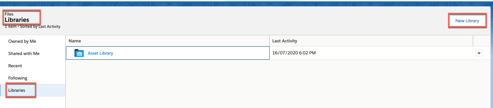
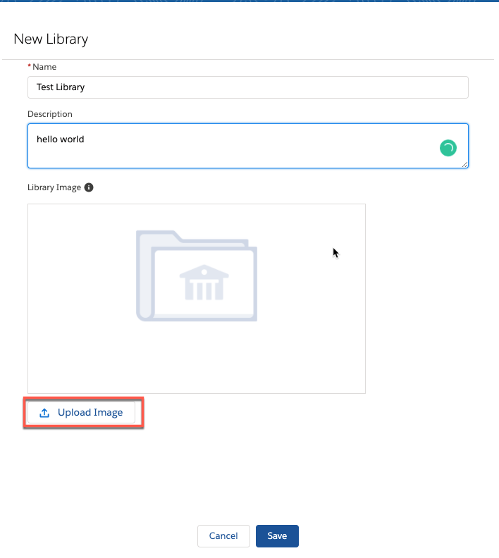
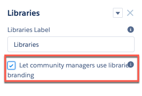

_PreReq: You will need to be in Lightning in order to follow along. If you aren't using Lightning yet, please check out my short guide on Lightning [here](https://sf9to5.wordpress.com/2019/08/26/salesforce-lightning-guide/)._

Let's say that you are planning on having a Community through Salesforce, and you are interested in sharing Libraries of files with people. Still, you don't want the Library's cover just to be a plain boring folder image. Below are the steps for adding an image to a Library:

1. Go to the 9 dots in the top left corner (waffle) and look for Files
2. Once in the Files tab, click on the Libraries tab on the left  
    
3. If you don't have a Library yet, go ahead and click New Library
4. You will see the Upload Image here  
    
5. You can also click the dropdown and click Edit Library Details to modify or add an Image  
    

Once you have your Library set up, you can go into the Experience Builder and add the Library component. Here you will see the image appear as the cover for the Library.

Please note that the checkbox "Let community managers use libraries branding" needs to be on for the image to render in the screen.

